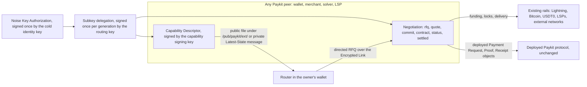
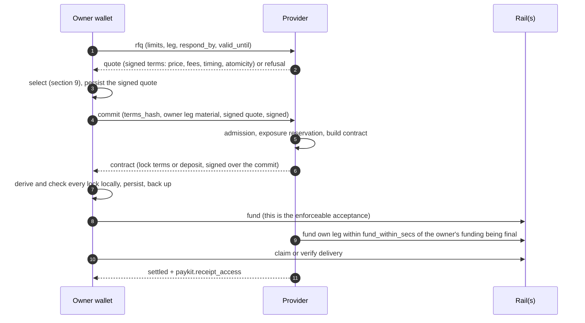

# Paykit Capabilities: one capability and intent layer for Paykit peers

Design proposal for team review. Author: `BitcoinErrorLog`. 27 October 2026; review answers on [pubky/paykit-rs#229](https://github.com/pubky/paykit-rs/issues/229) to 5 November 2026, and pubky-swap at [`f8fc788`](https://github.com/coreyphillips/pubky-swap/tree/f8fc788). Answers question 8 of the Paykit Intents draft ([BitcoinErrorLog/paykit-server#34](https://github.com/BitcoinErrorLog/paykit-server/pull/34)) and the blocker on [pubky/paykit-rs#209](https://github.com/pubky/paykit-rs/issues/209). The review answers and the decisions taken from them are in the #229 thread.

## Current state

1. Decision (27 Oct): the intent family does not go into `paykit-lib`. It becomes a separate spec, and the Paykit team reviews it before it is adopted. It is meant to cover more than swaps.
2. This document proposes that spec: **Paykit Capabilities**, a general layer through which a Paykit peer advertises what it can do and negotiates it with another peer. Swaps are the first profile. Seven other profiles are sketched.
3. The deployed protocol does not change. `paykit-lib` wire types, the App Registry, the message-kind table, the Noise Key Authorization and the paykit-rs specifications stay as they are.
4. Signing uses a capability signing key derived from `K_g` and delegated once per key generation by the Noise routing key that the identity has already authorized (§5). There are no new identity-key signatures, no Ring prompts and no new session scopes.
5. paykit-rs gets one additive request: an SDK API to send, confirm and read messages of kinds outside `paykit.*`, tracked in [pubky/paykit-rs#209](https://github.com/pubky/paykit-rs/issues/209), retitled to that scope on 2 Nov. It needs no wire change, but it does touch the identity's shared state; one choice there is open with the SDK owners (§17).
6. The 23 Oct pubky-swap review (points A to I) is adopted as written in the swap profile (§13.1).
7. Every interactive profile states its liveness requirement: one foreground session, wakes and who sends them, steps safe to finish late, round trips before funding, "the phone disappeared" scenarios and phone-capable roles (§12.5).
8. Capabilities runs on v0.1's Encrypted Links today and moves to Paykit v0.2 sealed messages under v0.2's generic extension scope if v0.2 is adopted. It depends on nothing in v0.2 (§14.1).
9. No code exists for the core yet. pubky-swap runs the `swap/1` kinds over iroh `direct/1` with signed quotes and contracts ([pubky-swap#116](https://github.com/coreyphillips/pubky-swap/pull/116), [#120](https://github.com/coreyphillips/pubky-swap/pull/120)) and publishes a descriptor ([#126](https://github.com/coreyphillips/pubky-swap/pull/126)); §13.1 lists where its wire still differs from this spec. `coreyphillips` owns `swap/1` and `liquidity/1`; the Phase 1 contract `liquidity/1` waited on is merged ([pubky-swap#109](https://github.com/coreyphillips/pubky-swap/issues/109)). Bitkit has draft swap routes over iroh ([bitkit-android#1732](https://github.com/synonymdev/bitkit-android/pull/1732), [bitkit-ios#1170](https://github.com/synonymdev/bitkit-ios/pull/1170), on [bitkit-core#182](https://github.com/synonymdev/bitkit-core/pull/182)).
10. Review status (§19.1): asks 3, 4, 5 and 9 are answered, apart from one shared-state choice under ask 4. Ask 1 has support from the consumer side but no answer yet from a paykit-rs maintainer. Asks 2, 6, 7 and 8 are open. No reply on #229 objects to the design.

---

## 1. The question and the answer

The #34 draft put intent types, a solver card, a terms hash and two new App Registry capabilities (`intents`, `intent_solver`) into `paykit-lib`. The open question was whether they belong there or in a separate spec. The answer: a separate spec, reviewed by the Paykit team, and not only for swaps. A peer will want to advertise and use many capabilities when it solves or routes a payment, for example:

- swaps between Lightning and on-chain Bitcoin;
- intents involving other assets (USDT on other chains, other coins);
- payments routed under an allowance;
- routing by atomicity guarantee, including Atomicity credit lines;
- conversion quotes, channel purchases and JIT liquidity, and payjoin receive.

All of these share the same structure:

1. **Advertise** what you can do, with bounds and indicative prices, publicly or to chosen contacts.
2. **Discover** and select counterparties.
3. **Negotiate** a binding price.
4. **Commit** and lock.
5. **Settle** with evidence.
6. **Fail** in defined ways.

Only the body of each step differs. So the spec defines those steps once (the *core*) and each use case as a *profile*. A profile defines the bodies for its domain and the rules specific to it.

## 2. Constraints

| Constraint | Consequence in this design |
| --- | --- |
| The deployed protocol stays unchanged | No new `paykit.*` kinds, no registry schema change, no change to the paykit-rs specifications. New message kinds use a separate prefix, `paykit-cap.`. Deployed readers already keep messages of unknown kinds without acting on them (paykit-rs `specs/paykit-sdk.md`: unknown valid Private Application Messages are retained; paykit-sdk `PrivateStreamParseStatus::UnknownKind`). Keeping them has costs: no duplicate collapse, a 4,096-item cap for peers the user has not chosen, and no reclaim (§8.1). |
| The identity key stays cold (Ring or another signer, rarely used) | Descriptors and terms are signed by a **capability signing key** derived from the identity-wide secret `K_g`. Every Paykit app already holds `K_g`. The **routing key** (the Ed25519 key whose seed is `noise_secret`), which the identity's signed Noise Key Authorization already binds, signs one delegation to that key per generation, so the routing key signs no descriptor, terms or message (§5). |
| No extra auth prompts | All public files sit under `/pub/paykit/`, which the existing `/pub/paykit/:rw` session already covers. Private messages ride the existing Encrypted Links. §15 lists every action against its prompt count, which is zero. |
| Event Messages are at most 1,000 bytes | Every core message fits. Larger payloads (hold invoices, PSBTs, provider plans) go into an encrypted blob: the location, key and hash travel in the message, and the hash is covered by the signature (the one exception, the commit's signed quote, is checked against `terms_hash` instead, §10.2). This is the Encrypted Receipt construction. On v0.2's larger sealed messages most payloads travel inline (§14.1). |
| The first owners are phones | Mobile operating systems stop polling once an app is backgrounded. Each interactive profile states what needs one foreground session, what needs a wake and from whom, and what is safe to finish late (§12.5). |
| Strangers cannot open a link to you | A responder cannot observe unknown initiators. Descriptors therefore list introduction channels (§7.3). |
| `/priv` is stored in plaintext on the homeserver | Nothing is written to `/priv`. Private data travels over Encrypted Links or in encrypted blobs. |
| Deployed hazards | (1) Allowances V1 check every unknown-kind message for a top-level `allowance_id`. A hit blocks automatic handling of that allowance. Core messages therefore never carry a top-level `allowance_id`. (2) `event_id` is unique across all kinds on a link. Extension events use fresh UUIDv4 values from the same space, and are only sent to peers that advertise support (§8.1). (3) Every re-send of an unknown kind is a new stream item; at the 30 s retry, one unconfirmed event fills a non-chosen peer's 4,096-item cap in about 34 hours, after which that link stops, `paykit.*` included. Senders cap retries (§8.1). (4) The identity's shared state rejects unknown outbound kinds, so an older SDK on the same identity fails to read a state holding an extension event; one design choice is open (§17). (5) Each received message is its own storage transaction on the receiver's shared state, so polling competes with payments; status is pushed, not polled (§8.1). |

## 3. Lessons from existing intent and capability systems

| System | What it standardises | Lesson | Applied in |
| --- | --- | --- | --- |
| **CoW Protocol** | Users sign limit orders. Bonded solvers compete in batch auctions; the protocol scores solutions on surplus; the settlement contract enforces the limit price ([rules](https://docs.cow.fi/cow-protocol/reference/core/auctions/competition-rules)) | The user signs a **limit**, never a route, and the enforcement point checks the limit. Selection uses a published scoring rule. Solvers are bonded and can be denylisted | The RFQ carries limits only (§8.4). Scoring is deterministic (§9). Bonds and reputation are inputs (§9.3) |
| **UniswapX** | Signed Dutch orders; RFQ with **indicative** quotes before the user signs and **hard** quotes after; the RFQ winner gets an exclusivity window; open fillers take over if the winner fades ([RFQ](https://developers.uniswap.org/docs/liquidity/uniswapx/concepts/uniswaprfq)) | Keep cheap indicative prices separate from accountable commitments. Penalise fading. Have a fallback when the exclusive filler disappears | The descriptor is indicative and the signed quote is firm (§10). A solver that fades after commit is attributable (§12) |
| **ERC-7683** | The May 2026 revision has resolvers turn a protocol payload into steps, payments and **named assumptions** that solvers vet ([R36 in #34](https://github.com/BitcoinErrorLog/paykit-server/pull/34)) | Every trust assumption is named, and a party that sees an unknown assumption declines | `trust` and `via` labels, plus the closed atomicity classes (§11). Unknown labels are ineligible |
| **Across** | Relayers front capital on the destination chain; repayment comes later after optimistic verification | A fast fill by the solver's own capital is a separate step from the slower, verified settlement and repayment. The solver carries that risk | Delivery evidence and payee proof (`routed-fill-v1`) are separate from the owner's funding (§10.3) |
| **Anoma** | Intents as constraints plus preferences; solvers compose partial transactions into balanced ones; gossip for counterparty discovery. Live through protocol adapters on EVM chains, not as its own chain ([adapter](https://docs.anoma.net/anoma-protocol-adapter)) | Keep **constraints**, which must hold, separate from **preferences**, which only rank. Discovery and solving are distinct roles | RFQ `limits` versus wallet `policy` (§8.4, §9). Discovery (§7) is separate from routing (§9) |
| **NEAR Intents** | A Message Bus relays quote requests to market makers, who return signed quotes; a Verifier contract ledger settles atomically. The bus is optional ([docs](https://docs.near-intents.org/integration/market-makers/message-bus/introduction)) | Use a quote relay for reach, but never make it a dependency. Atomicity comes from a shared ledger, which is a trust choice that must be stated | No relay is required; directed RFQ goes over links. NEAR 1Click is a `provider_trusted` route through `via` (§13.7) |
| **LSPS0, LSPS1, LSPS2** ([bLIP 50](https://github.com/lightning/blips/blob/master/blip-0050.md), [51](https://github.com/lightning/blips/blob/master/blip-0051.md), [52](https://github.com/lightning/blips/blob/master/blip-0052.md)) | LSPS0 lists the protocols a peer supports; LSPS1 covers `get_info`, then `create_order`, payment and status; LSPS2's `get_info` returns a fee menu whose entries carry an LSP-made `promise`, and `buy` must copy an entry verbatim | Capability discovery is its own call. A quote can be **stateless for the provider**: it signs the terms and checks its own signature at commit, so being quoted costs it nothing. `create_order` is not idempotent, so orders need an idempotency key | Profiles are listed in a descriptor (§6). Quotes are self-contained and signed (§10.1). The provider stores the commit's `event_id` with the order as its idempotency key (§13.5). Liquidity profile (§13.5) |
| **BOLT 12 offers** | A static, reusable offer; the payer fetches a fresh signed invoice over onion messages | A static advertisement plus a live fetch of the binding terms. Amounts may be denominated in fiat and resolved at fetch time | Descriptor plus RFQ and quote (§6, §8) |
| **Submarine swaps (Boltz API, pubky-swap)** | An on-chain HTLC paired with a Lightning HTLC on one hash; the refund timeouts are ordered | Hash locks give atomicity across Lightning and on-chain. Timeouts must be ordered. The party holding the preimage has a free option. The contract is only created after the client commits | Swap profile (§13.1), with the #34 §10.4 timing gates kept |
| **Payjoin (BIP 78, BIP 77)** | The receiver advertises a payjoin endpoint. BIP 77 replaces the receiver's server with an untrusted store-and-forward directory reached over OHTTP. The sender's fully signed Original PSBT is always a valid fallback ([BIP 77](https://bitcoin.org/bip/77/)) | An asynchronous encrypted mailbox suits homeservers. The safest failure mode is a fallback that still pays | Payjoin profile using the Encrypted Link as the mailbox (§13.6) |

What is common to all of them: advertisements are cheap and non-binding; quotes are signed and accountable; commitment creates resources; funding is the enforceable act; evidence comes from the rail; and every trust assumption has a name.

## 4. Architecture



The subkey delegation link is the ask 3 decision (§5).

Roles. A peer can hold several roles under different profiles.

- **Owner:** the party with an intent, usually a payer's wallet or a swapper.
- **Provider** (solver, LSP, quoter, payjoin receiver): advertises a capability and answers RFQs.
- **Router:** wallet-local logic that selects providers and composes legs. It has no network role and sends no messages of its own.
- **Payee:** receives the outcome through the deployed Payment Request and Proof flow.

Layers. The core (§5 to §12) is profile-neutral. Profiles (§13) define the bodies and rules for one domain, and each has a named owner. The deployed Paykit protocol carries the payee side: Payment Requests, Proofs (whose `proof` member is an open object), Receipts (whose `metadata` member is an open object) and Allowances V1.

## 5. Keys and signing

**Decision (ask 3): a delegated subkey**. The routing key signs nothing in the deployed protocol, and its scalar also performs the pair-path Diffie-Hellman (Encrypted Link pair paths). Descriptors, terms and messages are therefore signed by a separate capability signing key, and the routing key's only signature is one delegation per key generation under its own domain string.

**Key chain.**

1. The cold identity key signs the deployed Noise Key Authorization at `/pub/paykit-authority/v0/current-key.json` once per key generation.
2. That authorization binds the routing key (Ed25519, seed `noise_secret`) and the static key (X25519) for generation `g`.
3. Every app of the identity holds `K_g`, and so the routing key and the capability signing key: an Ed25519 key whose seed is `derive_key("paykit/cap-signing", K_g)` (Paykit KDF v1).
4. The routing key signs a **subkey delegation** naming the capability signing key's public key for generation `g`.
5. The capability signing key signs descriptors and negotiation objects.

Nothing else is needed, and no identity-key signature is added.

**Subkey delegation.** A closed object, published at `/pub/paykit/ext/capabilities/v1/signing-key.json` under the existing session:

```json
{"version":1,"kind":"paykit-cap.signing_key","owner":"<z-base-32 identity key>",
 "key_generation":1,"signing_key":"<base64url Ed25519 public key>","sig":"<base64url Ed25519 by the routing key>"}
```

It holds no timestamp, it is written in JCS form, and Ed25519 signatures are deterministic (RFC 8032), so every app of the identity produces byte-identical bytes for one generation, and concurrent writes for the same generation cannot conflict. The file is rewritten after each key rotation. Evidence bundles embed a copy (below).

**Writing the delegation.** An app writes `signing-key.json` only for the generation that the published Noise Key Authorization names, and reads the authorization again immediately before each write. An app that holds only an older `K_g` does not write. A stale delegation makes readers reject every current-generation object of the identity at step 3 below, until it is rewritten. The check and the write are not atomic, so an app that read generation `g` just before a rotation can still overwrite the `g+1` delegation. Repair covers that window: an app on the published generation reads `signing-key.json` when it starts, before each descriptor write, and at least once a minute while it signs, and rewrites it when it names a lower generation or is missing. A read before every signed object is not required: an object signed while the delegation is stale is rejected only until the next check repairs it, and a quote rejected that way can be asked for again. A reader whose fetched delegation names a lower generation than the authorization does not cache that result, and fetches again on its next verification.

**Encodings.** These apply to every object in this document, `signing-key.json` and the §10.1 terms included:

- An identity (`owner`, `provider` and every other member that names one) is the bare z-base-32 encoding of the 32-byte public key: 52 lowercase characters, with no `pubky` or `pk:` prefix and no URL form. In pubky-common this is `PublicKey::z32()`, not its `Display` form (`pubky<z32>`). A reader rejects any other form rather than normalizing it, because a signature covers the exact bytes.
- base64url is RFC 4648 §5 without padding: 43 characters for a 32-byte key and 86 for a 64-byte signature.

**Signature inputs.** Signed objects use RFC 8785 JCS, as Locks does. The subkey delegation, the descriptor and the attestation are signed with Ed25519 over

```text
domain || 0x00 || JCS(object without "sig")
```

Quote terms, commits and contracts are signed with Ed25519 over their 32-byte hash, `terms_hash`, `commit_hash` or `contract_hash` (§10). Each hash is SHA-256 over the same `domain || 0x00 || JCS(…)` encoding of the hashed members, so the hashes chain and a third party can check the chain without the full message.

| Object | Domain string | Signed by |
| --- | --- | --- |
| Subkey delegation | `paykit-cap/subkey/v1` | Routing key |
| Capability Descriptor | `paykit-cap/descriptor/v1` | Capability signing key |
| Quote terms | `paykit-cap/terms/v1` | Capability signing key |
| Commit | `paykit-cap/commit/v1` | Capability signing key |
| Contract | `paykit-cap/contract/v1` | Capability signing key |
| Settlement attestation (optional, public) | `paykit-cap/attestation/v1` | Capability signing key |

The domain strings are the same for every profile. `profile` is a hashed member of the terms (§10.1), and `commit_hash` and `contract_hash` chain to `terms_hash`, so a signature made under one profile cannot verify under another. A profile defines a domain string of its own only for an object the core does not define. In messages, hashes are 64 lowercase hex characters.

Every signed object names `owner` (the identity) and `key_generation`.

**Verifying a signature.**

1. Fetch and verify the signer's Noise Key Authorization under the paykit-rs rules (`specs/paykit-sdk.md`, Shared Identity Model), and keep the highest verified generation.
2. Require that `key_generation` equals it. A lower generation means the object is stale and must be ignored.
3. Fetch the signer's subkey delegation, require the same `owner` and `key_generation`, and verify it with the authorized routing key under `paykit-cap/subkey/v1`.
4. Verify the object's signature with the delegated capability signing key. Cache the verified delegation per identity and generation.

**Evidence that outlives a rotation.** Only the current authorization and delegation are published. A bundle that must stay verifiable after rotation therefore carries copies of the authorization (at most 4,096 bytes) and of the delegation at the signing generation. Receipts, disputes and reputation attestations are such bundles. The authorization is identity-signed and the delegation is signed by the key it authorizes, so both verify on their own. Limitation: the copies show which keys were valid for a generation, not when an object was signed, so timestamps in historical evidence are claims, not proofs.

**Trust.** A compromised app that holds `K_g` can sign descriptors and quotes as the identity. It can already publish endpoints and use Encrypted Links today, so this design adds no new trust in apps. Signers are pluggable in every profile, so the key choice does not reach profile code.

**On v0.2.** The app's own certified signing key replaces both the delegation and the capability signing key, and the domain strings stay (§14.1).

## 6. Capability Descriptor

### 6.1 Public file

Path: `/pub/paykit/ext/capabilities/v1/apps/{app_id}.json`. There is one file per App ID, so apps of the same identity never race to write the same document. It is outside `/pub/paykit/v0/`, so public payment resolution never lists it. The reserved `ext/` subtree is a review ask (§19, item 2).

```json
{
  "version": 1,
  "kind": "paykit-cap.descriptor",
  "owner": "<z-base-32 identity key>",
  "app_id": "pubky-swap",
  "key_generation": 1,
  "seq": 42,
  "created_at": 1793000000,
  "valid_until": 1793086400,
  "profiles": [
    {
      "profile": "swap/1",
      "role": "provider",
      "edges": [
        {"from": "btc-lightning-bolt11", "to": "btc-bitcoin-p2wpkh", "dir": "reverse",
         "min": "25000", "max": "5000000", "unit": "sat",
         "fee": {"base": "100", "ppm": "2500", "onchain": "310"},
         "atomicity": "hash", "lock_profiles": ["taproot_boltz", "p2wsh"],
         "sides": ["exact_out"], "fund_within_secs": 300},
        {"from": "btc-lightning-bolt11", "to": "btc-bitcoin-p2tr", "dir": "reverse",
         "min": "25000", "max": "5000000", "unit": "sat",
         "fee": {"base": "100", "ppm": "2500", "onchain": "310"},
         "atomicity": "hash", "lock_profiles": ["taproot_boltz", "p2wsh"],
         "sides": ["exact_out"], "fund_within_secs": 300}
      ],
      "terms": {"offer_id": "9a1f3c2e-7b4d-4e8a-9c1f-3d2b6a4e7c11", "network": "bitcoin",
                "htlc_timeout_blocks": 144, "required_confirmations": 2}
    },
    {
      "profile": "paykit-features/1",
      "role": "payee",
      "terms": {"request_members": ["conversion.fixed", "payment_deadline"],
                "proof_profiles": ["erc20-transfer-eip712"]}
    }
  ],
  "contact": {
    "rfq": ["encrypted-link", "iroh:pubky-swap/direct/1"],
    "intro": [{"type": "iroh", "alpn": "pubky-swap/direct/1"},
              {"type": "https", "url": "https://solver.example/paykit-cap/introductions"}]
  },
  "reputation": {"bond": {"outpoint": "<txid>:<vout>", "proof_sig": "<base64url>"}},
  "sig": "<base64url Ed25519 by the capability signing key>"
}
```

The two reverse edges differ only in `to`: an edge names exactly one identifier, so a provider lists one edge per on-chain identifier it covers (§13.1).

### 6.2 Field rules

- The envelope is a closed object.
- `app_id` MUST be registered in the owner's App Registry.
- `seq` MUST increase on every rewrite. Readers reject a `seq` lower than the highest they have seen for that owner and app.
- `valid_until` is required, so a descriptor that is no longer refreshed lapses.
- The file is at most 65,536 bytes, with at most 32 profile entries and at most 64 edges per profile.
- **Profiles are open-world, profile contents are closed-world.** A reader ignores an unknown `profile` (as LSPS0 does with unknown protocols). It treats a known profile at an unknown major version as unknown. Inside a known profile version, unknown members make that entry invalid; the rest of the descriptor stays usable.
- **Edges** are the routing primitive that every value-moving profile shares, so a router can build a graph without parsing profile internals. `from` and `to` are Payment Endpoint Identifiers in their owner-facing format (pubky-swap review point E). Each is one exact identifier: three lowercase segments compared byte for byte, so wildcards such as `btc-bitcoin-*` are invalid and an edge that covers several identifiers is listed once per identifier. Amounts are base-unit integer strings with an explicit `unit`. `fee` has `base`, `ppm` and an optional `onchain` component, and the indicative fee for an amount `a` is `base + floor(a × ppm / 1,000,000) + onchain`. `min` is the minimum the provider actually enforces, which can be higher than its configured floor. It is the provider's floor, not the wallet's: a profile may also cap the fee as a share of the amount, which raises the effective floor, and routers pre-rank with the same cap (`swap/1`: 5%, §13.1). A router that pre-ranks on a lower fee or a lower minimum understates cost and sends RFQs that get `amount_below_minimum` or quotes the wallet then refuses. `atomicity` is a class from §11. `via` names any external network used internally. `lock_profiles` and `sides` are optional.
- **A descriptor binds nothing.** It reserves no liquidity and promises no price. Only a signed quote binds (§10).

### 6.3 Private descriptor

The same object, with `sig` optional, can be sent over an Encrypted Link as the Latest-State kind `paykit-cap.descriptor`. The newest valid message per source App ID wins, as with Private Payment Lists. Anything over 1,000 bytes is sent as `{"blob": {"loc", "key", "sha256"}}` pointing at an encrypted blob.

A private descriptor can disclose more than the public one, or exist without any public file. Examples: tighter fees for a contact, credit-line headroom, or payjoin support offered only to known payers.

A deployed reader keeps a private descriptor as an unknown item: never superseded, never confirmed, and counted toward its stream cap; only Private Payment Lists are reclaimed. A private descriptor is therefore sent only in answer to a `descriptor_request`, or to a peer that has published a verified descriptor or confirmed a `paykit-cap` kind, and is rewritten rarely. Whether readers later carry and reclaim extension records depends on the open shared-state choice in §17.

`paykit-cap.descriptor_request` (an Event) asks a peer for its private descriptor, optionally filtered by profile. The peer may ignore it.

### 6.4 Encrypted blobs

Path: `/pub/paykit/ext/capabilities/v1/blobs/{id}`. The construction is the Encrypted Receipt's: XChaCha20-Poly1305 under a fresh 256-bit key with associated data `paykit-cap.blob.v1:` followed by the location. Each blob is at most 262,144 bytes. Its hash is inside the signed object that references it, with one exception: the blob holding the commit's signed quote is referenced outside `commit_hash`, because its content is an object the provider signed and the provider checks it against the commit's `terms_hash` (§10.2). The writer deletes a blob after the flow ends, or by its own retention policy.

## 7. Discovery

### 7.1 Public

The sources, in order of trust:

1. Contacts' descriptors, read directly from their homeservers.
2. The Pubky follow and tag graph.
3. Curated lists: a public file listing provider keys, published by anyone and trusted by choice.
4. Later, a Nexus index of `paykit-cap.descriptor` files.

The reader verifies the chain in §5 and freshness in §6.2 for every descriptor, whatever its source. An index only finds descriptors; it is never trusted for their contents.

### 7.2 Private

A private descriptor is only revealed to identities the owner has already linked with, and only by the owner's choice. Use it for anything that leaks a graph or a balance: credit lines, allowance acceptance, payjoin, or per-contact pricing.

### 7.3 Reaching a provider for the first time

A provider cannot hear from an identity it has not linked with. A descriptor therefore lists the introduction channels it accepts, in order:

- pubky-swap's iroh doorbell `pubky-swap/direct/1`, which exists today;
- a signed HTTPS `POST` naming the owner, in the style of paykit-server's signed routes;
- `pubky/inbox`, once it is suitable (assumption, verify).

The provider admits or ignores the newcomer by its own policy, then completes the Encrypted Link handshake.

### 7.4 What each step reveals

| Step | Learns what |
| --- | --- |
| Public descriptor | Everyone: the profiles, bounds and indicative fees |
| Private descriptor | One contact: whatever the owner chose to disclose |
| RFQ fan-out | Each provider asked: the amount, the leg and the timing, whether or not it wins. The router's fan-out budget bounds this (§9) |
| Hash-locked route | Operators of each leg, if they cooperate: correlation through the shared hash. Point locks remove it |
| Homeserver operators | Write activity only. Link contents and blobs are encrypted |

## 8. Negotiation

### 8.1 Common rules

- Every message is a closed JSON object, at most 1,000 bytes on an Encrypted Link, with the envelope `version` (1), `kind`, `app_id`, `profile`, `flow_id` and `key_generation`, a `body`, and the members its kind defines (§8.4, §10). The same envelope is used on every carrier, iroh `direct/1` included, so a message, its signature and the flow's state never depend on the carrier that delivered it.
  - `flow_id` is a UUIDv4 chosen by the owner and stable across all providers asked. It is hashed into the terms, so status, recovery and evidence name the same flow on any carrier.
  - `profile` selects the body's schema and is hashed into the terms (§5).
  - `app_id` is the sender's App ID. The receiver checks it against the sender's App Registry and uses it to pick the sender's descriptor.
  - `key_generation` is the sender's current key generation. Signatures are verified against that generation's delegation (§5), and the terms record both parties' generations (§10.1).
- Member names and placement in the examples are normative: a message carries exactly the envelope, the `body` and the members its kind defines, and a profile's body carries exactly the members its section lists. Amounts are base-unit integer strings, as in descriptors (§6.2); times (`respond_by`, `valid_until`) are integer Unix seconds. The terms hash covers the JCS form of the RFQ and the quote (§10.1), so two implementations interoperate only if they use the same names, placement and encodings.
- Events also carry `event_id`: a fresh UUIDv4, unique across every kind on the link, and reused byte-for-byte on retry. A reply names the event it answers (`rfq_event_id`, `quote_event_id`, `commit_event_id`), so no carrier-specific request id is needed. `event_id` is also the receiver's duplicate key, and in `liquidity/1` the order's idempotency key (§13.5).
- A receiver that durably stores a valid core message confirms it with the deployed `paykit.delivery_confirmation`.
- **Only send core events to a peer whose verified descriptor (public or private) lists that profile.** A deployed SDK keeps unknown kinds but does not confirm them, so the sender would otherwise retry forever.
- **Cap retries toward a peer that has never confirmed a `paykit-cap` kind**. Each re-send to a deployed reader is a new stored item with no duplicate collapse. A peer the user has not chosen stops the whole link at 4,096 items, `paykit.*` included, which one unconfirmed event reaches in about 34 hours at the 30 s retry. A contact has no cap and grows toward the 64 MiB shared-state limit. After the cap the sender stops and marks the peer as not supporting the profile until it confirms a `paykit-cap` kind. The cap is a parameter of the SDK API (§17).
- **Push status, do not poll it**. Each received message is its own storage transaction on the receiver's shared state, so repeated `status_request` messages compete with payments. Providers push `status` on every state change. `status_request` is for recovery and lost replies (§12.4).
- **Never put a top-level `allowance_id` in a core message.** References to an allowance go inside `body`.
- A profile body that does not fit moves into an encrypted blob referenced by `{"blob": …}`. The blob's hash is inside the signed terms.
- Signatures make quotes, commits and contracts attributable to third parties. The link already authenticates the sender, so unsigned kinds (RFQ, status, refusal) need nothing more.
- A status message is a hint. Outcomes come from the rail. A timeout means unknown, never failed.

### 8.2 Kinds

| Kind | Type | Direction | Purpose |
| --- | --- | --- | --- |
| `paykit-cap.descriptor` | Latest-State | either | Private descriptor (§6.3) |
| `paykit-cap.descriptor_request` | Event | either | Ask for a private descriptor |
| `paykit-cap.rfq` | Event | owner → provider | Limits and the requested leg. No side effects for the provider |
| `paykit-cap.quote` | Event, signed | provider → owner | Firm price and economic terms. Creates no resources for the provider |
| `paykit-cap.refusal` | Event | provider → owner | Closed reason code (§12.1) |
| `paykit-cap.commit` | Event, signed | owner → provider | Accepts the quote's `terms_hash`, carries the owner's leg material and the signed quote (§10.2). No funding yet |
| `paykit-cap.contract` | Event, signed | provider → owner | Lock terms or deposit instructions, covering the commit. The provider creates resources here |
| `paykit-cap.status` | Event | either | Leg status hint with evidence references (§12.2) |
| `paykit-cap.status_request` | Event | either | Asks for the signed contract and the latest status (pubky-swap review point F). Answered with the stored contract message, byte for byte, then a `status`. For recovery and lost replies only, never polling (§8.1) |
| `paykit-cap.cancel` | Event | either | Valid only before any funding |
| `paykit-cap.settled` | Event | provider → owner | Terminal notice with evidence, followed by the deployed `paykit.receipt_access` |

Profiles may add kinds named `paykit-cap.{profile}.{name}`, for example the swap profile's MuSig2 nonce round (§13.1).

### 8.3 Flow



A profile may declare `"contract_step": "none"` when its quote already carries everything the owner needs to fund. Provider-trusted deposit routes such as 1Click are like this. The owner then funds straight after the commit.

### 8.4 RFQ body

```json
{"version":1,"kind":"paykit-cap.rfq","app_id":"bitkit","event_id":"<uuid>","flow_id":"<uuid>",
 "profile":"swap/1","key_generation":1,
 "body":{"offer_id":"<uuid>","dir":"reverse","from":"btc-lightning-bolt11","to":"btc-bitcoin-p2tr","amount_sat":"250000"},
 "atomicity_min":"hash","respond_by":1792482660,"valid_until":1792483200}
```

The RFQ carries **constraints** only: amounts, the leg, `atomicity_min`, an optional `max_cost_bps`, and deadlines. **Preferences** stay in the owner's wallet and never leave it: provider ranking, trust policy, and which other providers were asked. Measured compact size: 415 bytes.

Sizes in this document are measured on the JCS form of the example, with every placeholder replaced by a value of full length: 36-character UUIDs, 52-character identities, 64-character hex hashes, 86-character base64url signatures, 43-character base64url keys and 66-character hex public keys.

## 9. Selection and routing

### 9.1 Router, wallet-local and deterministic

```text
route(intent, policy, allowance?):
  descriptors = verified and fresh (section 5, section 6.2), public or private
  candidates  = edges where (from, to) is covered, amount is within [min, max],
                atomicity >= intent.atomicity_min, every via and trust label is allowed by policy,
                the indicative fee is within the profile's fee cap,
                the profile's liveness requirement fits this device (section 12.5),
                and the provider is not denied
  paths       = candidate single edges, plus two-edge paths joined on an endpoint identifier
                (two legs at most in v1; only where policy.allow_two_leg is set)
  pre-rank    = indicative cost from edge fees (base + ppm + onchain), then atomicity, then reputation
  ask         = top policy.fanout_budget (default 3), concurrently
  usable      = signed, valid, expiring more than 5 s from now, within intent limits,
                funding <= balance
  winner      = argmax credit_min / (debit + max_fee), by integer cross-multiplication;
                tie: stronger atomicity, then a native Pubky provider, then pre-rank
  freeze(winner); commit; contract; persist; back up; fund
```

The fee-cap filter, the liveness filter and the `allow_two_leg` gate are review decisions. The rest is Bitkit's shipped USDT selection rule (bitkit-core `modules/usdt`, cited in #34 §5.3), widened to any provider. Selection is frozen once made: send and recovery never pick another route. A path's atomicity is that of its weakest leg. Hash and point legs never mix in one atomic path. Legs are ordered by claim order for the timing gates (#34 §10.4).

Two-leg paths commit both legs up front, so the second leg's quote and deposit address must stay valid until the first leg's claim lands, and every delay from a backgrounded phone widens that gap. Bitkit keeps `allow_two_leg` off until single-leg swaps have real-device data (measured in [pubky-swap#85](https://github.com/coreyphillips/pubky-swap/issues/85)).

### 9.2 Provider side

- **Admission:** allow and deny lists, web of trust, a rate limit per identity, optionally a bond or a `commit_fee`.
- **Stateless quotes:** the provider signs the full terms and checks its own signature at commit. Being quoted therefore costs it nothing, as with LSPS2's `promise`. A provider that instead keeps quotes only in memory fades whenever it restarts or evicts them (§10.1).
- **Resources only at commit:** keys, contracts, hold invoices and exposure reservations are created only when a commit arrives (pubky-swap review point A, and [pubky-swap#76](https://github.com/coreyphillips/pubky-swap/pull/76)).

### 9.3 Inputs for reputation and trust

Nothing here is a reputation system; these are its inputs:

- signed quotes, which make no-shows attributable;
- fading after commit (a commit answered by neither a contract nor an allowed refusal, §10.1);
- optional public settlement attestations (`paykit-cap/attestation/v1` over `contract_hash` and the outcome);
- fidelity bonds referenced in descriptors;
- Pubky tags on provider profiles.

## 10. Quoting, commitment and settlement

### 10.1 Quote

A quote is firm on price until `valid_until`, but it reserves nothing (review point A). At commit the provider rechecks capacity, rate limits and access, so a commit on a valid quote may still be refused with `liquidity_unavailable`, `rate_limited` or `access_denied`. Those three refusals at commit are allowed and do not count as fading; the owner commits to the next quote. Fading is a commit answered by neither a contract nor one of those refusals, or by a contract on terms other than the quote's.

`quote_expired` is a valid answer to a commit only after the quote's `valid_until`. A provider that keeps quotes only in memory answers `quote_expired` to a quote that is still validly signed after any restart or eviction (pubky-swap evicts the oldest past 10,000), and that answer is a fade. Providers therefore verify their own terms signature at commit (§9.2), using the signed quote the commit carries (§10.2), and take single use from their own creation records, as the `swap/1` adapter does.

Measured compact size: 717 bytes for a swap quote.

```json
{"version":1,"kind":"paykit-cap.quote","app_id":"pubky-swap","event_id":"<uuid>","flow_id":"<uuid>",
 "rfq_event_id":"<uuid>","profile":"swap/1","key_generation":1,
 "body":{"quote_id":"<uuid>","offer_id":"<uuid>","dir":"reverse","amount_sat":"250000",
         "service_fee_sat":"725","onchain_fee_sat":"310","total_sat":"251035",
         "htlc_timeout_blocks":144,"required_confirmations":2,"fund_within_secs":300,
         "lock_profiles":["taproot_boltz"]},
 "atomicity":"hash","valid_until":1792482960,"sig":"<base64url>"}
```

The example quote lives 300 s, pubky-swap's default, and asks for 2 confirmations, its mainnet minimum.

`terms_hash` is SHA-256 over `paykit-cap/terms/v1 || 0x00 || JCS(terms)`. The terms are a closed object with exactly these members:

```json
{"owner":"<z-base-32>","owner_key_generation":1,"provider":"<z-base-32>","provider_key_generation":1,
 "profile":"swap/1","flow_id":"<uuid>",
 "rfq":{"body":{…},"atomicity_min":"hash","respond_by":1792482660,"valid_until":1792483200},
 "quote":{"body":{…},"atomicity":"hash","valid_until":1792482960}}
```

- `owner` is the identity that sent the RFQ, as authenticated by the carrier; `provider` is the quoting identity. A quote issued to one owner does not verify for another.
- `owner_key_generation` is the RFQ's `key_generation` and `provider_key_generation` the quote's. They fix which delegations verify the quote and the owner's commit (§5), so a key rotation in the middle of a flow cannot change who signed what.
- `profile` binds the terms to one profile's rules, which is what lets the domain strings stay core-wide (§5). `flow_id` binds them to the flow, so status, recovery and evidence on any carrier refer to the same agreement.
- `rfq` is the RFQ message without its envelope (`version`, `kind`, `app_id`, `event_id`, `flow_id`, `profile`, `key_generation`). `quote` is the quote message without its envelope, `rfq_event_id` and `sig`. `atomicity` and `valid_until` are therefore covered, and so are any blob hashes in either body.

The provider's `sig` covers `terms_hash`. Measured: the terms of the example quote are 862 bytes.

### 10.2 Commit and contract

- **Commit.** The commit carries `quote_event_id`, `terms_hash`, the owner's leg material in `body`, and the signed quote in `quote`. Its `sig` covers `commit_hash` = SHA-256(`paykit-cap/commit/v1 || 0x00 || JCS({terms_hash, body})`).
- **Why the owner signs the commit.** The carrier authenticates the owner to the provider and to no one else. The contract signs `commit_hash`, so without the owner's signature a third party cannot tell whether the leg material it covers (the payment hash, the claim or refund key, the invoice) came from the owner or from the provider. The owner's signature makes the commit attributable, and with it a fade after the commit (§9.3, §12.4), so a dispute or a `routed-fill-v1` proof stands on the signed objects alone. It costs one signature, plus the owner's subkey delegation, published once per key generation (§5).
- **The signed quote in the commit.** `quote` is `{"terms": <the terms object>, "sig": <the provider's sig>}`. It is outside `commit_hash`, because `terms_hash` already binds it. A provider that no longer holds the quote recomputes `terms_hash` from `terms` and requires that it equals the commit's `terms_hash`, that `terms.owner` is the commit's authenticated sender, that its own `sig` verifies, and that `valid_until` has not passed. It then applies single use from its creation records and admits the commit as usual (§10.1).
- **Fitting 1,000 bytes.** Inline, the signed quote makes a reverse-swap commit 1,608 bytes. On an Encrypted Link, `quote` is therefore `{"blob": {"loc", "key", "sha256"}}`, pointing at an encrypted blob the owner writes before sending the commit (§6.4), and the provider reads it only when it no longer holds the quote. On a carrier without the limit, such as iroh `direct/1`, `quote` may travel inline; `commit_hash` and the owner's signature are the same either way. Measured: 922 bytes for a reverse-swap commit with the quote in a blob, and 632 bytes without `quote`.
- **Contract.** The contract carries `commit_event_id`, `commit_hash` and the provider's lock terms in `body`. Its `sig` covers `contract_hash` = SHA-256(`paykit-cap/contract/v1 || 0x00 || JCS({commit_hash, body})`). The body holds only what the owner cannot derive. What the owner derives from the body and the rail's rules (the script, the Taproot tree, the address) is neither sent nor signed; the owner derives it and checks it before funding (§10.3). Measured: 967 bytes for a reverse swap, with the hold invoice in a blob.
- **Recovery.** A `status_request` is answered with the stored contract message, byte for byte, followed by a `status` (402 bytes in the `swap/1` example), so neither reply exceeds 1,000 bytes.
- The hashes form a chain: contract → commit → terms. A third party holding the three signed objects and the authorizations can therefore check everything that was agreed.

### 10.3 Funding, `fund_within` and evidence

- **Funding the derived contract is the enforceable acceptance.** The owner derives every lock from the signed terms and the rail's own parameters, and never accepts an address on trust.
- `fund_within_secs` starts when the owner's funding is **final**: the hold invoice accepted on a reverse swap, the confirmation depth reached on a submarine swap. Time before that never counts (pubky-swap review point I, shipped in [pubky-swap#96](https://github.com/coreyphillips/pubky-swap/pull/96)).
- Evidence comes from the rail: a txid and output, a preimage, a provider reference, a postback. Only a witness that hashes to `H` counts as a claim on a hash leg.
- **Payee side, deployed objects only.** When a provider delivers to a payee, the payer's deployed `paykit.payment_proof` carries a `routed-fill-v1` object in its open `proof` member. That object holds `contract_hash`, the delivery reference, the provider's signature and the payer's signature (#34 §6.8, with `terms_hash` replaced by `contract_hash`). Payees that verify it need code (paykit-server). The wire does not change.
- **Receipts:** the deployed Encrypted Receipt carries the flow in its open `metadata` member: `flow_id`, `contract_hash`, the legs and the fees.

## 11. Atomicity

| Class | Guarantee | Typical rails |
| --- | --- | --- |
| `hash` | Every leg commits to one SHA-256 hash; refunds come by timeout | Lightning HTLCs and hold invoices, on-chain HTLCs (pubky-swap, Boltz API), ERC-20 HTLCs |
| `point` | Adaptor signatures, with no shared hash | MuSig2 adaptors; Ark adaptor transfers; future PTLCs |
| `escrow` | A third party or multisig holds the funds until both sides act | P2P exchanges with bonds |
| `attested` | Release depends on a named attestor's signature, such as a Locks verifier or a delivery attestor | Conditional settlement (§13.3) |
| `credit_bounded` | Bounded-trust credit that finalizes or auto-reverts | Atomicity credit lines (§13.8) |
| `provider_trusted` | A provider delivers after receiving the funds and refunds by its own action | USDT0, Orchestra, NEAR 1Click, THORChain, LSPS1 and LSPS2, allowance-funded solvers |
| `fiat_attested` | No lock; a provider postback is the evidence; reversals are possible | PayPal IPN |

The table lists the classes from strongest to weakest. This changes #34 in one place: `attested` is added between `escrow` and `credit_bounded`.

Rules:

- A path takes the weakest class among its legs.
- The RFQ's `atomicity_min` is a hard constraint.
- The wallet's policy may require a stronger class above an amount threshold (#34 open question 4).
- An unknown class or trust label makes the route ineligible. This is ERC-7683's rule for unknown assumptions.

"Atomicity routing" therefore works at two levels. The router chooses paths by guarantee, and Atomicity credit lines are one more class it can choose.

Refund and timing rules per class are #34 §10.3 and §10.4, unchanged. pubky-swap already meets the hash-lock gates, several with wider margins (review, "Already aligned").

## 12. Failure handling

### 12.1 Refusal codes (closed)

`unsupported_route`, `amount_below_minimum`, `amount_above_maximum`, `liquidity_unavailable`, `pricing_unavailable`, `quote_expired`, `invalid_destination`, `invalid_request`, `unsupported_protocol`, `offer_stale`, `atomicity_unsupported`, `rate_limited`, `access_denied`, `internal_error`.

All of these except `atomicity_unsupported` are pubky-swap's shipped `RejectCode` ([pubky-swap#98](https://github.com/coreyphillips/pubky-swap/pull/98)). `not_found` answers `status_request` only. `pending` answers `status_request` and also a retried or concurrent commit while the provider is still admitting it ([CLIENT_ADAPTERS.md](https://github.com/coreyphillips/pubky-swap/blob/f8fc788/docs/CLIENT_ADAPTERS.md) at `f8fc788`). At commit it therefore means "query again": the owner sends `status_request` or retries the same commit bytes, and never treats it as a decline. A reader treats an unknown code as a generic decline.

### 12.2 Leg status (closed)

| Status | Meaning |
| --- | --- |
| `pending` | Source step submitted, outcome unresolved |
| `failed` | Proven unexecuted |
| `replaced` | Another operation consumed the input |
| `in_transit` | Source executed, delivery unresolved |
| `needs_attention` | A retryable problem |
| `delivery_failed` | Delivery permanently stopped. This does not imply a refund |
| `refunded` | Refund proven by evidence on the rail |
| `delivered` | Delivery evidence accepted under the route's trust label |

These are the #34 §5.5 statuses, mapped from pubky-swap's `SwapState` in [pubky-swap#95](https://github.com/coreyphillips/pubky-swap/pull/95).

### 12.3 Rules every profile inherits

These come from Bitkit's USDT stack and from pubky-swap:

- persist before any irreversible step, and back up first;
- at most one unresolved route per source account and asset;
- a timeout, expired quote or lost reply never starts another payment;
- no status ever triggers an automatic paid retry or refund;
- the chain or provider evidence is authoritative over messages;
- a refund counts only with a receipt on the source chain, and one refund settles at most one flow;
- reported delivery is bounded by the principal that was sent;
- recovery needs only the seed and the persisted signed objects: re-derive, rebuild the locks, query the rails, then reconcile;
- per-commit secrets (preimages, settlement keys) come from a fresh, sequential derivation index per commit, persisted before the commit is sent, never from `flow_id`. A per-flow secret would be shared by every provider asked in that flow and reused by a second commit; a random `flow_id` cannot be recovered from the seed; sequential indices can be re-derived by scanning;
- a flow keeps one owner identity from RFQ to settlement, on every carrier, because providers answer status and recovery only to the identity that committed.

### 12.4 Failure table

| Failure | Defence |
| --- | --- |
| Provider never answers the RFQ | `respond_by` passes and the router uses the other quotes. Nothing is committed |
| Commit refused with `liquidity_unavailable`, `rate_limited` or `access_denied` | Allowed, because quotes reserve nothing. Nothing is funded; the owner commits to the next quote. Not counted as fading |
| Commit answered with `pending` | Admission is still in progress. Query again with `status_request`; never treat it as a decline |
| Provider fades after commit (no contract and no allowed refusal) | Nothing is funded; the owner commits to the next quote. The signed quote and commit make the fade attributable |
| Provider restarted and lost in-memory quotes | Its own terms signature still verifies, so it honours the quote (§10.1). Answering `quote_expired` before `valid_until` is a fade |
| Peer never confirms an extension event | The sender stops at the retry cap and treats the peer as not supporting the profile (§8.1) |
| Owner's app backgrounded or killed mid-flow | The profile's liveness section (§12.5) says what is safe late, which wake brings the owner back, and what the timeout refunds |
| Contract reply lost | `status_request` returns the signed contract and the latest status |
| Provider never funds after the owner's funding is final | Timeout refund on the owner's lock, or a cooperative refund where the profile supports one. Missing `fund_within_secs` is attributable |
| Owner never claims (free option) | Short lock windows on volatile pairs; an optional `commit_fee` priced in the quote; reputation |
| Provider underfunds a lock | The owner checks the locked value before revealing anything |
| Homeserver or link outage | The outbox retries the exact bytes. Timeouts still protect the funds. Outcomes are read from the rails |
| Provider-trusted delivery fails | The provider refunds to the owner's address, and it counts only with evidence on the source chain |

### 12.5 Liveness

Providers are always-on services. The owner is usually a phone, and a phone coordinating a timed, multi-step exchange is the hard case: once the app is backgrounded the operating system stops it polling, and every step over a v0.1 Encrypted Link is a homeserver write plus the other side's poll. Every interactive profile therefore states its liveness requirement in this form:

| Item | What the profile states |
| --- | --- |
| Foreground session | What the owner must complete while the user is looking at the screen. The target is everything up to funding in one session |
| Wakes | Each later step that needs the owner: the message or rail event that triggers the wake, who sends the push, and what the phone must finish inside the operating system's short background window. A step that does not fit moves into the foreground session or to the provider |
| Safe late | Steps that may finish at any later time without loss, and the bound (a timeout or block height) after which a refund applies |
| Round trips before funding | Counted per profile, so they can be checked against Paykit v0.2 and the carrier chosen on measured RFQ-to-contract times, foreground and backgrounded |
| "The phone disappeared" | The outcome when the app is killed after commit, after funding and before claim, and when the wallet is restored from the seed mid-flow. These are test cases |
| Phone-capable roles | Which roles a phone can hold. Roles that assume an always-on peer say so, so no mobile wallet is expected to serve them |

Core rules:

- The router skips routes whose liveness requirement the device cannot meet (§9.1).
- A wake is a hint, like `status`. The woken app reads the rail and the signed objects before acting.
- On v0.1 a wake comes from outside Paykit: a provider's push hook, or the wallet's existing incoming-payment wake. On v0.2 the inbox's push can carry it (§14.1).
- In profiles whose owner funds a lock with a timeout refund (`hash`, `point`, and `escrow` or `attested` locks that carry a timeout), a missed wake before the owner reveals a secret costs only time: the timeout refunds, and the profile states how long that takes. After a reveal, for example a broadcast claim that must confirm before a timeout, a missed wake can cost principal. The profile names that window and how it is covered, such as fee bumps on wakes or a pre-signed RBF ladder left with a broadcaster (§13.1).
- In `provider_trusted`, `credit_bounded` and `fiat_attested` routes, the owner's safety rests on the provider's refund, the hold's auto-revert or the postback, as §11 states, not on the owner being awake. A missed wake neither adds nor removes that trust; the profile states what the owner must still do, if anything.

Liveness of every profile except `swap/1` is an estimate from its flow, not a measurement:

| Profile | Round trips before funding | Owner after funding | Phone-capable roles |
| --- | --- | --- | --- |
| `swap/1` | 2 (§13.1) | Submarine: the incoming-payment wake when the wallet holds the invoice; otherwise nothing unless refunding. Reverse: one wake at lockup depth to claim | Owner yes; provider no |
| `paykit-features/1` | 0 (no live exchange) | None | Payer and payee yes |
| `conditional/1` | 2 | None for a payer; the payee or attestor releases | Payer yes; attestor no; payee only while it is online |
| `allowance-route/1` | 2 (RFQ→quote, commit), then the solver's Payment Request. Paying it automatically is the funding, and on a phone it needs a wake (the existing V1 automatic-payment path) | None; the solver delivers | Owner yes; solver no |
| `liquidity/1` | 2 | None; the provider opens the channel after the on-chain payment confirms | Buyer yes; provider no |
| `payjoin/1` | 1 (Original PSBT, then Proposal PSBT); the sender's broadcast is the funding | None | Sender yes; receiver no (it must answer while the sender waits) |
| `cross-asset/1` | 2, or 1 plus a one-way commit where `contract_step` is `none` | None; the provider delivers | Owner yes; provider no |
| `credit-route/1` | 2 | Neighbour finalizes | Owner yes; neighbours no (always-on) |

"The phone disappeared" for the sketched profiles (estimates; `swap/1` is in §13.1). "Before claim" applies only where the owner claims, so it is folded into "after funding":

| Profile | Killed after commit | Killed after funding | Restored from seed mid-flow |
| --- | --- | --- | --- |
| `conditional/1` | Nothing funded; the contract lapses | The lock releases on the condition or refunds at its declared timeout; nothing is owed by the payer | Re-read the lock on the rail; the persisted contract names it |
| `allowance-route/1` | Nothing funded yet; the solver's request waits for the next wake, then the wallet pays it under V1 rules (the funding) or it expires | The solver delivers or refunds (`provider_trusted`); the owner proves the route later with `routed-fill-v1` | Allowance state and payments come back through the deployed V1 flow; the persisted contract links them |
| `liquidity/1` | Nothing funded; the order lapses | The provider opens the channel after confirmation, or refunds per the order (`provider_trusted`) | The owner-scoped order list returns the order (§13.5) |
| `payjoin/1` | The receiver may broadcast the fully signed Original, which pays; otherwise its Proposal waits for the sender's return | Nothing left to do; the broadcast transaction confirms | Check the chain for the Original or the Proposal; if neither appears, the persisted Original is still valid to broadcast |
| `cross-asset/1` | Nothing funded | The provider delivers or refunds to the owner's address (`provider_trusted`) | Query the provider and the source chain; the persisted quote and contract name both |
| `credit-route/1` | Holds auto-revert on their TTL | Neighbours finalize or the holds auto-revert | The finalize receipt or the revert is read from the neighbours |

## 13. Profiles

Each profile names its owner, its edges, the bodies of its messages, its atomicity and its liveness (§12.5). The swap and Paykit-features profiles are specified in enough detail to build. The others are sketches, so their owners can say whether the core fits before anyone writes them. Owners confirmed so far: `coreyphillips` for `swap/1` and `liquidity/1`. The rest are proposed or open.

### 13.1 `swap/1`: Lightning and on-chain Bitcoin swaps (first profile)

Owner: `coreyphillips` (pubky-swap). Atomicity: `hash`. Rails: Lightning plus P2WSH or Taproot (Boltz-compatible) HTLCs. This maps one to one onto pubky-swap's existing wire family (`swap-common/src/messages.rs` at [`8686702`](https://github.com/coreyphillips/pubky-swap/tree/8686702)):

| Core | pubky-swap | Body |
| --- | --- | --- |
| Descriptor `swap/1` entry | `SwapOffer` | `offer_id`, `network`, one edge per offered direction and on-chain identifier, `htlc_timeout_blocks`, `required_confirmations`, and `lock_profiles` built from `SwapOffer.features`, so a provider without `boltz-taproot-v1` never advertises `taproot_boltz`. Each edge's `min` is `effective_min_amount_sat()` (the configured `min_amount_sat` raised to 10 × `onchain_fee_sat`), not `min_amount_sat`. `max` is `max_amount_sat`. `fee` is `base_fee_sat`, `fee_ppm` and `onchain_fee_sat`, matching `quote_fee()`. These values and `fund_within_secs` are offer-wide today, so every edge carries the same numbers. Refreshed as fees move the minimum |
| `rfq` | `QuoteRequest` | Exactly `offer_id`, `dir` (`direction`), `from`, `to` and `amount_sat`. `client_pkarr` always comes from the authenticated link, never from the body |
| `quote` | `Quote` | Exactly `quote_id`, `offer_id`, `dir`, `amount_sat`, `service_fee_sat`, `onchain_fee_sat`, `total_sat`, `htlc_timeout_blocks`, `required_confirmations`, `fund_within_secs` and `lock_profiles`. `valid_until_unix` is the quote message's top-level `valid_until`, outside `body`. `fee_sat` is not sent, because it is `service_fee_sat + onchain_fee_sat`. No side effects |
| `commit` | `SwapRequest` | `lock_profile` (`p2wsh` or `taproot_boltz`, from `script_type`), `payment_hash` (H), `claim_pubkey` on reverse, `refund_pubkey` and `invoice` on submarine. A submarine invoice usually goes in a blob |
| `contract` | `SwapAccept` | `swap_id`, `lock_profile`, `onchain_amount_sat`, `timeout_block_height`, `provider_pubkey`, the hold invoice on reverse (in a blob). The script, the Taproot tree and the address are neither sent nor signed, because the client derives them ([#99](https://github.com/coreyphillips/pubky-swap/pull/99); compact contract in [#119](https://github.com/coreyphillips/pubky-swap/pull/119)) |
| `status` | `SwapStatusUpdate` | `SwapState::leg_status`, with the settling txid in `reference` ([#97](https://github.com/coreyphillips/pubky-swap/pull/97)) |
| `status_request` | `SwapStatusRequest` → `SwapStatusSnapshot` | The snapshot carries the contract (`SwapAccept`), the state and the observed txids. At `f8fc788` the adapter signs quotes and contracts and stores the signed contract with the swap, and `status_request` returns it ([#116](https://github.com/coreyphillips/pubky-swap/pull/116), [#120](https://github.com/coreyphillips/pubky-swap/pull/120)). Here the reply is the stored contract message, then a `status` (§10.2) |
| `refusal` | `Reject` with `RejectCode` | §12.1 |
| `paykit-cap.swap.coop_nonces`, `paykit-cap.swap.coop_partial` | `CoopSignature` (reserved for any cooperative key-path spend) | A MuSig2 nonce round, then a partial signature, for any cooperative key-path spend on a Taproot contract: a cooperative refund on a submarine swap (review point D) or a cooperative claim on a reverse swap. Deferred until pubky-swap supports cooperative signing (its roadmap Phase 8). A reverse swap's refund needs no signature: the provider cancels the hold invoice. P2WSH has no cooperative path |

Profile rules:

- `exact_out` only in v1. A reverse leg's `credit_min` is the locked amount, and the wallet subtracts its own claim fee when scoring (review point H).
- One swap edge is one leg. pubky-swap's `leg_status` covers the whole route, so `status.leg` is `0` for a swap. A later split into separate Lightning and chain legs can wrap it (open in [pubky-swap#89](https://github.com/coreyphillips/pubky-swap/issues/89)).
- The value check before revealing is pubky-swap's: one output of the right value. Other hash profiles use the stricter check: the sum across live outputs (#34).
- **Edge identifiers**. A reverse claim can pay any on-chain address type, so a reverse provider lists one edge per on-chain `to` identifier it pays (for example `btc-bitcoin-p2wpkh` and `btc-bitcoin-p2tr`), and a submarine provider lists one edge per on-chain `from` identifier it accepts. Identifiers are exact; `btc-bitcoin-*` fails the identifier grammar, although bitkit-core#182 uses `btc-{network}-*` patterns internally.
- **Test networks**. The deployed identifier grammar does not encode a network. A `swap/1` entry names its network in `terms.network` (`bitcoin`, `testnet`, `signet` or `regtest`). On a test network the on-chain identifiers use the network as their rail segment (`btc-regtest-p2wpkh`, `btc-signet-p2tr`, `btc-testnet-p2wpkh`), as Bitkit's regtest fixtures and pubky-swap's descriptor already publish, and the Lightning identifier stays `btc-lightning-bolt11`. A reader ignores any `swap/1` entry whose `terms.network` differs from its own.
- **Confirmations**. `required_confirmations` is at least 2 on mainnet, enforced by both client and provider at pubky-swap `8686702`. It gates a different act in each direction: on a reverse swap, the depth at which the owner may claim (the client enforces it); on a submarine swap, the depth at which the provider pays the owner's invoice (the provider enforces it).
- **Fee cap**. swap-common refuses a quote whose fee exceeds 5% of the amount. Routers pre-rank with the same cap. At pubky-swap's default 500 sat base and 2,000 ppm, with a funding fee of about 770 sat, that refuses amounts under about 26,500 sat even when the offer's minimum is 10,000.
- **Per-commit secrets**. Preimages and settlement keys come from a fresh index per commit, persisted before the commit is sent, under derivation domains the wallet chooses (§12.3). pubky-swap refuses a reused payment hash with `invalid_request`, so a per-flow hash would fail a second commit and hand the next provider an H the first one has seen. bitkit-core#182 already derives per commit ([keys.rs](https://github.com/synonymdev/bitkit-core/blob/1abc3ff/src/modules/pubky_swaps/keys.rs#L50-L67)).
- **Owner identity**. Commit and terms name the owner identity, and a swap keeps that identity for its whole life on every carrier: pubky-swap answers status and recovery only to the identity that created the swap. bitkit-core#182 talks to every provider as one seed-derived key that is not the user's Pubky ([keys.rs](https://github.com/synonymdev/bitkit-core/blob/1abc3ff/src/modules/pubky_swaps/keys.rs#L41-L48)). With such a key, contact allowlists ([pubky-swap#88](https://github.com/coreyphillips/pubky-swap/issues/88)) and per-contact pricing never see the contact, every provider sees the same key, and a swap started over iroh cannot be recovered over an Encrypted Link, which authenticates the Pubky identity.
- **Quotes at commit**. The adapter verifies its own terms signature on the signed quote the commit carries, rather than looking the quote up in memory ([pubky-swap#122](https://github.com/coreyphillips/pubky-swap/pull/122)); single use comes from payment-hash uniqueness and the swap's creation record (§10.1, §10.2).
- The same signed payloads may travel over iroh `pubky-swap/direct/1` for lower latency. Swap state never depends on which carrier delivered a message.
- Carrier order in Bitkit: iroh `direct/1` first, with Pubky DMs as pubky-swap's fallback, because no Encrypted Link carrier exists until the SDK API (ask 1) and the pubky-swap adapter land. Only bitkit-core's transport layer is iroh-specific; Encrypted Links are added beside iroh afterwards, with the router and claim logic unchanged. The final carrier is chosen on the round trips below and on measured RFQ-to-contract times, foreground and backgrounded, in [pubky-swap#85](https://github.com/coreyphillips/pubky-swap/issues/85).
- Bitkit ships `swap/1` only once swap state survives a restore from the seed (per-commit secrets, above). This is a Bitkit release condition, not a protocol change.
- Pubky Swaps does not deliver USDT. The #34 §11.1 "Lightning to USDT" proof becomes a two-leg path: a reverse swap whose claim pays the NEAR 1Click deposit address (review point C), which is `provider_trusted` overall. Bitkit holds two-leg paths until single-leg swaps have real-device data (§9.1).

**Alignment with pubky-swap at [`f8fc788`](https://github.com/coreyphillips/pubky-swap/tree/f8fc788).** The five wire differences listed on [#229](https://github.com/pubky/paykit-rs/issues/229) between its `paykit-cap` kinds over `direct/1` and this spec are settled here:

1. **Domains.** The core strings `paykit-cap/terms/v1`, `paykit-cap/commit/v1` and `paykit-cap/contract/v1` replace `paykit-cap/swap/1/{terms,commit,contract}_hash`. The profile is bound by `profile` in the terms (§5).
2. **Terms.** The closed terms object of §10.1 replaces `{owner, provider, rfq, quote}`. It adds both key generations, `profile` and `flow_id`, and its `rfq` and `quote` members are the two messages without their envelopes.
3. **Commit signature.** The owner signs `commit_hash` (§10.2).
4. **Envelope.** Every message carries the §8.1 envelope on `direct/1` too, and replies name the event they answer (`rfq_event_id`, `quote_event_id`, `commit_event_id`) instead of a `request_id`. The envelope's `version` and `profile` replace `protocol_version`.
5. **Size.** The contract leaves out what the owner derives, as [pubky-swap#119](https://github.com/coreyphillips/pubky-swap/pull/119) proposes: 967 bytes for a reverse swap. On an Encrypted Link the commit carries its signed quote in a blob (922 bytes), so a provider restart does not turn a valid quote into `quote_expired`.

One behaviour also differs: pubky-swap pushes `SwapStatusUpdate` only for terminal states, plus the reverse "claimable" hint, and non-terminal statuses come from `status_request`. §8.1 has providers push `status` on every state change.

Until a subkey delegation is published, pubky-swap signs with the provider's identity key. Moving to the capability signing key changes only the signer ([pubky-swap#127](https://github.com/coreyphillips/pubky-swap/issues/127)).

**Liveness**, at pubky-swap's shipped defaults:

| Item | `swap/1` |
| --- | --- |
| Round trips before funding | 2: `QuoteRequest`→`Quote` and `SwapRequest`→`SwapAccept`, plus an optional `OfferRequest`. Over iroh `direct/1`, 70 to 85 ms p50 each when warm and 330 to 360 ms cold through a public relay ([measurements](https://github.com/coreyphillips/pubky-swap/blob/8686702/docs/transport-performance.md)). Quotes last 300 s |
| Submarine (owner locks on chain, receives Lightning) | The owner's part is one foreground session. Whoever holds the invoice must be online to receive the payment once the lockup has its confirmations; when the invoice is the wallet's own, its existing incoming-payment wake covers it. The owner returns only after a failure, to refund after the 144-block timeout |
| Reverse (owner pays Lightning, receives on chain) | Does not fit one session on mainnet. The provider funds within `fund_within_secs` (300 s) of the hold invoice being accepted; the owner waits for 2 confirmations (about 20 minutes); the owner must start the claim more than 6 blocks before the timeout (`CLAIM_ABORT_MARGIN`) and keep bumping its fee until it confirms. An owner who never claims has its Lightning payment held for up to 216 blocks (about 36 hours) before the refund |
| Wakes | Reverse: one wake when the lockup reaches depth, sent by the provider, which watches its own funding. Fetching the lockup, signing and broadcasting fit the iOS background window. Fee bumps need further wakes, or a ladder of RBF versions signed at claim time and left with a broadcaster, which learns nothing new because the preimage is public once the first claim is in the mempool. pubky-swap pushes a "claimable" hint when a reverse lockup reaches depth and wakes the owner through a wake grant ([pubky-swap#117](https://github.com/coreyphillips/pubky-swap/pull/117)), checked against a real wake gateway ([#121](https://github.com/coreyphillips/pubky-swap/pull/121)) |
| "The phone disappeared" | Killed after commit, before funding: nothing is funded, and the provider's commit-time resources lapse. Killed after funding, submarine: the provider pays the owner's invoice once the lockup has its confirmations, which needs the incoming-payment wake; if that payment never lands, the owner refunds after the 144-block timeout. Killed after funding, reverse: the provider still funds; the claim waits for the next wake, and once less than `CLAIM_ABORT_MARGIN` remains the owner stops trying and the hold invoice is released within 216 blocks. Killed after broadcasting a reverse claim: the preimage is public, so the claim must confirm before the timeout; further wakes or the RBF ladder cover this window, the one where a missed wake can cost principal. Restored from seed mid-swap: re-derive the per-commit secrets by scanning indices, recover the contract from the provider as the same owner identity (`status_request`), then claim or refund. Each is a test case |
| Phone-capable roles | Owner yes; provider no |

### 13.2 `paykit-features/1`: advertising support for deployed optional features

Proposed owner: the Paykit team. Atomicity: none, because this profile only advertises.

The deployed spec says that before using conversion terms, deadlines or quotes, peers must establish support "through coordinated deployment or an agreed capability mechanism". It also says the `payment_requests` capability does not advertise those features. Version 1 has no negotiation mechanism for these optional members. This profile is that mechanism, and it sits outside the deployed protocol.

```json
{"profile":"paykit-features/1","role":"payee",
 "terms":{"request_members":["payment_endpoints","conversion.fixed","conversion.per_period","payment_deadline"],
          "rate_selectors":["asset","asset-rail"],
          "proof_members":["allowance_id","conversion_quote_id"],
          "proof_profiles":["erc20-transfer-eip712","routed-fill-v1"],
          "allowances":["v1"]}}
```

The `role` is `payer` or `payee`. An advertisement only lets a peer *try* a feature. A deployed parser that rejects the message still wins: the sender treats the rejection as "not supported" and never strips terms to make a request fit. A false advertisement can cause a rejected message, never a wrong payment.

This is the cheapest profile to ship. A Shop seller's paykit-server and a buyer's Bitkit can use it today instead of coordinating deployments. It ships first.

**Liveness:** none. There is no live exchange, so no foreground session, wake or round trip; both roles are phone-capable.

### 13.3 `conditional/1`: atomic and conditional settlement (sketch)

Proposed owner: open; `dzdidi` is a candidate because of the Locks link. A payment completes only if a condition holds, and refunds by timeout otherwise.

- **Advertised:** the condition types (`preimage`, `adaptor`, `attestation:<attestor key>`, `locks:<criterion type>`), the maximum hold time, and the attestors accepted.
- **Flow:** the payee sends a deployed Payment Request. A `contract` names the condition and the lock. The payer funds a conditional lock, for example a hold invoice whose preimage is the content key of a digital good. Release happens when the condition is met; otherwise the lock times out.
- **Atomicity:** `hash` or `point` when the condition is the release of a secret. `attested` when an attestor decides.
- **Ties to existing work:** Locks already verifies a `paykit-payment` criterion. A condition such as "a Locks entitlement exists" makes unlocking and payment one atomic step for digital delivery.
- **Constraint:** Lightning hold invoices tie up routing liquidity, so the maximum hold time is short and declared.
- **Liveness (estimate, §12.5)**: the payer funds in one foreground session and has nothing to do afterwards. The release needs the payee or attestor online, so attestors are not phone-capable, and a phone payee must be reachable within the declared hold time.

### 13.4 `allowance-route/1`: allowance-funded routing under Allowances V1 (sketch)

Proposed owner: open (Paykit team with Bitkit). This gives automatic cross-asset payments **without** Allowance terms V2.

- **Setup:** the owner already holds a V1 Allowance granted to a solver S, in the asset the owner funds from (for example `btc`, with V1 ceilings). Approving it is one existing V1 approval.
- **Per payment:**
  1. The owner sends an RFQ to S ("deliver 20 USDT to this payee's request").
  2. S quotes and the owner commits.
  3. S sends a deployed `paykit.payment_request` in the funding asset and amount. Its open `metadata` carries `{"paykit_cap":{"flow_id":…,"contract_hash":…}}`, which are references, not destinations.
  4. The owner's wallet pays it automatically under V1 rules: same asset, no repricing, within the ceilings.
  5. S delivers to the payee, and the payer proves the payment with `routed-fill-v1`.
- **Why it fits V1:** the repricing happens at the solver. The allowance accounts only in the funding asset, which is exactly V1's rule. A wallet that does not understand this profile sees an ordinary request from an Allowee it authorized, and V1 already means "pay it".
- **Bounds:** before committing, the wallet's own policy limits cost against the payee amount (`max_cost_bps`). Committing automatically requires a wallet-local policy that the user set once. The V1 ceilings cap the solver's exposure.
- **Atomicity:** `provider_trusted`. The solver holds the funds between legs.
- **Also in this profile:** an Allowee can advertise the proposal shapes it sends (for subscriptions), and an Allower wallet can advertise that it handles them automatically. A merchant then knows whether to offer automatic payment.
- **Out of scope:** Allowance terms V2 (a cross-asset denomination and routing limits inside the allowance itself). That changes paykit-rs and is the Paykit team's decision.
- **Liveness (estimate, §12.5)**: RFQ, quote and commit fit one foreground session. Step 4, the funding, is the existing V1 automatic payment, so it needs the same wake that any automatic Allowance payment needs on a phone. The solver is not phone-capable.

### 13.5 `liquidity/1`: channel purchase and JIT liquidity (sketch, unblocked)

Owner: `coreyphillips`. The Phase 1 contract it waited on in [pubky-swap#84](https://github.com/coreyphillips/pubky-swap/issues/84) is merged as [`docs/CHANNEL_PURCHASES.md`](https://github.com/coreyphillips/pubky-swap/blob/main/docs/CHANNEL_PURCHASES.md) ([pubky-swap#109](https://github.com/coreyphillips/pubky-swap/issues/109)). #84 covers Bitkit buying channels from its selected Pubky Swap provider.

- **Phase 1 scope**: the Pubky adapter only, with no LSPS0 endpoint. It sells prepaid channels that are paid on chain, confirmed and private. LSPS0 over BOLT 8, and `liquidity/1` over Encrypted Links once the SDK API (#209) lands, come later on the same order service.
- **Revisions**: LSPS1 at bLIP 51 [`ba7a34b`](https://github.com/lightning/blips/blob/ba7a34b/blip-0051.md). LSPS2 at [`8b09c57`](https://github.com/lightning/blips/blob/8b09c57/blip-0052.md) and LSPS5 at [`a833e7b`](https://github.com/lightning/blips/blob/a833e7b/blip-0055.md) are pinned for the later JIT and notification phases.
- **Mapping:** the descriptor caches `lsps1.get_info` options and the `lsps2.get_info` fee menu as indicative terms. `rfq` and `quote` map to `get_info` with the LSP's signed terms; LSPS2's `promise` is already a stateless quote. `commit` maps to `create_order` or `buy`, and `contract` to the order's payment details or the `scid`. Funding is the payment. Settlement evidence is the channel funding txid and the channel becoming ready.
- **Message bodies:** the LSPS JSON bodies travel verbatim inside `body.lsps`, so standard LSP code can be reused. LSPS0 over BOLT 8 stays the standard path, and the Pubky envelope is an adapter, as #84 already says.
- **Beyond `body.lsps`**: LSPS1 has no order listing and authenticates the client only by its node connection. A commit therefore also carries a challenge signed by the buyer's node, binding the owner, the provider, the network, the node id and the quote. The profile adds an owner-scoped order list (kinds `paykit-cap.liquidity.orders_request` and `paykit-cap.liquidity.orders`), so a wallet restored from the seed can find its orders.
- **Atomicity:** `provider_trusted`, with LSPS2's trust modes named in `trust`.
- **Idempotency**: `create_order` is not idempotent. The commit's `event_id` is the order's idempotency key: the provider stores it with the order and refuses a reused `event_id` that carries different terms. paykit-rs does not dedupe unknown kinds, so this lives in the order store, not the transport.
- **Wallet caution**: LDK Node's built-in LSPS1 and LSPS2 clients add the LSP to the node's zero-conf trust list ([builder.rs](https://github.com/synonymdev/ldk-node/blob/1976754dd49886e102f2b3132d5f700d6aabd8d7/src/builder.rs#L516-L548)). A wallet does not use them for a provider it has only discovered through a descriptor.
- **LSPS2 fee formula**: the bLIP's prose divides by 10,000,000 where its reference code divides by 1,000,000 ([lightning/blips#74](https://github.com/lightning/blips/issues/74), open). Converting the `get_info` menu into edge fees follows the reference code.
- **Liveness (estimate, §12.5)**: two round trips and the on-chain payment fit one foreground session; the provider opens the channel after the payment confirms, which needs nothing from the buyer. The buyer is phone-capable; the provider is not.

### 13.6 `payjoin/1`: payjoin receive (sketch)

Proposed owner: open (Bitkit). Atomicity: none, because payjoin is one transaction; failure falls back to the sender's original.

- **Advertised:** per endpoint identifier (for example `btc-bitcoin-p2tr`), the payjoin versions and transports supported: `bip77` (directory and OHTTP relay hints) or `encrypted-link`. The deployed endpoint payload stays the bare handle; no `pj=` parameter is added to it.
- **Flow over the link, which acts as the mailbox:**
  1. The payer's `commit` points to the fully signed Original PSBT in a blob.
  2. The receiver's `contract` points to the Proposal PSBT in a blob.
  3. The payer checks it, signs and broadcasts.
- **Failure:** either side broadcasts the Original PSBT, and the payment still completes.
- **Privacy:** the link hides contents but not that writes happen. BIP 77 adds OHTTP to hide IP addresses from the directory, while a homeserver operator sees the writer's connection. The descriptor's transport list lets the receiver offer BIP 77 where that matters.
- **Liveness (estimate, §12.5)**: one round trip while the sender waits; the sender's broadcast is the funding. Payjoin receive assumes an always-on receiver and is not aimed at mobile wallets; the sender is phone-capable.

### 13.7 `cross-asset/1`: other assets and chains, and external intent networks (sketch)

Proposed owner: open (Bitkit, `ben-kaufman`, building on the shipped USDT router).

- **Edges:** between any `{asset}-{rail}-{format}` identifiers (`usdt-arbitrum-address`, `usdt-tron-address`, `usdc-base-address`, `eth-ethereum-address`, `sol-solana-address`). Identifiers are introduced by use. This spec is not limited to Bitcoin methods.
- **Providers:** Paykit solvers, or wallet adapters reaching external networks named in `via`: `near-1click`, `thorchain`, ERC-7683 resolvers, UniswapX, Across, `usdt0`, `orchestra`.
- **Atomicity:** mostly `provider_trusted`. It is `hash` where both chains have HTLCs (for example an ERC-20 HTLC paired with Lightning).
- **Delivery proof:** `routed-fill-v1` for EVM deliveries. Other chains need their own evidence profile.
- **Rules:** Bitkit's quote validation, error taxonomy and "never re-route" rules apply unchanged.
- **Liveness (estimate, §12.5)**: the owner's part ends at funding, in one foreground session; delivery and any refund are the provider's. The owner is phone-capable; providers are not.

### 13.8 `credit-route/1`: Atomicity credit routing (sketch)

Proposed owner: the Atomicity project.

- **Discovery is private only:** credit-line edges (headroom, rate, expiry) are disclosed to neighbours through private descriptors, never published. Atomicity has no global gossip, only neighbour-only routing signals.
- **Mapping:** `rfq` and `quote` map to a short-lived RoutingOffer. `commit` and `contract` map to the hop-by-hop capacity holds. Settlement is the finalize receipt, and an unfinalized hold auto-reverts on its TTL.
- **Atomicity:** `credit_bounded`.
- **Net balances** settle over deployed Payment Requests.
- **Liveness (estimate, §12.5)**: credit-route neighbours hold and finalize capacity holds on short TTLs, so they assume always-on peers and are not aimed at mobile wallets. A phone can be an owner whose payment routes through them.
- **Vocabulary:** these object names come from the public [pubky/atomicity](https://github.com/pubky/atomicity) Q3 report and may change as that protocol evolves.

## 14. Where this sits relative to the deployed protocol

| Deployed element | Used how | Changed? |
| --- | --- | --- |
| Noise Key Authorization | Root of the signing chain; its routing key signs the subkey delegation (§5) | No |
| App Registry | `app_id` existence check only. Gating comes from descriptors, not new capability booleans | No |
| `/pub/paykit/:rw` session | Writes descriptors, the subkey delegation and blobs under `/pub/paykit/ext/` | No (the `ext/` reservation is a review ask) |
| Encrypted Links | Transport for `paykit-cap.*` kinds | No wire change. One additive SDK API (§17), which touches the identity's shared state (one open choice, §17) |
| Delivery Confirmation | Confirms durably stored core events | No |
| Payment Request, `metadata` | Allowance-funded legs carry references in `metadata` | No |
| Payment Proof, `proof` (open object) | `routed-fill-v1` object | No wire change. Payees verify in code |
| Receipt, Receipt Access, receipt `metadata` | Settlement record for a flow | No |
| Allowances V1 | Used as-is by `allowance-route/1`. Core messages avoid a top-level `allowance_id` | No |

### 14.1 Carriers: v0.1 Encrypted Links today, v0.2 sealed messages later

Capabilities runs on the deployed v0.1 protocol plus the additive SDK API (§17), and needs nothing from Paykit v0.2, which is a proposal and not deployed. If v0.2 is adopted, one generic extension scope, `ext:` with the `paykit-cap.` prefix and narrowed by the kinds the app record's `accepts` lists, covers every Capabilities kind, and Capabilities moves to v0.2 with the rest of Paykit.

Everything Capabilities signs is signed inside the object (§5), so within one protocol version the same signed bytes are valid over any carrier (iroh or a v0.1 Encrypted Link today), and a flow's state never depends on the carrier. Moving to v0.2 keeps the message bodies, the hash chain and the domain strings, but objects are signed by the app's certified key, so v0.2 objects are re-signed, not byte-identical. On v0.2:

| Capabilities on v0.1 | On v0.2 |
| --- | --- |
| Kinds outside `paykit.*`; deployed readers keep unknown kinds unconfirmed | One `ext:` scope with the `paykit-cap.` prefix covers every current and future Capabilities kind |
| Send only to peers whose descriptor lists the profile (§8.1) | Send only to apps whose `accepts` lists the kind |
| Capability signing key delegated by the routing key (§5) | The app's own certified signing key; the delegation goes away. Domain strings stay |
| Event Messages up to 1,000 bytes; larger bodies in encrypted blobs (§6.4) | Larger sealed messages, so most blobs go away |
| Wakes from outside Paykit (§12.5) | The inbox's push |
| Public files under `/pub/paykit/ext/` | Location settled when v0.2 is final |
| Round trips over homeserver writes and polls | Each profile's round-trip count (§12.5) is the input for comparing the two |

Prompts on v0.2: the first use of the `paykit-cap.` prefix needs the scope in the app's certificate, which costs one Ring approval when the certificate is issued or renewed. After that, new Capabilities kinds and profiles need no certificate change and no prompt. On v0.1 the count stays zero (§15).

## 15. Authorization prompts

| Action | Prompts for the user |
| --- | --- |
| Publish or refresh a public descriptor | 0 (existing session, capability-signing-key signature) |
| Publish the subkey delegation | 0 (existing session; routing-key signature, once per key generation) |
| Send a private descriptor | 0 (existing link) |
| RFQ, quote, commit, contract, status | 0. The payment itself is approved in the wallet as today, or is automatic under a policy set once |
| Sign terms | 0 (capability signing key; Ring never asked) |
| First contact with a provider | 0 for the user. Introduction is app-to-app |
| Allowance-funded automatic payment | 0 beyond the existing one-time V1 Allowance approval |
| Key rotation | The existing authorizer flow, unchanged. The delegation and descriptors are re-signed automatically afterwards |
| On v0.2 | One Ring approval per app, at the certificate issue or renewal that first adds the `paykit-cap.` extension scope; 0 per kind or profile after that (§14.1) |

A provider such as a pubky-swap daemon is a separate identity. Its operator signs its own Noise Key Authorization once at setup. No user is involved.

## 16. Where the #34 draft should change

1. **§6.1, §13.1 item 1, §14 (ownership):** remove the `intents` and `intent_solver` App Registry capabilities and the `paykit.intent*` kinds from `paykit-lib`. They become the `paykit-cap.*` kinds and descriptors of this spec. This answers question 8.
2. **§6.3 (solver card):** replace it with the Capability Descriptor and a `swap/1` entry. Rename legs to their owner-facing formats with a `lock_profile` per leg (point E). Drop the Pubky Swaps USDT route (C). Drop `refund-consent-v1` until cooperative signing exists (D).
3. **§6.7 (identifiers):** drop `btc-lightning-hold` and `btc-bitcoin-htlc`. A lock is described by `lock_profile`, never by an identifier (E).
4. **§6.4, §6.5, §11.2 (flow):** the quote has no side effects. Add commit, carrying H, the owner's keys and the invoice (B), and contract, carrying the solver-signed lock terms (A). The terms hash becomes the chain `terms_hash` → `commit_hash` → `contract_hash`.
5. **§6.5 and open question 7 (signing key):** sign with the capability signing key that the routing key delegates once per generation (§5). Not the root key, and no new identity-authorized key (G).
6. **§6.4, §8.4 (`fund_within`):** the clock starts when the owner's funding is final, and the value is declared per direction (I).
7. **§6.5:** add `status_request` (F). Use the closed refusal codes and leg statuses as pubky-swap shipped them.
8. **§6.2, §5.3:** `exact_out` only for hash routes in v1. On a reverse leg, `credit_min` is the locked amount (H).
9. **§10.4 and `intent_refund_consent`:** move to the swap profile as `coop_nonces` and `coop_partial` (a nonce round plus a partial signature, for any cooperative key-path spend), and defer it (D).
10. **§11.1 (first proof):** use a two-leg path: a reverse swap whose claim pays the 1Click deposit address (C). Alternatively, change the first proof (question 1).
11. **§9 (Allowances V2):** move out of this spec. Point to `allowance-route/1` as the V1-compatible path, and leave V2 to paykit-rs.
12. **§10.2:** add `attested` between `escrow` and `credit_bounded`.
13. **§8.2:** introduction channels move into descriptors. Directory sources are as §7.1.
14. **§14 (build plan):** shrink the paykit-rs row to the SDK API in §17. Add profile ownership to the pubky-swap row.

## 17. Work by repository

| Repository | Work |
| --- | --- |
| pubky/paykit-rs (`paykit-sdk`, `paykit-ffi`) | One additive API, with no wire or registry change, tracked in [#209](https://github.com/pubky/paykit-rs/issues/209) (retitled "Additive SDK API to send, confirm and read extension message kinds" on 2 Nov; its body also covers the shared-state and retention work). (1) Queue an Event Message whose kind is outside `paykit.*` on the identity-wide outbound queue, with the same FIFO, retry and exact-bytes rules, and a retry cap toward peers that have never confirmed a `paykit-cap` kind (§8.1). (2) Let the app register extension kinds it understands, so the SDK confirms them with `paykit.delivery_confirmation`. (3) Read retained unknown-kind stream items by kind prefix. (4) Derive the capability signing key and produce the routing key's `paykit-cap/subkey/v1` delegation (§5), so apps sign through the SDK instead of deriving keys themselves. Swift and Kotlin bindings for the same. `paykit-lib`'s `send_private_application_message_json` is public and takes any kind, but on an SDK-owned link it bypasses the SDK's outbound queue and its send-slot bookkeeping, so the SDK API stays the ask. **Open choice for the SDK owners (`ben-kaufman`, `Jasonvdb`)**: the shared state rejects unknown outbound kinds, so older SDKs on the same identity fail to read a state that holds a queued extension event, and a deployed reader keeps a private descriptor as an unknown item forever. The design works with either option. (a) **A coordinated state-format change** lets every reader carry and reclaim extension records. Its cost can stay small: write the new state version only on an identity that has registered an extension kind, and keep writing version 1 everywhere else. Only identities that use Capabilities then need every app upgraded, and an older SDK refuses the newer state with its existing "unsupported SDK state blob version" error instead of a decode error. The state blob is postcard, which cannot skip unknown fields, and its decoder refuses trailing bytes ([`state_blob.rs`](https://github.com/pubky/paykit-rs/blob/ebb8b08/paykit-sdk/src/storage/state_blob.rs#L32-L52)), so any new field (registered kinds, per-peer retry caps, Latest-State supersede for extension kinds) needs a version change in any case. If Paykit v0.2 changes the state format, (a) folds into that change. (b) **Extension records outside that state.** An extension send uses the link's send slots like a `paykit.*` send, and the link state and the queued exact bytes are updated together in one locked transaction ([`records.rs`](https://github.com/pubky/paykit-rs/blob/ebb8b08/paykit-sdk/src/storage/records.rs#L674)). A second store splits that transaction, so a crash between the two writes, or an older SDK writing the shared state in between, can leave the link state and the queued bytes out of step. The analysis on [#229](https://github.com/pubky/paykit-rs/issues/229) favours (a) for this reason |
| pubky/paykit-server | Verify `routed-fill-v1` inside `proof`. Publish a `paykit-features/1` descriptor for each seller app. No routing |
| coreyphillips/pubky-swap | Owns `swap/1` and `liquidity/1`. Shipped at [`f8fc788`](https://github.com/coreyphillips/pubky-swap/tree/f8fc788): the adapter over iroh `direct/1` signs quotes and contracts and stores the signed contract for `status_request` ([#116](https://github.com/coreyphillips/pubky-swap/pull/116), [#120](https://github.com/coreyphillips/pubky-swap/pull/120)); a commit carrying its signed quote is honoured after a restart or eviction ([#122](https://github.com/coreyphillips/pubky-swap/pull/122)); `pending` at commit is looked up through recovery ([#125](https://github.com/coreyphillips/pubky-swap/pull/125)); reverse swaps push a "claimable" hint and wake the owner ([#117](https://github.com/coreyphillips/pubky-swap/pull/117), [#121](https://github.com/coreyphillips/pubky-swap/pull/121)); owners list their swaps to restore from the seed ([#113](https://github.com/coreyphillips/pubky-swap/pull/113)); the descriptor is published from `SwapOffer` ([#126](https://github.com/coreyphillips/pubky-swap/pull/126)). Next: the five alignment points in §13.1, `status` pushed on every state change (§8.1), signing with the capability signing key ([#127](https://github.com/coreyphillips/pubky-swap/issues/127)), Encrypted Links once the SDK API lands, and real-device RFQ-to-contract measurements ([#85](https://github.com/coreyphillips/pubky-swap/issues/85)). `liquidity/1` Phase 1 per `docs/CHANNEL_PURCHASES.md` |
| synonymdev/bitkit-core, Bitkit apps | Router (§9), descriptor verification, profile clients, the review screen (provider, atomicity, maximum debit, trust label), routed-fill signing. Order: `paykit-features/1` first, then `swap/1`, whose iroh drafts exist ([bitkit-android#1732](https://github.com/synonymdev/bitkit-android/pull/1732), [bitkit-ios#1170](https://github.com/synonymdev/bitkit-ios/pull/1170)) and ship after seed-restore of swap state. For `swap/1`: per-commit derivation indices, one owner identity per swap, the 5% fee cap in pre-rank, exact identifiers instead of `btc-{network}-*`, and the "phone disappeared" scenarios as tests. Two-leg routes stay off until single-leg swaps have real-device data |
| pubky/locks | Later: `conditional/1` with a Locks criterion as the condition |
| Atomicity project | Later: `credit-route/1` |
| Spec home | Review ask (§19). First for feedback in the `BitcoinErrorLog/paykit-server` fork, next to #34 |

## 18. Out of scope

- Any change to the deployed Paykit protocol, `paykit-lib` wire types, the App Registry, the message-kind table or the paykit-rs specifications.
- Allowance terms V2 (cross-asset authority inside an allowance). That is a paykit-rs decision.
- Public intents, order books, global gossip, NIP-69 bridges and sealed-bid auctions. The core leaves room for a later public `paykit-cap.intent` file, but this spec does not define one.
- Settlement code, custody, bridges and price oracles. Paykit carries and checks prices and never fetches them.
- Paths of more than two legs, and payments split across several solvers.
- The design of a reputation system. Only its inputs are listed (§9.3).
- The internals of the Atomicity, Ark, fiat (PayPal) and ERC-7683 resolver work, and separate privacy-routing work.
- Legal analysis of provider roles. A `provider_trusted` solver that holds funds between legs may be a regulated activity, and needs legal review before any hosted operation.

## 19. Review asks

1. **paykit-rs** (`ben-kaufman`, `Jasonvdb`, `dzdidi`): is the additive SDK API in §17 acceptable, with no wire change? Or would you rather carry these kinds inside `paykit-lib` later, after the spec settles?
2. **Namespace:** may descriptors and blobs live under `/pub/paykit/ext/`, which keeps the existing `/pub/paykit/:rw` session and so adds no new prompt? Should the paykit-rs specifications note `ext/` as reserved for extensions, informationally?
3. **Cryptography** (`dzdidi`, `Jasonvdb`): is it acceptable to sign with the routing key, which is also used in X25519 path derivation, under the domain strings in §5? Or should we take the subkey fallback? *Answered: subkey (§5).*
4. **Deployed hazards:** please confirm the two rules in §8.1: no top-level `allowance_id`, and extension events only to peers that advertise them. Is there any other deployed reader behaviour that an extension kind could trip? *Answered, with one open choice (§17).*
5. **pubky-swap** (`coreyphillips`): does §13.1 match `main`, and will you own `swap/1` and `liquidity/1`? *Answered.*
6. **Bitkit** (`ovitrif`, `ben-kaufman`): the router lives in bitkit-core. Which profiles come first? `paykit-features/1` is proposed as the cheapest. Can the review screen hold the trust labels with zero extra approvals?
7. **paykit-server** (`dzdidi`): `routed-fill-v1` verification, and publishing `paykit-features/1` for sellers.
8. **Ownership and home:** who owns the core spec and the profile registry? Should it be a new repository or a folder outside `paykit-lib`?
9. **paykit-rs#209:** retitle it to the SDK API in §17, or close it in favour of this spec? *Answered: retitled.*
10. **Shared state** (`ben-kaufman`, `Jasonvdb`), from ask 4: a coordinated state-format change so readers carry and reclaim extension records, or extension records kept outside the shared state (§17)?

### 19.1 Review status (5 November 2026)

The answers are on [pubky/paykit-rs#229](https://github.com/pubky/paykit-rs/issues/229).

| Ask | Status | Still open |
| --- | --- | --- |
| 1. Additive SDK API | Supported from the consumer side, including no wire change; it unblocks moving swaps onto Encrypted Links | A paykit-rs maintainer's answer (`ben-kaufman`, `Jasonvdb`, `dzdidi`) |
| 2. `/pub/paykit/ext/` and the reservation note | No answer. On v0.2 the location is settled when v0.2 is final (§14.1) | `dzdidi`, `ben-kaufman`, `Jasonvdb` |
| 3. Routing-key signing or subkey | Subkey (§5): the routing key signs nothing in the deployed protocol, and its scalar also performs the pair-path Diffie-Hellman | Review of §5 by `dzdidi` is welcome |
| 4. Deployed hazards | Five reader behaviours named and handled: retries become stream items (retry cap, §8.1); the shared state rejects unknown outbound kinds (ask 10); private descriptors are never reclaimed (§6.3); each received message is a storage transaction (status pushed, §8.1); `send_private_application_message_json` bypasses the SDK's outbound queue on SDK-owned links (§17). The reverse hold invoice goes in a blob (§13.1) | Ask 10 |
| 5. `swap/1` mapping and ownership | Mapping confirmed with corrections, liveness numbers and five alignment points (§13.1). `coreyphillips` owns `swap/1` and `liquidity/1`; the `liquidity/1` prerequisite (pubky-swap#84 Phase 1) is merged | — |
| 6. First profile | `paykit-features/1` first, then `swap/1`; `swap/1` ships in Bitkit after swap state survives a seed restore | `ben-kaufman`; the review-screen trust-label question |
| 7. paykit-server support | No answer | `dzdidi` |
| 8. Owner and home of the core spec | No answer | Paykit team |
| 9. Fate of #209 | Retitled to the §17 SDK API on 2 Nov | — |
| 10. Shared state | Two options in §17; the analysis on #229 favours (a) | `ben-kaufman`, `Jasonvdb` |
| Not an ask: liveness | Every interactive profile states its liveness (§12.5), with measured `swap/1` numbers | — |

No reply on #229 objects to the design.

## Sources

- Paykit Intents draft, BitcoinErrorLog/paykit-server#34 (19 Oct 2026), text at [`c069053`](https://github.com/BitcoinErrorLog/paykit-server/blob/c069053/docs/paykit-intents-spec.md); pubky-swap review, [comment](https://github.com/BitcoinErrorLog/paykit-server/pull/34#issuecomment-6369719982), [clock point](https://github.com/BitcoinErrorLog/paykit-server/pull/34#issuecomment-6370074453), [full text](https://gist.github.com/coreyphillips/04a093db9527b1dcce9aa3c1f648f9f2) (23 Oct).
- [pubky/paykit-rs#209](https://github.com/pubky/paykit-rs/issues/209) (23 Oct; retitled to the SDK API on 2 Nov).
- Review thread [pubky/paykit-rs#229](https://github.com/pubky/paykit-rs/issues/229).
- paykit-rs at [`ebb8b08`](https://github.com/pubky/paykit-rs/tree/ebb8b08): `paykit-sdk/src/storage/state_blob.rs`, `paykit-sdk/src/storage/records.rs` (shared state).
- paykit-rs at [`01de5dd`](https://github.com/pubky/paykit-rs/tree/01de5dd) (26 Oct): `specs/paykit-sdk.md` (shared identity model, Noise Key Authorization, Paykit KDF v1, App Registry, private stream records, unknown kinds retained), `specs/allowances.md` (Compatibility and size: the allowance probe on unknown kinds), `specs/payment-conversion.md` ("an agreed capability mechanism"), `specs/payment-endpoint-identifier.md` (identifier grammar), `specs/pubky-auth-companion-claims.md`, `paykit-lib/src/app_registry.rs`, `paykit-lib/src/encrypted_link/link.rs` (`send_private_application_message_json`, public, any kind), `paykit-sdk/src/domain/outbound_private/` and `paykit-sdk/src/domain/private_stream/` (outbound kind check, unknown-kind retention and reclaim).
- bitkit-core [#182](https://github.com/synonymdev/bitkit-core/pull/182) at `1abc3ff`: `src/modules/pubky_swaps/router.rs`, `keys.rs`.
- pubky-swap docs at `8686702`: `docs/CLIENT_ADAPTERS.md`, `docs/transport-performance.md`, `swap-common/src/timelock.rs`, `swap-common/src/validate.rs`; at `main`: [`docs/CHANNEL_PURCHASES.md`](https://github.com/coreyphillips/pubky-swap/blob/main/docs/CHANNEL_PURCHASES.md) ([#109](https://github.com/coreyphillips/pubky-swap/issues/109)); [#85](https://github.com/coreyphillips/pubky-swap/issues/85) measurement matrix; [#88](https://github.com/coreyphillips/pubky-swap/issues/88) contact allowlists.
- pubky-swap at [`f8fc788`](https://github.com/coreyphillips/pubky-swap/tree/f8fc788): `swap-common/src/paykit_cap.rs`, `swap-common/src/cap_descriptor.rs`, `docs/CLIENT_ADAPTERS.md` ("Paykit Capabilities kinds over direct/1"); [#119](https://github.com/coreyphillips/pubky-swap/pull/119) compact contract.
- pubky-swap at `main` (23 Oct): `swap-common/src/messages.rs`; [#89](https://github.com/coreyphillips/pubky-swap/issues/89) tracker; [#84](https://github.com/coreyphillips/pubky-swap/issues/84) channel purchases; [#95](https://github.com/coreyphillips/pubky-swap/pull/95) to [#99](https://github.com/coreyphillips/pubky-swap/pull/99).
- Locks: [pubky/pubky-locks](https://github.com/pubky/pubky-locks) `readme.md` at `eec374b`; [pubky/locks](https://github.com/pubky/locks) ADR 0020.
- Atomicity: [pubky/atomicity](https://github.com/pubky/atomicity) Q3 report.
- External: [CoW competition rules](https://docs.cow.fi/cow-protocol/reference/core/auctions/competition-rules), [CoW solvers](https://docs.cow.fi/cow-protocol/concepts/introduction/solvers), [UniswapX RFQ](https://developers.uniswap.org/docs/liquidity/uniswapx/concepts/uniswaprfq), [UniswapX auction types](https://developers.uniswap.org/docs/liquidity/uniswapx/concepts/auction-types), [ERC-7683 at `96d110f`](https://github.com/ethereum/ERCs/blob/96d110f/ERCS/erc-7683.md), [Anoma protocol adapter](https://docs.anoma.net/anoma-protocol-adapter), [Anoma intents](https://anoma.net/blog/intents-rm), [NEAR Intents Message Bus](https://docs.near-intents.org/integration/market-makers/message-bus/introduction), [NEAR Verifier](https://docs.near-intents.org/integration/verifier-contract/introduction), [bLIP 50](https://github.com/lightning/blips/blob/master/blip-0050.md), [bLIP 51](https://github.com/lightning/blips/blob/master/blip-0051.md), [bLIP 52](https://github.com/lightning/blips/blob/master/blip-0052.md), [BIP 77](https://bitcoin.org/bip/77/), BOLT 12 (lightning/bolts). Across and BOLT 12 details were not re-read for this document: assumption, verify.
