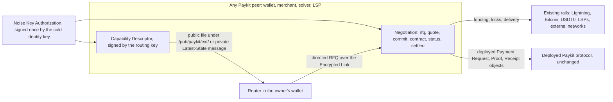
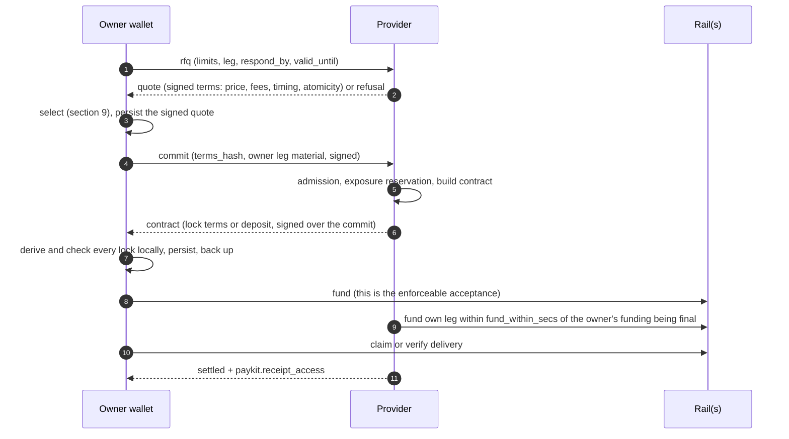

# Paykit Capabilities: one capability and intent layer for Paykit peers

Design proposal for team review. Author: `BitcoinErrorLog`. 27 October 2026; updated 29 October 2026 with the pubky-swap review on [pubky/paykit-rs#229](https://github.com/pubky/paykit-rs/issues/229#issuecomment-6459055920). Answers question 8 of the Paykit Intents draft ([BitcoinErrorLog/paykit-server#34](https://github.com/BitcoinErrorLog/paykit-server/pull/34)) and the blocker on [pubky/paykit-rs#209](https://github.com/pubky/paykit-rs/issues/209).

## Current state

1. Decision (27 Oct): the intent family does not go into `paykit-lib`. It becomes a separate spec, and the Paykit team reviews it before it is adopted. It is meant to cover more than swaps.
2. This document proposes that spec: **Paykit Capabilities**, a general layer through which a Paykit peer advertises what it can do and negotiates it with another peer. Swaps are the first profile. Seven other profiles are sketched.
3. The deployed protocol does not change. `paykit-lib` wire types, the App Registry, the message-kind table, the Noise Key Authorization and the paykit-rs specifications stay as they are.
4. Signing uses the Noise routing key that the identity has already authorized. There are no new identity keys, no Ring prompts and no new session scopes.
5. paykit-rs gets one additive request: an SDK API to send and confirm messages of kinds outside `paykit.*`. It needs no wire change.
6. The 23 Oct pubky-swap review (points A to I) is adopted as written in the swap profile (§13.1).
7. No code exists yet. pubky-swap already ships several pieces the swap profile needs ([#95](https://github.com/coreyphillips/pubky-swap/pull/95) to [#99](https://github.com/coreyphillips/pubky-swap/pull/99), 23 Oct). On 28 Oct `coreyphillips` confirmed the swap mapping at pubky-swap `main` `8686702` and took ownership of `swap/1` and `liquidity/1`; his five corrections are folded in (§6.2, §10.1, §12, §13.1).
8. The review asks are in §19. Design review runs on [pubky/paykit-rs#229](https://github.com/pubky/paykit-rs/issues/229).

---

## 1. The question and the answer

The #34 draft put intent types, a solver card, a terms hash and two new App Registry capabilities (`intents`, `intent_solver`) into `paykit-lib`. The pubky-swap review asked whether they belong there or in a separate spec. The author's answer: a separate spec, reviewed by the Paykit team, and not only for swaps. A peer will want to advertise and use many capabilities when it solves or routes a payment, for example:

- swaps between Lightning and on-chain Bitcoin;
- intents involving other assets (USDT on other chains, other coins);
- payments routed under an allowance;
- routing by atomicity guarantee, including Atomicity credit lines;
- conversion quotes, channel purchases and JIT liquidity, and payjoin receive.

All of these share the same structure:

1. **Advertise** what you can do, with bounds and indicative prices, publicly or to chosen contacts.
2. **Discover** and select counterparties.
3. **Negotiate** a binding price.
4. **Commit** and lock.
5. **Settle** with evidence.
6. **Fail** in defined ways.

Only the body of each step differs. So the spec defines those steps once (the *core*) and each use case as a *profile*. A profile defines the bodies for its domain and the rules specific to it.

## 2. Constraints

| Constraint | Consequence in this design |
| --- | --- |
| The deployed protocol stays unchanged | No new `paykit.*` kinds, no registry schema change, no change to the paykit-rs specifications. New message kinds use a separate prefix, `paykit-cap.`. Deployed readers already keep messages of unknown kinds without acting on them (paykit-rs `specs/paykit-sdk.md`: unknown valid Private Application Messages are retained; paykit-sdk `PrivateStreamParseStatus::UnknownKind`). |
| The identity key stays cold (Ring or another signer, rarely used) | Descriptors and terms are signed by the **routing key**: the Ed25519 key whose seed is `noise_secret`, derived from the identity-wide secret `K_g`. Every Paykit app already holds `K_g`, and the identity's signed Noise Key Authorization already binds that key to it. No identity-key signature is needed per device or per action. |
| No extra auth prompts | All public files sit under `/pub/paykit/`, which the existing `/pub/paykit/:rw` session already covers. Private messages ride the existing Encrypted Links. §15 lists every action against its prompt count, which is zero. |
| Event Messages are at most 1,000 bytes | Every core message fits. Larger payloads (hold invoices, PSBTs, provider plans) go into an encrypted blob: the location, key and hash travel in the message, and the hash is covered by the signature. This is the Encrypted Receipt construction. |
| Strangers cannot open a link to you | A responder cannot observe unknown initiators. Descriptors therefore list introduction channels (§7.3). |
| `/priv` is stored in plaintext on the homeserver | Nothing is written to `/priv`. Private data travels over Encrypted Links or in encrypted blobs. |
| Two deployed hazards | (1) Allowances V1 check every unknown-kind message for a top-level `allowance_id`. A hit blocks automatic handling of that allowance. Core messages therefore never carry a top-level `allowance_id`. (2) `event_id` is unique across all kinds on a link. Extension events use fresh UUIDv4 values from the same space, and are only sent to peers that advertise support (§8.1). |

## 3. Lessons from existing intent and capability systems

| System | What it standardises | Lesson | Applied in |
| --- | --- | --- | --- |
| **CoW Protocol** | Users sign limit orders. Bonded solvers compete in batch auctions; the protocol scores solutions on surplus; the settlement contract enforces the limit price ([rules](https://docs.cow.fi/cow-protocol/reference/core/auctions/competition-rules)) | The user signs a **limit**, never a route, and the enforcement point checks the limit. Selection uses a published scoring rule. Solvers are bonded and can be denylisted | The RFQ carries limits only (§8.4). Scoring is deterministic (§9). Bonds and reputation are inputs (§9.3) |
| **UniswapX** | Signed Dutch orders; RFQ with **indicative** quotes before the user signs and **hard** quotes after; the RFQ winner gets an exclusivity window; open fillers take over if the winner fades ([RFQ](https://developers.uniswap.org/docs/liquidity/uniswapx/concepts/uniswaprfq)) | Keep cheap indicative prices separate from accountable commitments. Penalise fading. Have a fallback when the exclusive filler disappears | The descriptor is indicative and the signed quote is firm (§10). A solver that fades after commit is attributable (§12) |
| **ERC-7683** | The May 2026 revision has resolvers turn a protocol payload into steps, payments and **named assumptions** that solvers vet ([R36 in #34](https://github.com/BitcoinErrorLog/paykit-server/pull/34)) | Every trust assumption is named, and a party that sees an unknown assumption declines | `trust` and `via` labels, plus the closed atomicity classes (§11). Unknown labels are ineligible |
| **Across** | Relayers front capital on the destination chain; repayment comes later after optimistic verification | A fast fill by the solver's own capital is a separate step from the slower, verified settlement and repayment. The solver carries that risk | Delivery evidence and payee proof (`routed-fill-v1`) are separate from the owner's funding (§10.3) |
| **Anoma** | Intents as constraints plus preferences; solvers compose partial transactions into balanced ones; gossip for counterparty discovery. Live through protocol adapters on EVM chains, not as its own chain ([adapter](https://docs.anoma.net/anoma-protocol-adapter)) | Keep **constraints**, which must hold, separate from **preferences**, which only rank. Discovery and solving are distinct roles | RFQ `limits` versus wallet `policy` (§8.4, §9). Discovery (§7) is separate from routing (§9) |
| **NEAR Intents** | A Message Bus relays quote requests to market makers, who return signed quotes; a Verifier contract ledger settles atomically. The bus is optional ([docs](https://docs.near-intents.org/integration/market-makers/message-bus/introduction)) | Use a quote relay for reach, but never make it a dependency. Atomicity comes from a shared ledger, which is a trust choice that must be stated | No relay is required; directed RFQ goes over links. NEAR 1Click is a `provider_trusted` route through `via` (§13.7) |
| **LSPS0, LSPS1, LSPS2** ([bLIP 50](https://github.com/lightning/blips/blob/master/blip-0050.md), [51](https://github.com/lightning/blips/blob/master/blip-0051.md), [52](https://github.com/lightning/blips/blob/master/blip-0052.md)) | LSPS0 lists the protocols a peer supports; LSPS1 covers `get_info`, then `create_order`, payment and status; LSPS2's `get_info` returns a fee menu whose entries carry an LSP-made `promise`, and `buy` must copy an entry verbatim | Capability discovery is its own call. A quote can be **stateless for the provider**: it signs the terms and checks its own signature at commit, so being quoted costs it nothing. `create_order` is not idempotent, so the transport must dedupe | Profiles are listed in a descriptor (§6). Quotes are self-contained and signed (§10.1). Commit dedupes by `event_id` (§8). Liquidity profile (§13.5) |
| **BOLT 12 offers** | A static, reusable offer; the payer fetches a fresh signed invoice over onion messages | A static advertisement plus a live fetch of the binding terms. Amounts may be denominated in fiat and resolved at fetch time | Descriptor plus RFQ and quote (§6, §8) |
| **Submarine swaps (Boltz API, pubky-swap)** | An on-chain HTLC paired with a Lightning HTLC on one hash; the refund timeouts are ordered | Hash locks give atomicity across Lightning and on-chain. Timeouts must be ordered. The party holding the preimage has a free option. The contract is only created after the client commits | Swap profile (§13.1), with the #34 §10.4 timing gates kept |
| **Payjoin (BIP 78, BIP 77)** | The receiver advertises a payjoin endpoint. BIP 77 replaces the receiver's server with an untrusted store-and-forward directory reached over OHTTP. The sender's fully signed Original PSBT is always a valid fallback ([BIP 77](https://bitcoin.org/bip/77/)) | An asynchronous encrypted mailbox suits homeservers. The safest failure mode is a fallback that still pays | Payjoin profile using the Encrypted Link as the mailbox (§13.6) |

What is common to all of them: advertisements are cheap and non-binding; quotes are signed and accountable; commitment creates resources; funding is the enforceable act; evidence comes from the rail; and every trust assumption has a name.

## 4. Architecture



Roles. A peer can hold several roles under different profiles.

- **Owner:** the party with an intent, usually a payer's wallet or a swapper.
- **Provider** (solver, LSP, quoter, payjoin receiver): advertises a capability and answers RFQs.
- **Router:** wallet-local logic that selects providers and composes legs. It has no network role and sends no messages of its own.
- **Payee:** receives the outcome through the deployed Payment Request and Proof flow.

Layers. The core (§5 to §12) is profile-neutral. Profiles (§13) define the bodies and rules for one domain, and each has a named owner. The deployed Paykit protocol carries the payee side: Payment Requests, Proofs (whose `proof` member is an open object), Receipts (whose `metadata` member is an open object) and Allowances V1.

## 5. Keys and signing

**Key chain.**

1. The cold identity key signs the deployed Noise Key Authorization at `/pub/paykit-authority/v0/current-key.json` once per key generation.
2. That authorization binds the routing key (Ed25519, seed `noise_secret`) and the static key (X25519) for generation `g`.
3. Every app of the identity holds `K_g`, and so the routing key.
4. The routing key signs descriptors and negotiation terms.

Nothing else is needed.

**Signature inputs.** Signed objects use RFC 8785 JCS, as Locks does. The signature is Ed25519 by the routing key over

```text
domain || 0x00 || JCS(object without "sig")
```

| Object | Domain string |
| --- | --- |
| Capability Descriptor | `paykit-cap/descriptor/v1` |
| Quote terms | `paykit-cap/terms/v1` |
| Commit | `paykit-cap/commit/v1` |
| Contract | `paykit-cap/contract/v1` |
| Settlement attestation (optional, public) | `paykit-cap/attestation/v1` |

Every signed object names `owner` (the identity) and `key_generation`.

**Verifying a signature.**

1. Fetch and verify the signer's Noise Key Authorization under the paykit-rs rules (`specs/paykit-sdk.md`, Shared Identity Model), and keep the highest verified generation.
2. Require that `key_generation` equals it. A lower generation means the object is stale and must be ignored.
3. Verify the signature with the authorized routing key.

**Evidence that outlives a rotation.** Only the current authorization is published. A bundle that must stay verifiable after rotation therefore carries a copy of the authorization at the signing generation (at most 4,096 bytes). Receipts, disputes and reputation attestations are such bundles. The copy is identity-signed, so it verifies on its own. Limitation: rotation does not revoke an old `K_g`. A leaked old key can still sign objects that claim the old generation, so timestamps in historical evidence are claims, not proofs.

**Trust.** A compromised app that holds `K_g` can sign descriptors and quotes as the identity. It can already publish endpoints and use Encrypted Links today, so this design adds no new trust in apps.

**Review point.** The routing key is also used in X25519 path derivation (Encrypted Link pair paths). This design uses Ed25519 signing under distinct domain strings. If cryptographic review rejects signing with the routing key, the fallback adds one link to the chain and still involves no identity key: the routing key signs a `paykit-cap/subkey/v1` delegation to a signing key derived as `derive_key("paykit/cap-signing", K_g)`.

## 6. Capability Descriptor

### 6.1 Public file

Path: `/pub/paykit/ext/capabilities/v1/apps/{app_id}.json`. There is one file per App ID, so apps of the same identity never race to write the same document. It is outside `/pub/paykit/v0/`, so public payment resolution never lists it. The reserved `ext/` subtree is a review ask (§19, item 2).

```json
{
  "version": 1,
  "kind": "paykit-cap.descriptor",
  "owner": "<z-base-32 identity key>",
  "app_id": "pubky-swap",
  "key_generation": 1,
  "seq": 42,
  "created_at": 1793000000,
  "valid_until": 1793086400,
  "profiles": [
    {
      "profile": "swap/1",
      "role": "provider",
      "edges": [
        {"from": "btc-lightning-bolt11", "to": "btc-bitcoin-p2tr", "dir": "reverse",
         "min": "25000", "max": "5000000", "unit": "sat",
         "fee": {"base": "100", "ppm": "2500", "onchain": "310"},
         "atomicity": "hash", "lock_profiles": ["taproot_boltz", "p2wsh"],
         "sides": ["exact_out"], "fund_within_secs": 120}
      ],
      "terms": {"offer_id": "9a1f3c2e-7b4d-4e8a-9c1f-3d2b6a4e7c11", "network": "bitcoin",
                "htlc_timeout_blocks": 144, "required_confirmations": 1}
    },
    {
      "profile": "paykit-features/1",
      "role": "payee",
      "terms": {"request_members": ["conversion.fixed", "payment_deadline"],
                "proof_profiles": ["erc20-transfer-eip712"]}
    }
  ],
  "contact": {
    "rfq": ["encrypted-link", "iroh:pubky-swap/direct/1"],
    "intro": [{"type": "iroh", "alpn": "pubky-swap/direct/1"},
              {"type": "https", "url": "https://solver.example/paykit-cap/introductions"}]
  },
  "reputation": {"bond": {"outpoint": "<txid>:<vout>", "proof_sig": "<base64url>"}},
  "sig": "<base64url Ed25519 by the routing key>"
}
```

### 6.2 Field rules

- The envelope is a closed object.
- `app_id` MUST be registered in the owner's App Registry.
- `seq` MUST increase on every rewrite. Readers reject a `seq` lower than the highest they have seen for that owner and app.
- `valid_until` is required, so a descriptor that is no longer refreshed lapses.
- The file is at most 65,536 bytes, with at most 32 profile entries and at most 64 edges per profile.
- **Profiles are open-world, profile contents are closed-world.** A reader ignores an unknown `profile` (as LSPS0 does with unknown protocols). It treats a known profile at an unknown major version as unknown. Inside a known profile version, unknown members make that entry invalid; the rest of the descriptor stays usable.
- **Edges** are the routing primitive that every value-moving profile shares, so a router can build a graph without parsing profile internals. `from` and `to` are Payment Endpoint Identifiers in their owner-facing format (pubky-swap review point E). Amounts are base-unit integer strings with an explicit `unit`. `fee` has `base`, `ppm` and an optional `onchain` component, and the indicative fee for an amount `a` is `base + floor(a × ppm / 1,000,000) + onchain`. `min` is the minimum the provider actually enforces, which can be higher than its configured floor. A router that pre-ranks on a lower fee or a lower minimum understates cost and sends RFQs that get `amount_below_minimum`. `atomicity` is a class from §11. `via` names any external network used internally. `lock_profiles` and `sides` are optional.
- **A descriptor binds nothing.** It reserves no liquidity and promises no price. Only a signed quote binds (§10).

### 6.3 Private descriptor

The same object, with `sig` optional, can be sent over an Encrypted Link as the Latest-State kind `paykit-cap.descriptor`. The newest valid message per source App ID wins, as with Private Payment Lists. Anything over 1,000 bytes is sent as `{"blob": {"loc", "key", "sha256"}}` pointing at an encrypted blob.

A private descriptor can disclose more than the public one, or exist without any public file. Examples: tighter fees for a contact, credit-line headroom, or payjoin support offered only to known payers.

`paykit-cap.descriptor_request` (an Event) asks a peer for its private descriptor, optionally filtered by profile. The peer may ignore it.

### 6.4 Encrypted blobs

Path: `/pub/paykit/ext/capabilities/v1/blobs/{id}`. The construction is the Encrypted Receipt's: XChaCha20-Poly1305 under a fresh 256-bit key with associated data `paykit-cap.blob.v1:` followed by the location. Each blob is at most 262,144 bytes. Its hash is inside the signed object that references it. The writer deletes a blob after the flow ends, or by its own retention policy.

## 7. Discovery

### 7.1 Public

The sources, in order of trust:

1. Contacts' descriptors, read directly from their homeservers.
2. The Pubky follow and tag graph.
3. Curated lists: a public file listing provider keys, published by anyone and trusted by choice.
4. Later, a Nexus index of `paykit-cap.descriptor` files.

The reader verifies the chain in §5 and freshness in §6.2 for every descriptor, whatever its source. An index only finds descriptors; it is never trusted for their contents.

### 7.2 Private

A private descriptor is only revealed to identities the owner has already linked with, and only by the owner's choice. Use it for anything that leaks a graph or a balance: credit lines, allowance acceptance, payjoin, or per-contact pricing.

### 7.3 Reaching a provider for the first time

A provider cannot hear from an identity it has not linked with. A descriptor therefore lists the introduction channels it accepts, in order:

- pubky-swap's iroh doorbell `pubky-swap/direct/1`, which exists today;
- a signed HTTPS `POST` naming the owner, in the style of paykit-server's signed routes;
- `pubky/inbox`, once it is suitable (assumption, verify).

The provider admits or ignores the newcomer by its own policy, then completes the Encrypted Link handshake.

### 7.4 What each step reveals

| Step | Learns what |
| --- | --- |
| Public descriptor | Everyone: the profiles, bounds and indicative fees |
| Private descriptor | One contact: whatever the owner chose to disclose |
| RFQ fan-out | Each provider asked: the amount, the leg and the timing, whether or not it wins. The router's fan-out budget bounds this (§9) |
| Hash-locked route | Operators of each leg, if they cooperate: correlation through the shared hash. Point locks remove it |
| Homeserver operators | Write activity only. Link contents and blobs are encrypted |

## 8. Negotiation

### 8.1 Common rules

- Every message is a closed JSON object of at most 1,000 bytes with `version` (1), `kind`, `app_id`, `profile` and `flow_id`. `flow_id` is a UUIDv4 chosen by the owner and stable across all providers asked.
- Events also carry `event_id`: a fresh UUIDv4, unique across every kind on the link, and reused byte-for-byte on retry.
- A receiver that durably stores a valid core message confirms it with the deployed `paykit.delivery_confirmation`.
- **Only send core events to a peer whose verified descriptor (public or private) lists that profile.** A deployed SDK keeps unknown kinds but does not confirm them, so the sender would otherwise retry forever.
- **Never put a top-level `allowance_id` in a core message.** References to an allowance go inside `body`.
- A profile body that does not fit moves into an encrypted blob referenced by `{"blob": …}`. The blob's hash is inside the signed terms.
- Signatures make quotes, commits and contracts attributable to third parties. The link already authenticates the sender, so unsigned kinds (RFQ, status, refusal) need nothing more.
- A status message is a hint. Outcomes come from the rail. A timeout means unknown, never failed.

### 8.2 Kinds

| Kind | Type | Direction | Purpose |
| --- | --- | --- | --- |
| `paykit-cap.descriptor` | Latest-State | either | Private descriptor (§6.3) |
| `paykit-cap.descriptor_request` | Event | either | Ask for a private descriptor |
| `paykit-cap.rfq` | Event | owner → provider | Limits and the requested leg. No side effects for the provider |
| `paykit-cap.quote` | Event, signed | provider → owner | Firm price and economic terms. Creates no resources for the provider |
| `paykit-cap.refusal` | Event | provider → owner | Closed reason code (§12.1) |
| `paykit-cap.commit` | Event, signed | owner → provider | Accepts the quote's `terms_hash` and carries the owner's leg material. No funding yet |
| `paykit-cap.contract` | Event, signed | provider → owner | Lock terms or deposit instructions, covering the commit. The provider creates resources here |
| `paykit-cap.status` | Event | either | Leg status hint with evidence references (§12.2) |
| `paykit-cap.status_request` | Event | either | Asks for the signed contract and the latest status (pubky-swap review point F) |
| `paykit-cap.cancel` | Event | either | Valid only before any funding |
| `paykit-cap.settled` | Event | provider → owner | Terminal notice with evidence, followed by the deployed `paykit.receipt_access` |

Profiles may add kinds named `paykit-cap.{profile}.{name}`, for example the swap profile's MuSig2 nonce round (§13.1).

### 8.3 Flow



A profile may declare `"contract_step": "none"` when its quote already carries everything the owner needs to fund. Provider-trusted deposit routes such as 1Click are like this. The owner then funds straight after the commit.

### 8.4 RFQ body

```json
{"version":1,"kind":"paykit-cap.rfq","app_id":"bitkit","event_id":"<uuid>","flow_id":"<uuid>",
 "profile":"swap/1",
 "body":{"offer_id":"<uuid>","dir":"reverse","from":"btc-lightning-bolt11","to":"btc-bitcoin-p2tr","amount_sat":"250000"},
 "atomicity_min":"hash","respond_by":1792482660,"valid_until":1792483200}
```

The RFQ carries **constraints** only: amounts, the leg, `atomicity_min`, an optional `max_cost_bps`, and deadlines. **Preferences** stay in the owner's wallet and never leave it: provider ranking, trust policy, and which other providers were asked. Measured compact size: 396 bytes.

## 9. Selection and routing

### 9.1 Router, wallet-local and deterministic

```text
route(intent, policy, allowance?):
  descriptors = verified and fresh (section 5, section 6.2), public or private
  candidates  = edges where (from, to) is covered, amount is within [min, max],
                atomicity >= intent.atomicity_min, every via and trust label is allowed by policy,
                and the provider is not denied
  paths       = candidate single edges, plus two-edge paths joined on an endpoint identifier
                (two legs at most in v1)
  pre-rank    = indicative cost from edge fees (base + ppm + onchain), then atomicity, then reputation
  ask         = top policy.fanout_budget (default 3), concurrently
  usable      = signed, valid, expiring more than 5 s from now, within intent limits,
                funding <= balance
  winner      = argmax credit_min / (debit + max_fee), by integer cross-multiplication;
                tie: stronger atomicity, then a native Pubky provider, then pre-rank
  freeze(winner); commit; contract; persist; back up; fund
```

This is Bitkit's shipped USDT selection rule (bitkit-core `modules/usdt`, cited in #34 §5.3), widened to any provider. Selection is frozen once made: send and recovery never pick another route. A path's atomicity is that of its weakest leg. Hash and point legs never mix in one atomic path. Legs are ordered by claim order for the timing gates (#34 §10.4).

### 9.2 Provider side

- **Admission:** allow and deny lists, web of trust, a rate limit per identity, optionally a bond or a `commit_fee`.
- **Stateless quotes:** the provider signs the full terms and checks its own signature at commit. Being quoted therefore costs it nothing, as with LSPS2's `promise`.
- **Resources only at commit:** keys, contracts, hold invoices and exposure reservations are created only when a commit arrives (pubky-swap review point A, and [pubky-swap#76](https://github.com/coreyphillips/pubky-swap/pull/76)).

### 9.3 Inputs for reputation and trust

Nothing here is a reputation system; these are its inputs:

- signed quotes, which make no-shows attributable;
- fading after commit (a commit answered by neither a contract nor an allowed refusal, §10.1);
- optional public settlement attestations (`paykit-cap/attestation/v1` over `contract_hash` and the outcome);
- fidelity bonds referenced in descriptors;
- Pubky tags on provider profiles.

## 10. Quoting, commitment and settlement

### 10.1 Quote

A quote is firm on price until `valid_until`, but it reserves nothing (review point A). At commit the provider rechecks capacity, rate limits and access, so a commit on a valid quote may still be refused with `liquidity_unavailable`, `rate_limited` or `access_denied`. Those three refusals at commit are allowed and do not count as fading; the owner commits to the next quote. Fading is a commit answered by neither a contract nor one of those refusals, or by a contract on terms other than the quote's. Measured compact size: 717 bytes for a swap quote.

```json
{"version":1,"kind":"paykit-cap.quote","app_id":"pubky-swap","event_id":"<uuid>","flow_id":"<uuid>",
 "rfq_event_id":"<uuid>","profile":"swap/1","key_generation":1,
 "body":{"quote_id":"<uuid>","offer_id":"<uuid>","dir":"reverse","amount_sat":"250000",
         "service_fee_sat":"725","onchain_fee_sat":"310","total_sat":"251035",
         "htlc_timeout_blocks":144,"required_confirmations":0,"fund_within_secs":120,
         "lock_profiles":["taproot_boltz"]},
 "atomicity":"hash","valid_until":1792482720,"sig":"<base64url>"}
```

`terms_hash` is SHA-256 over `paykit-cap/terms/v1 || 0x00 || JCS(terms)`. The terms are:

- both identities and both key generations;
- `profile` and `flow_id`;
- the RFQ's constraints and body;
- the quote's body, `atomicity`, `valid_until` and any blob hashes.

The provider's `sig` covers `terms_hash`.

### 10.2 Commit and contract

- The commit carries `quote_event_id`, `terms_hash` and the owner's leg material. Its `sig` covers `commit_hash` = SHA-256(`paykit-cap/commit/v1 || 0x00 || JCS({terms_hash, body})`). Measured: 632 bytes for a reverse swap.
- The contract carries the provider's lock terms. Its `sig` covers `contract_hash` = SHA-256(`paykit-cap/contract/v1 || 0x00 || JCS({commit_hash, body})`). Measured: 821 bytes for a reverse swap, with the hold invoice moved into a blob.
- The hashes form a chain: contract → commit → terms. A third party holding the three signed objects and the authorizations can therefore check everything that was agreed.

### 10.3 Funding, `fund_within` and evidence

- **Funding the derived contract is the enforceable acceptance.** The owner derives every lock from the signed terms and the rail's own parameters, and never accepts an address on trust.
- `fund_within_secs` starts when the owner's funding is **final**: the hold invoice accepted on a reverse swap, the confirmation depth reached on a submarine swap. Time before that never counts (pubky-swap review point I, shipped in [pubky-swap#96](https://github.com/coreyphillips/pubky-swap/pull/96)).
- Evidence comes from the rail: a txid and output, a preimage, a provider reference, a postback. Only a witness that hashes to `H` counts as a claim on a hash leg.
- **Payee side, deployed objects only.** When a provider delivers to a payee, the payer's deployed `paykit.payment_proof` carries a `routed-fill-v1` object in its open `proof` member. That object holds `contract_hash`, the delivery reference, the provider's signature and the payer's signature (#34 §6.8, with `terms_hash` replaced by `contract_hash`). Payees that verify it need code (paykit-server). The wire does not change.
- **Receipts:** the deployed Encrypted Receipt carries the flow in its open `metadata` member: `flow_id`, `contract_hash`, the legs and the fees.

## 11. Atomicity

| Class | Guarantee | Typical rails |
| --- | --- | --- |
| `hash` | Every leg commits to one SHA-256 hash; refunds come by timeout | Lightning HTLCs and hold invoices, on-chain HTLCs (pubky-swap, Boltz API), ERC-20 HTLCs |
| `point` | Adaptor signatures, with no shared hash | MuSig2 adaptors; Ark adaptor transfers; future PTLCs |
| `escrow` | A third party or multisig holds the funds until both sides act | P2P exchanges with bonds |
| `attested` | Release depends on a named attestor's signature, such as a Locks verifier or a delivery attestor | Conditional settlement (§13.3) |
| `credit_bounded` | Bounded-trust credit that finalizes or auto-reverts | Atomicity credit lines (§13.8) |
| `provider_trusted` | A provider delivers after receiving the funds and refunds by its own action | USDT0, Orchestra, NEAR 1Click, THORChain, LSPS1 and LSPS2, allowance-funded solvers |
| `fiat_attested` | No lock; a provider postback is the evidence; reversals are possible | PayPal IPN |

The table lists the classes from strongest to weakest. This changes #34 in one place: `attested` is added between `escrow` and `credit_bounded`.

Rules:

- A path takes the weakest class among its legs.
- The RFQ's `atomicity_min` is a hard constraint.
- The wallet's policy may require a stronger class above an amount threshold (#34 open question 4).
- An unknown class or trust label makes the route ineligible. This is ERC-7683's rule for unknown assumptions.

"Atomicity routing" therefore works at two levels. The router chooses paths by guarantee, and Atomicity credit lines are one more class it can choose.

Refund and timing rules per class are #34 §10.3 and §10.4, unchanged. pubky-swap already meets the hash-lock gates, several with wider margins (review, "Already aligned").

## 12. Failure handling

### 12.1 Refusal codes (closed)

`unsupported_route`, `amount_below_minimum`, `amount_above_maximum`, `liquidity_unavailable`, `pricing_unavailable`, `quote_expired`, `invalid_destination`, `invalid_request`, `unsupported_protocol`, `offer_stale`, `atomicity_unsupported`, `rate_limited`, `access_denied`, `internal_error`.

All of these except `atomicity_unsupported` are pubky-swap's shipped `RejectCode` ([pubky-swap#98](https://github.com/coreyphillips/pubky-swap/pull/98)). `not_found` answers `status_request` only. `pending` answers `status_request` and also a retried or concurrent commit while the provider is still admitting it ([CLIENT_ADAPTERS.md](https://github.com/coreyphillips/pubky-swap/blob/8686702/docs/CLIENT_ADAPTERS.md)). At commit it therefore means "query again": the owner sends `status_request` or retries the same commit bytes, and never treats it as a decline. A reader treats an unknown code as a generic decline.

### 12.2 Leg status (closed)

| Status | Meaning |
| --- | --- |
| `pending` | Source step submitted, outcome unresolved |
| `failed` | Proven unexecuted |
| `replaced` | Another operation consumed the input |
| `in_transit` | Source executed, delivery unresolved |
| `needs_attention` | A retryable problem |
| `delivery_failed` | Delivery permanently stopped. This does not imply a refund |
| `refunded` | Refund proven by evidence on the rail |
| `delivered` | Delivery evidence accepted under the route's trust label |

These are the #34 §5.5 statuses, mapped from pubky-swap's `SwapState` in [pubky-swap#95](https://github.com/coreyphillips/pubky-swap/pull/95).

### 12.3 Rules every profile inherits

These come from Bitkit's USDT stack and from pubky-swap:

- persist before any irreversible step, and back up first;
- at most one unresolved route per source account and asset;
- a timeout, expired quote or lost reply never starts another payment;
- no status ever triggers an automatic paid retry or refund;
- the chain or provider evidence is authoritative over messages;
- a refund counts only with a receipt on the source chain, and one refund settles at most one flow;
- reported delivery is bounded by the principal that was sent;
- recovery needs only the seed and the persisted signed objects: re-derive, rebuild the locks, query the rails, then reconcile.

### 12.4 Failure table

| Failure | Defence |
| --- | --- |
| Provider never answers the RFQ | `respond_by` passes and the router uses the other quotes. Nothing is committed |
| Commit refused with `liquidity_unavailable`, `rate_limited` or `access_denied` | Allowed, because quotes reserve nothing. Nothing is funded; the owner commits to the next quote. Not counted as fading |
| Commit answered with `pending` | Admission is still in progress. Query again with `status_request`; never treat it as a decline |
| Provider fades after commit (no contract and no allowed refusal) | Nothing is funded; the owner commits to the next quote. The signed quote and commit make the fade attributable |
| Contract reply lost | `status_request` returns the signed contract and the latest status |
| Provider never funds after the owner's funding is final | Timeout refund on the owner's lock, or a cooperative refund where the profile supports one. Missing `fund_within_secs` is attributable |
| Owner never claims (free option) | Short lock windows on volatile pairs; an optional `commit_fee` priced in the quote; reputation |
| Provider underfunds a lock | The owner checks the locked value before revealing anything |
| Homeserver or link outage | The outbox retries the exact bytes. Timeouts still protect the funds. Outcomes are read from the rails |
| Provider-trusted delivery fails | The provider refunds to the owner's address, and it counts only with evidence on the source chain |

## 13. Profiles

Each profile names its owner, its edges, the bodies of its messages and its atomicity. The swap and Paykit-features profiles are specified in enough detail to build. The others are sketches, so their owners can say whether the core fits before anyone writes them. Owners confirmed so far: `coreyphillips` for `swap/1` and `liquidity/1` (28 Oct, on [pubky/paykit-rs#229](https://github.com/pubky/paykit-rs/issues/229#issuecomment-6459055920)). The rest are proposed or open.

### 13.1 `swap/1`: Lightning and on-chain Bitcoin swaps (first profile)

Owner: `coreyphillips` (pubky-swap), confirmed on [pubky/paykit-rs#229](https://github.com/pubky/paykit-rs/issues/229#issuecomment-6459055920) (28 Oct). Atomicity: `hash`. Rails: Lightning plus P2WSH or Taproot (Boltz-compatible) HTLCs. This maps one to one onto pubky-swap's existing wire family (`swap-common/src/messages.rs` at [`8686702`](https://github.com/coreyphillips/pubky-swap/tree/8686702), confirmed by its owner):

| Core | pubky-swap | Body |
| --- | --- | --- |
| Descriptor `swap/1` entry | `SwapOffer` | `offer_id`, `network`, one edge per offered direction, `htlc_timeout_blocks`, `required_confirmations`. Each edge's `min` is `effective_min_amount_sat()` (the configured `min_amount_sat` raised to 10 × `onchain_fee_sat`), not `min_amount_sat`. `max` is `max_amount_sat`. `fee` is `base_fee_sat`, `fee_ppm` and `onchain_fee_sat`, matching `quote_fee()`. These values and `fund_within_secs` are offer-wide today, so both direction edges carry the same numbers. Refreshed as fees move the minimum |
| `rfq` | `QuoteRequest` | `offer_id`, `dir`, `amount_sat`. `client_pkarr` always comes from the authenticated link, never from the body |
| `quote` | `Quote` | Fee breakdown, `total_sat`, timeouts, `fund_within_secs`, `valid_until`. No side effects |
| `commit` | `SwapRequest` | `lock_profile` (`p2wsh` or `taproot_boltz`, from `script_type`), `payment_hash` (H), `claim_pubkey` on reverse, `refund_pubkey` and `invoice` on submarine. A submarine invoice usually goes in a blob |
| `contract` | `SwapAccept` | `swap_id`, `lock_profile`, `onchain_amount_sat`, `timeout_block_height`, `provider_pubkey`, the hold invoice on reverse (in a blob). The script and address may be omitted because the client derives them ([#99](https://github.com/coreyphillips/pubky-swap/pull/99)) |
| `status` | `SwapStatusUpdate` | `SwapState::leg_status`, with the settling txid in `reference` ([#97](https://github.com/coreyphillips/pubky-swap/pull/97)) |
| `status_request` | `SwapStatusRequest` → `SwapStatusSnapshot` | The snapshot carries the contract (`SwapAccept`), the state and the observed txids. Nothing is signed at `main`; the snapshot returns the plain `SwapAccept`. Signing quotes and contracts, and storing the signed contract so `status_request` can return it, is adapter work |
| `refusal` | `Reject` with `RejectCode` | §12.1 |
| `paykit-cap.swap.coop_nonces`, `paykit-cap.swap.coop_partial` | `CoopSignature` (reserved for any cooperative key-path spend) | A MuSig2 nonce round, then a partial signature, for any cooperative key-path spend on a Taproot contract: a cooperative refund on a submarine swap (review point D) or a cooperative claim on a reverse swap. Deferred until pubky-swap supports cooperative signing (its roadmap Phase 8). A reverse swap's refund needs no signature: the provider cancels the hold invoice. P2WSH has no cooperative path |

Profile rules:

- `exact_out` only in v1. A reverse leg's `credit_min` is the locked amount, and the wallet subtracts its own claim fee when scoring (review point H).
- One swap edge is one leg. pubky-swap's `leg_status` covers the whole route, so `status.leg` is `0` for a swap. A later split into separate Lightning and chain legs can wrap it (open in [pubky-swap#89](https://github.com/coreyphillips/pubky-swap/issues/89)).
- The value check before revealing is pubky-swap's: one output of the right value. The draft's sum across live outputs is the stricter check that other hash profiles use.
- Settlement keys are fresh per swap. Seed-derived preimages and keys (`HKDF(seed, "paykit-intent/P", flow_id)`) are a wallet change in Bitkit.
- The same signed payloads may travel over iroh `pubky-swap/direct/1` for lower latency. Swap state never depends on which carrier delivered a message.
- Pubky Swaps does not deliver USDT. The #34 §11.1 "Lightning to USDT" proof becomes a two-leg path: a reverse swap whose claim pays the NEAR 1Click deposit address (review point C), which is `provider_trusted` overall.

### 13.2 `paykit-features/1`: advertising support for deployed optional features

Proposed owner: the Paykit team. Atomicity: none, because this profile only advertises.

The deployed spec says that before using conversion terms, deadlines or quotes, peers must establish support "through coordinated deployment or an agreed capability mechanism". It also says the `payment_requests` capability does not advertise those features. Version 1 has no negotiation mechanism for these optional members. This profile is that mechanism, and it sits outside the deployed protocol.

```json
{"profile":"paykit-features/1","role":"payee",
 "terms":{"request_members":["payment_endpoints","conversion.fixed","conversion.per_period","payment_deadline"],
          "rate_selectors":["asset","asset-rail"],
          "proof_members":["allowance_id","conversion_quote_id"],
          "proof_profiles":["erc20-transfer-eip712","routed-fill-v1"],
          "allowances":["v1"]}}
```

The `role` is `payer` or `payee`. An advertisement only lets a peer *try* a feature. A deployed parser that rejects the message still wins: the sender treats the rejection as "not supported" and never strips terms to make a request fit. A false advertisement can cause a rejected message, never a wrong payment.

This is the cheapest profile to ship. A Shop seller's paykit-server and a buyer's Bitkit can use it today instead of coordinating deployments.

### 13.3 `conditional/1`: atomic and conditional settlement (sketch)

Proposed owner: open. dzdidi is a candidate because of the Locks link. A payment completes only if a condition holds, and refunds by timeout otherwise.

- **Advertised:** the condition types (`preimage`, `adaptor`, `attestation:<attestor key>`, `locks:<criterion type>`), the maximum hold time, and the attestors accepted.
- **Flow:** the payee sends a deployed Payment Request. A `contract` names the condition and the lock. The payer funds a conditional lock, for example a hold invoice whose preimage is the content key of a digital good. Release happens when the condition is met; otherwise the lock times out.
- **Atomicity:** `hash` or `point` when the condition is the release of a secret. `attested` when an attestor decides.
- **Ties to existing work:** Locks already verifies a `paykit-payment` criterion. A condition such as "a Locks entitlement exists" makes unlocking and payment one atomic step for digital delivery.
- **Constraint:** Lightning hold invoices tie up routing liquidity, so the maximum hold time is short and declared.

### 13.4 `allowance-route/1`: allowance-funded routing under Allowances V1 (sketch)

Proposed owner: open (Paykit team with Bitkit). This gives automatic cross-asset payments **without** Allowance terms V2.

- **Setup:** the owner already holds a V1 Allowance granted to a solver S, in the asset the owner funds from (for example `btc`, with V1 ceilings). Approving it is one existing V1 approval.
- **Per payment:**
  1. The owner sends an RFQ to S ("deliver 20 USDT to this payee's request").
  2. S quotes and the owner commits.
  3. S sends a deployed `paykit.payment_request` in the funding asset and amount. Its open `metadata` carries `{"paykit_cap":{"flow_id":…,"contract_hash":…}}`, which are references, not destinations.
  4. The owner's wallet pays it automatically under V1 rules: same asset, no repricing, within the ceilings.
  5. S delivers to the payee, and the payer proves the payment with `routed-fill-v1`.
- **Why it fits V1:** the repricing happens at the solver. The allowance accounts only in the funding asset, which is exactly V1's rule. A wallet that does not understand this profile sees an ordinary request from an Allowee it authorized, and V1 already means "pay it".
- **Bounds:** before committing, the wallet's own policy limits cost against the payee amount (`max_cost_bps`). Committing automatically requires a wallet-local policy that the user set once. The V1 ceilings cap the solver's exposure.
- **Atomicity:** `provider_trusted`. The solver holds the funds between legs.
- **Also in this profile:** an Allowee can advertise the proposal shapes it sends (for subscriptions), and an Allower wallet can advertise that it handles them automatically. A merchant then knows whether to offer automatic payment.
- **Out of scope:** Allowance terms V2 (a cross-asset denomination and routing limits inside the allowance itself). That changes paykit-rs and is the Paykit team's decision.

### 13.5 `liquidity/1`: channel purchase and JIT liquidity (sketch)

Owner: `coreyphillips`, confirmed on [pubky/paykit-rs#229](https://github.com/pubky/paykit-rs/issues/229#issuecomment-6459055920) (28 Oct). This stays a sketch until the Phase 1 contract in [pubky-swap#84](https://github.com/coreyphillips/pubky-swap/issues/84) is settled: which LSPS revisions, and whether the first release is Pubky-only or also LSPS0. #84 covers Bitkit buying channels from its selected Pubky Swap provider.

- **Mapping:** the descriptor caches `lsps1.get_info` options and the `lsps2.get_info` fee menu as indicative terms. `rfq` and `quote` map to `get_info` with the LSP's signed terms; LSPS2's `promise` is already a stateless quote. `commit` maps to `create_order` or `buy`, and `contract` to the order's payment details or the `scid`. Funding is the payment. Settlement evidence is the channel funding txid and the channel becoming ready.
- **Message bodies:** the LSPS JSON bodies travel verbatim inside `body.lsps`, so standard LSP code can be reused. LSPS0 over BOLT 8 stays the standard path, and the Pubky envelope is an adapter, as #84 already says.
- **Atomicity:** `provider_trusted`, with LSPS2's trust modes named in `trust`.
- **Idempotency:** `create_order` is not idempotent, so a commit is deduplicated by `event_id`.

### 13.6 `payjoin/1`: payjoin receive (sketch)

Proposed owner: open (Bitkit). Atomicity: none, because payjoin is one transaction; failure falls back to the sender's original.

- **Advertised:** per endpoint identifier (for example `btc-bitcoin-p2tr`), the payjoin versions and transports supported: `bip77` (directory and OHTTP relay hints) or `encrypted-link`. The deployed endpoint payload stays the bare handle; no `pj=` parameter is added to it.
- **Flow over the link, which acts as the mailbox:**
  1. The payer's `commit` points to the fully signed Original PSBT in a blob.
  2. The receiver's `contract` points to the Proposal PSBT in a blob.
  3. The payer checks it, signs and broadcasts.
- **Failure:** either side broadcasts the Original PSBT, and the payment still completes.
- **Privacy:** the link hides contents but not that writes happen. BIP 77 adds OHTTP to hide IP addresses from the directory, while a homeserver operator sees the writer's connection. The descriptor's transport list lets the receiver offer BIP 77 where that matters.

### 13.7 `cross-asset/1`: other assets and chains, and external intent networks (sketch)

Proposed owner: open (Bitkit, `ben-kaufman`, building on the shipped USDT router).

- **Edges:** between any `{asset}-{rail}-{format}` identifiers (`usdt-arbitrum-address`, `usdt-tron-address`, `usdc-base-address`, `eth-ethereum-address`, `sol-solana-address`). Identifiers are introduced by use. This spec is not limited to Bitcoin methods.
- **Providers:** Paykit solvers, or wallet adapters reaching external networks named in `via`: `near-1click`, `thorchain`, ERC-7683 resolvers, UniswapX, Across, `usdt0`, `orchestra`.
- **Atomicity:** mostly `provider_trusted`. It is `hash` where both chains have HTLCs (for example an ERC-20 HTLC paired with Lightning).
- **Delivery proof:** `routed-fill-v1` for EVM deliveries. Other chains need their own evidence profile.
- **Rules:** Bitkit's quote validation, error taxonomy and "never re-route" rules apply unchanged.

### 13.8 `credit-route/1`: Atomicity credit routing (sketch)

Proposed owner: the Atomicity project.

- **Discovery is private only:** credit-line edges (headroom, rate, expiry) are disclosed to neighbours through private descriptors, never published. Atomicity has no global gossip, only neighbour-only routing signals.
- **Mapping:** `rfq` and `quote` map to a short-lived RoutingOffer. `commit` and `contract` map to the hop-by-hop capacity holds. Settlement is the finalize receipt, and an unfinalized hold auto-reverts on its TTL.
- **Atomicity:** `credit_bounded`.
- **Net balances** settle over deployed Payment Requests.
- **Vocabulary:** these object names come from the public [pubky/atomicity](https://github.com/pubky/atomicity) Q3 report and may change as that protocol evolves.

## 14. Where this sits relative to the deployed protocol

| Deployed element | Used how | Changed? |
| --- | --- | --- |
| Noise Key Authorization | Root of the signing chain | No |
| App Registry | `app_id` existence check only. Gating comes from descriptors, not new capability booleans | No |
| `/pub/paykit/:rw` session | Writes descriptors and blobs under `/pub/paykit/ext/` | No (the `ext/` reservation is a review ask) |
| Encrypted Links | Transport for `paykit-cap.*` kinds | No wire change. One additive SDK API (§17) |
| Delivery Confirmation | Confirms durably stored core events | No |
| Payment Request, `metadata` | Allowance-funded legs carry references in `metadata` | No |
| Payment Proof, `proof` (open object) | `routed-fill-v1` object | No wire change. Payees verify in code |
| Receipt, Receipt Access, receipt `metadata` | Settlement record for a flow | No |
| Allowances V1 | Used as-is by `allowance-route/1`. Core messages avoid a top-level `allowance_id` | No |

## 15. Authorization prompts

| Action | Prompts for the user |
| --- | --- |
| Publish or refresh a public descriptor | 0 (existing session, routing-key signature) |
| Send a private descriptor | 0 (existing link) |
| RFQ, quote, commit, contract, status | 0. The payment itself is approved in the wallet as today, or is automatic under a policy set once |
| Sign terms | 0 (routing key; Ring never asked) |
| First contact with a provider | 0 for the user. Introduction is app-to-app |
| Allowance-funded automatic payment | 0 beyond the existing one-time V1 Allowance approval |
| Key rotation | The existing authorizer flow, unchanged. Descriptors are re-signed automatically afterwards |

A provider such as a pubky-swap daemon is a separate identity. Its operator signs its own Noise Key Authorization once at setup. No user is involved.

## 16. Where the #34 draft should change

1. **§6.1, §13.1 item 1, §14 (ownership):** remove the `intents` and `intent_solver` App Registry capabilities and the `paykit.intent*` kinds from `paykit-lib`. They become the `paykit-cap.*` kinds and descriptors of this spec. This answers question 8.
2. **§6.3 (solver card):** replace it with the Capability Descriptor and a `swap/1` entry. Rename legs to their owner-facing formats with a `lock_profile` per leg (point E). Drop the Pubky Swaps USDT route (C). Drop `refund-consent-v1` until cooperative signing exists (D).
3. **§6.7 (identifiers):** drop `btc-lightning-hold` and `btc-bitcoin-htlc`. A lock is described by `lock_profile`, never by an identifier (E).
4. **§6.4, §6.5, §11.2 (flow):** the quote has no side effects. Add commit, carrying H, the owner's keys and the invoice (B), and contract, carrying the solver-signed lock terms (A). The terms hash becomes the chain `terms_hash` → `commit_hash` → `contract_hash`.
5. **§6.5 and open question 7 (signing key):** sign with the routing key authorized by the Noise Key Authorization. Not the root key, and no new app key (G). This keeps the identity key cold.
6. **§6.4, §8.4 (`fund_within`):** the clock starts when the owner's funding is final, and the value is declared per direction (I).
7. **§6.5:** add `status_request` (F). Use the closed refusal codes and leg statuses as pubky-swap shipped them.
8. **§6.2, §5.3:** `exact_out` only for hash routes in v1. On a reverse leg, `credit_min` is the locked amount (H).
9. **§10.4 and `intent_refund_consent`:** move to the swap profile as `coop_nonces` and `coop_partial` (a nonce round plus a partial signature, for any cooperative key-path spend), and defer it (D).
10. **§11.1 (first proof):** use a two-leg path: a reverse swap whose claim pays the 1Click deposit address (C). Alternatively, change the first proof (question 1).
11. **§9 (Allowances V2):** move out of this spec. Point to `allowance-route/1` as the V1-compatible path, and leave V2 to paykit-rs.
12. **§10.2:** add `attested` between `escrow` and `credit_bounded`.
13. **§8.2:** introduction channels move into descriptors. Directory sources are as §7.1.
14. **§14 (build plan):** shrink the paykit-rs row to the SDK API in §17. Add profile ownership to the pubky-swap row.

## 17. Work by repository

| Repository | Work |
| --- | --- |
| pubky/paykit-rs (`paykit-sdk`, `paykit-ffi`) | One additive API, with no wire or registry change. (1) Queue an Event Message whose kind is outside `paykit.*` on the identity-wide outbound queue, with the same FIFO, retry and exact-bytes rules. (2) Let the app register extension kinds it understands, so the SDK confirms them with `paykit.delivery_confirmation`. (3) Read retained unknown-kind stream items by kind prefix. (4) Optionally, sign with the routing key under a caller-supplied domain. Today the library sends arbitrary kinds only in tests (`send_private_application_message_for_test`). Swift and Kotlin bindings for the same |
| pubky/paykit-server | Verify `routed-fill-v1` inside `proof`. Publish a `paykit-features/1` descriptor for each seller app. No routing |
| coreyphillips/pubky-swap | Owns `swap/1` and `liquidity/1` (confirmed 28 Oct). Publish the descriptor from `SwapOffer`. Add the adapter at the provider edge, over iroh first and then Encrypted Links. The adapter signs quotes and contracts and stores the signed contract for `status_request`; nothing is signed at `main` |
| synonymdev/bitkit-core, Bitkit apps | Router (§9), descriptor verification, profile clients, the review screen (provider, atomicity, maximum debit, trust label), routed-fill signing |
| pubky/locks | Later: `conditional/1` with a Locks criterion as the condition |
| Atomicity project | Later: `credit-route/1` |
| Spec home | Review ask (§19). First for feedback in the `BitcoinErrorLog/paykit-server` fork, next to #34 |

## 18. Out of scope

- Any change to the deployed Paykit protocol, `paykit-lib` wire types, the App Registry, the message-kind table or the paykit-rs specifications.
- Allowance terms V2 (cross-asset authority inside an allowance). That is a paykit-rs decision.
- Public intents, order books, global gossip, NIP-69 bridges and sealed-bid auctions. The core leaves room for a later public `paykit-cap.intent` file, but this spec does not define one.
- Settlement code, custody, bridges and price oracles. Paykit carries and checks prices and never fetches them.
- Paths of more than two legs, and payments split across several solvers.
- The design of a reputation system. Only its inputs are listed (§9.3).
- The internals of the Atomicity, Ark, fiat (PayPal) and ERC-7683 resolver work, and separate privacy-routing work.
- Legal analysis of provider roles. A `provider_trusted` solver that holds funds between legs may be a regulated activity. Hosted operation is outside this design.

## 19. Review asks

1. **paykit-rs** (`ben-kaufman`, `Jasonvdb`, `dzdidi`): is the additive SDK API in §17 acceptable, with no wire change? Or would you rather carry these kinds inside `paykit-lib` later, after the spec settles?
2. **Namespace:** may descriptors and blobs live under `/pub/paykit/ext/`, which keeps the existing `/pub/paykit/:rw` session and so adds no new prompt? Should the paykit-rs specifications note `ext/` as reserved for extensions, informationally?
3. **Cryptography** (`dzdidi`, `Jasonvdb`): is it acceptable to sign with the routing key, which is also used in X25519 path derivation, under the domain strings in §5? Or should we take the subkey fallback?
4. **Deployed hazards:** please confirm the two rules in §8.1: no top-level `allowance_id`, and extension events only to peers that advertise them. Is there any other deployed reader behaviour that an extension kind could trip?
5. **pubky-swap** (`coreyphillips`): answered 28 Oct on [pubky/paykit-rs#229](https://github.com/pubky/paykit-rs/issues/229#issuecomment-6459055920). §13.1 matches `main` at `8686702`, and points A to I are adopted correctly. His five corrections are folded into §6.2, §10.1, §12 and §13.1. He owns `swap/1`, and `liquidity/1` once the Phase 1 contract in pubky-swap#84 is settled.
6. **Bitkit** (`ovitrif`, `ben-kaufman`): the router lives in bitkit-core. Which profiles come first? `paykit-features/1` is proposed as the cheapest. Can the review screen hold the trust labels with zero extra approvals?
7. **paykit-server** (`dzdidi`): `routed-fill-v1` verification, and publishing `paykit-features/1` for sellers.
8. **Ownership and home:** who owns the core spec and the profile registry? Should it be a new repository or a folder outside `paykit-lib`?
9. **paykit-rs#209:** retitle it to the SDK API in §17, or close it in favour of this spec?

## Sources

- Paykit Intents draft, BitcoinErrorLog/paykit-server#34 (19 Oct 2026), text at [`c069053`](https://github.com/BitcoinErrorLog/paykit-server/blob/c069053/docs/paykit-intents-spec.md); pubky-swap review, [comment](https://github.com/BitcoinErrorLog/paykit-server/pull/34#issuecomment-6369719982), [clock point](https://github.com/BitcoinErrorLog/paykit-server/pull/34#issuecomment-6370074453), [full text](https://gist.github.com/coreyphillips/04a093db9527b1dcce9aa3c1f648f9f2) (23 Oct).
- [pubky/paykit-rs#209](https://github.com/pubky/paykit-rs/issues/209) (23 Oct) and its routing comment.
- paykit-rs at [`01de5dd`](https://github.com/pubky/paykit-rs/tree/01de5dd) (26 Oct): `specs/paykit-sdk.md` (shared identity model, Noise Key Authorization, Paykit KDF v1, App Registry, private stream records, unknown kinds retained), `specs/allowances.md` (Compatibility and size: the allowance probe on unknown kinds), `specs/payment-conversion.md` ("an agreed capability mechanism"), `specs/pubky-auth-companion-claims.md`, `paykit-lib/src/app_registry.rs`, `paykit-lib/src/encrypted_link/` (test-only arbitrary-kind send).
- pubky-swap at `main` (23 Oct): `swap-common/src/messages.rs`; [#89](https://github.com/coreyphillips/pubky-swap/issues/89) tracker; [#84](https://github.com/coreyphillips/pubky-swap/issues/84) channel purchases; [#95](https://github.com/coreyphillips/pubky-swap/pull/95) to [#99](https://github.com/coreyphillips/pubky-swap/pull/99).
- Locks: [pubky/pubky-locks](https://github.com/pubky/pubky-locks) `readme.md` at `eec374b`; [pubky/locks](https://github.com/pubky/locks) ADR 0020.
- Atomicity: [pubky/atomicity](https://github.com/pubky/atomicity) Q3 report.
- External: [CoW competition rules](https://docs.cow.fi/cow-protocol/reference/core/auctions/competition-rules), [CoW solvers](https://docs.cow.fi/cow-protocol/concepts/introduction/solvers), [UniswapX RFQ](https://developers.uniswap.org/docs/liquidity/uniswapx/concepts/uniswaprfq), [UniswapX auction types](https://developers.uniswap.org/docs/liquidity/uniswapx/concepts/auction-types), [ERC-7683 at `96d110f`](https://github.com/ethereum/ERCs/blob/96d110f/ERCS/erc-7683.md), [Anoma protocol adapter](https://docs.anoma.net/anoma-protocol-adapter), [Anoma intents](https://anoma.net/blog/intents-rm), [NEAR Intents Message Bus](https://docs.near-intents.org/integration/market-makers/message-bus/introduction), [NEAR Verifier](https://docs.near-intents.org/integration/verifier-contract/introduction), [bLIP 50](https://github.com/lightning/blips/blob/master/blip-0050.md), [bLIP 51](https://github.com/lightning/blips/blob/master/blip-0051.md), [bLIP 52](https://github.com/lightning/blips/blob/master/blip-0052.md), [BIP 77](https://bitcoin.org/bip/77/), BOLT 12 (lightning/bolts). Across and BOLT 12 details were not re-read for this document: assumption, verify.
