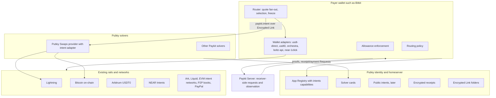
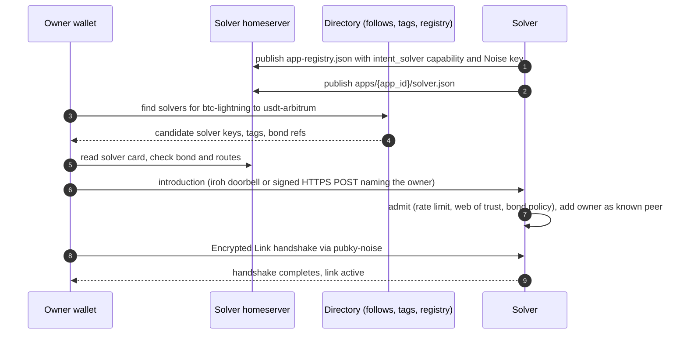
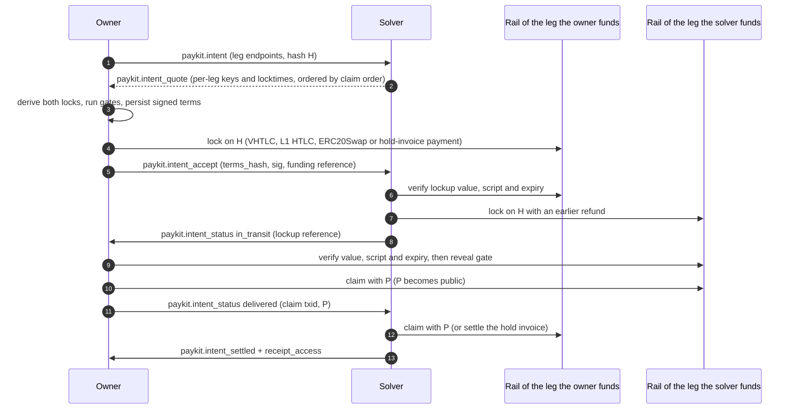
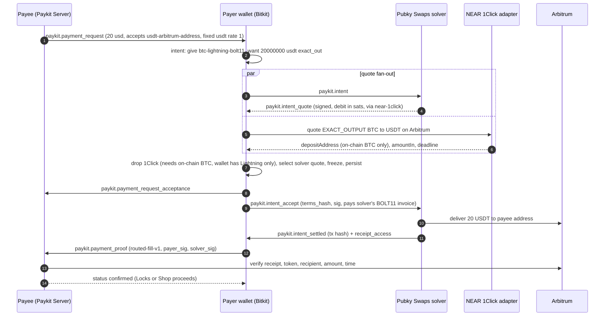
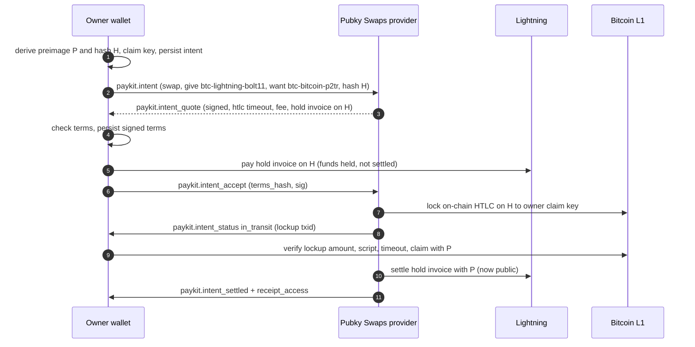
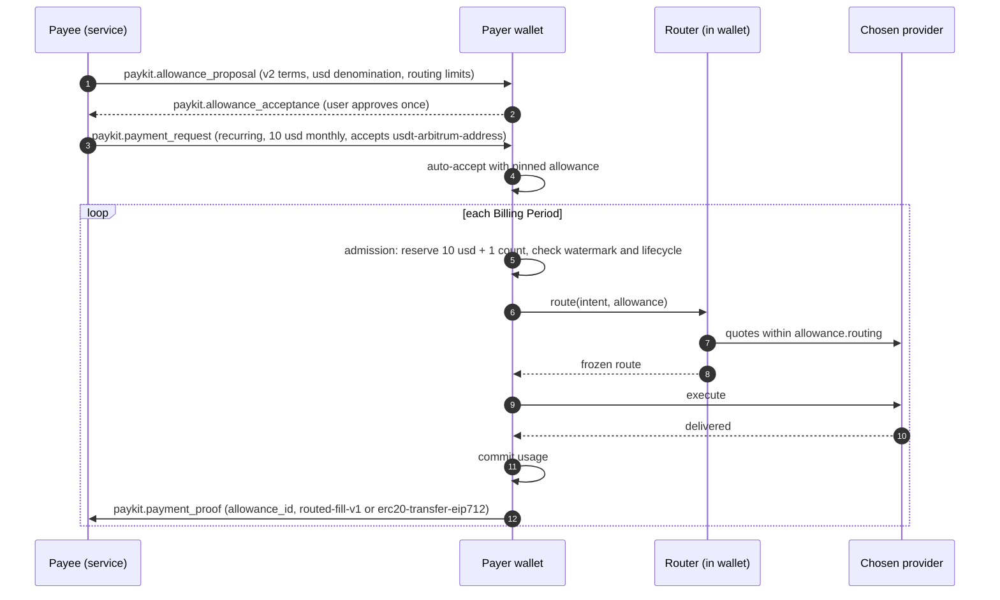
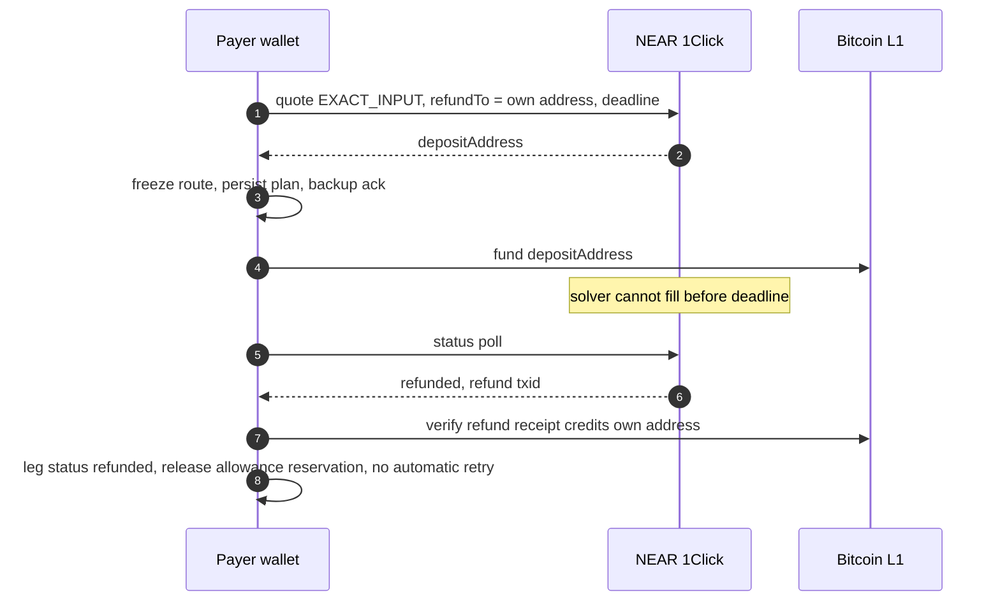
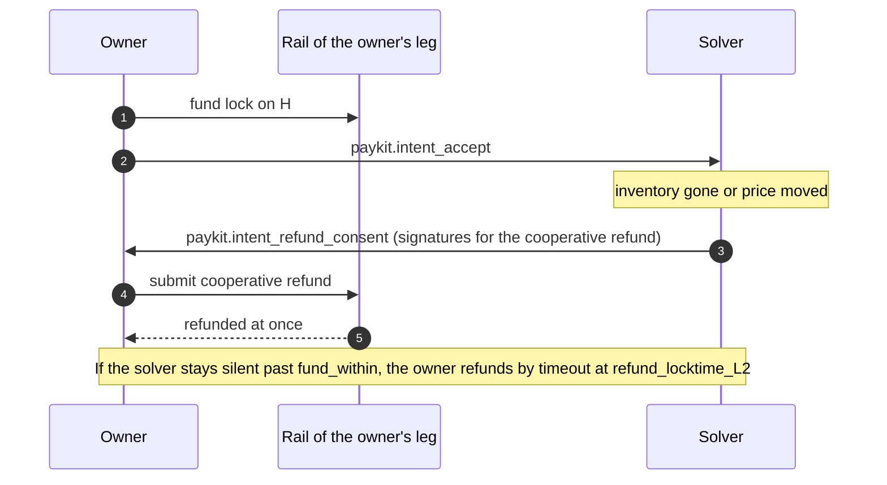
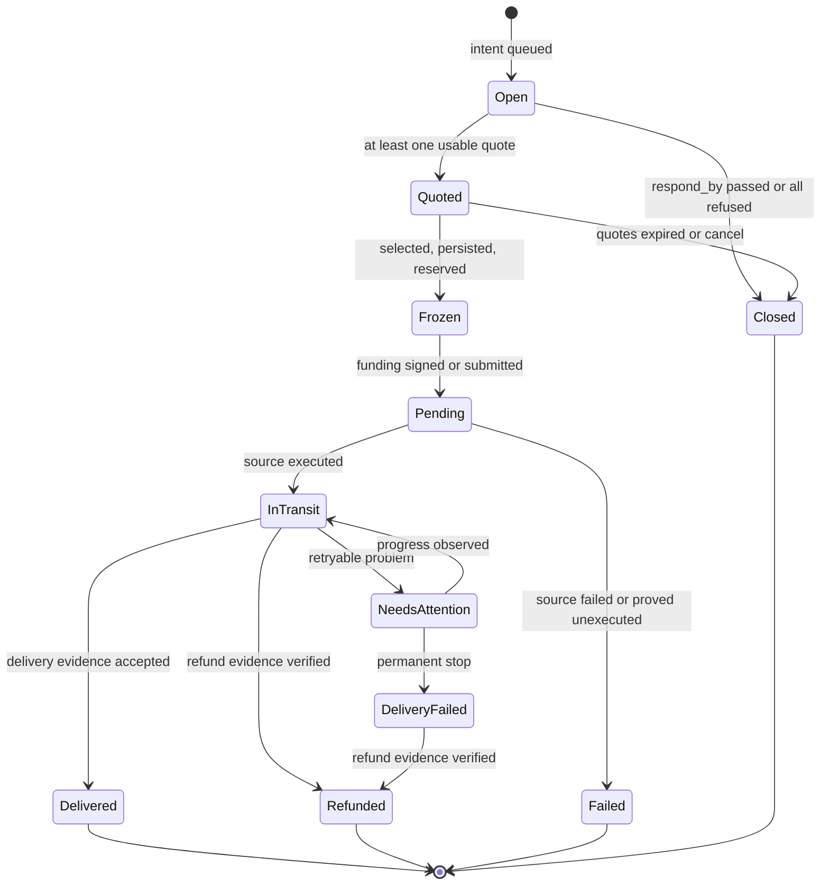

# Paykit Intents: matching, allowances and routing over existing rails

A proposal to the Pubky and Synonym teams. Author: John Carvalho. Status: draft for feedback, 19 October 2026.

This document proposes how Paykit can become a dynamic, intents-like payment layer that matches, authorizes and routes payments over the rails and swap networks that already exist. It is grounded in the current code of Paykit, Paykit Server, Locks, Pubky Swaps and Bitkit, cited by repository, commit and line. Sources are [R1]–[R70] at the end (R33 is unused). Anything not confirmed in source is marked **assumption, verify**. Feedback is welcome on every section, especially the open questions in §16.

## Current state

1. Status: design draft for review. No code exists yet for intents, solver quotes, routed allowances or the router.
2. Shape: Paykit becomes the identity, discovery and coordination layer. Existing rails and swap networks move the money through adapters; Paykit adds no settlement code.
3. Template: Bitkit's shipped USDT stack (bitkit-core `modules/usdt`, in Bitkit Android and iOS since 15 Oct) already routes one payment across three paths: direct Arbitrum, USDT0/LayerZero and Orchestra. Its quote, selection and failure rules become the adapter interface (§5).
4. v1 cut: directed Paykit intents (RFQ over Encrypted Links), Pubky Swaps as the native solver, Lightning swaps through a Boltz-API adapter, the existing USDT adapters, and NEAR Intents 1Click as the one external intent network (§13).
5. Gap: the ERC-20 proof profile requires the payer to be the token sender, so a payment delivered by a solver cannot be proven today. A `routed-fill-v1` proof profile is proposed (§6.8).
6. Constraint: Allowances V1 cannot authorize cross-asset repricing. Automatic routed payments need Allowance terms V2 (§9), planned for Phase 2.
7. External status: Boltz swaps have been suspended since 3 Aug 2026; Liquid peg-outs have been suspended since the 6 Sep exploit; ERC-7683 was rewritten in May 2026 to a resolver model.
8. Ark is one optional rail among many; its profile is specified in Appendix A.
9. Owners are not assigned; every build item in §14 carries an owner question.
10. Open questions for reviewers are in §16.

---

## What we're building and why

Today a Pubky user can publish where they can be paid, send a payment request, and grant a contact an allowance to auto-pay requests. What they cannot do is say "I want this outcome" and let the network find the best way to make it happen.

We want Paykit to handle that. A person, shop or app publishes a signed **intent**, for example "pay this invoice of $20, from any of my balances, within 0.5% cost, in the next ten minutes" or "swap 100,000 sats for USDT". Solvers compete to fill it. A solver can be a Pubky Swaps maker, a Lightning swap service, a cross-chain intent network such as NEAR Intents, or the wallet's own built-in routes. The user's wallet picks the best quote under rules it controls, pays, and keeps a receipt.

We are not building a new exchange or a new swap protocol. Pubky Swaps, Lightning swaps, USDT bridges, intent networks and P2P order books already exist and already work. What they lack is a shared identity, a shared way to find each other, a signed record of what was agreed, and spending permissions that work across all of them. Pubky identities and Paykit already provide exactly those parts. So Paykit becomes the layer that composes the existing rails, and each rail plugs in through a small adapter.

Bitkit has already done this once, for USDT: one "send" chooses between a direct Arbitrum payment, the USDT0 bridge and the Orchestra bridge by comparing quotes, then tracks delivery and refunds. This proposal takes that working design and makes it general.

---

## 1. Goals and non-goals

### 1.1 Goals

- **G1. Intents.** A payer or swapper publishes what it wants (pay X in any acceptable asset and rail, or swap A for B) with limits and an expiry, signed by its Pubky identity.
- **G2. Matching.** Solvers discover intents (directed first, public later), answer with signed binding quotes, and compete under rules that are explicit and checkable.
- **G3. Allowances.** Pre-authorized, scoped, revocable spending permissions extend from today's same-asset Allowances to routed, cross-asset payments, enforced by the payer's wallet and receipted.
- **G4. Routing.** The wallet picks rails, assets and hops per payment under a deterministic policy. Each route declares its atomicity (hash lock, point lock, escrow, provider-trusted, fiat-attested), its failure path and its refund path.
- **G5. Reuse.** Everything uses existing Paykit objects (Encrypted Links, Event Messages, Payment Requests, Proofs, Receipts, Allowances, App Registry) and existing rail protocols. New objects are added only where no existing object fits.
- **G6. Evidence.** Every fill ends in evidence that both parties, and a Locks verifier, can check: a chain receipt, a preimage, a provider-signed delivery, or a fiat postback.

### 1.2 Non-goals

- No new settlement protocol, bridge, chain or token. No custody by Paykit, Paykit Server or Pubky.
- No global order book in v1. Public intents are a later phase (§8.3).
- No requirement for any single rail. Ark, for example, is optional (Appendix A).
- No automatic paid retry after an ambiguous failure, on any rail. This is Bitkit's existing USDT rule [R18 L75, L127].
- No Paykit-side price oracle. Rates come from quotes; Paykit only carries and checks them, as it does today [R5].
- No multi-party mixing, credit networks or streaming in v1. The Atomicity credit design is a possible later rail (§3.8).

---

## 2. What exists (grounding)

Code was read at these commits: paykit-rs `dd8e75e`, paykit-server `525a623`, locks `ac8e893`, pubky-locks `eec374b`, pubky-shop-sdk `1581169`, pubky-swap `f525108`, pubky-swap-boltz (default branch, 10 Sep), bitkit-core `887a9b6` (16 Oct), bitkit-android `402aecb` (18 Oct), atomicity `1cb26de`, pubky-marketplace-service `971fb09`.

### 2.1 Paykit protocol

- Paykit is "the discovery and exchange layer". `paykit-lib` does not execute payments or choose the final endpoint; wallets own selection, execution and settlement detection [R1 L20-25, L260-272].
- Public data lives at `/pub/paykit/v0/app-registry.json` and `/pub/paykit/v0/apps/{app_id}/endpoints/{payment_endpoint_identifier}` [R1 L53-64].
- The App Registry is closed-world JSON with per-app `capabilities` (`private_payments`, `payment_requests`, `receipts`, `outgoing_payments`), a Noise key, and endpoint defaults; it is limited to 64 KiB and 64 apps [R3 L617-645]. Adding a capability is a spec change.
- Private messages are Event Messages over `pubky-noise` Encrypted Links: closed-world JSON, `event_id` dedupe, FIFO per direction, and **at most 1,000 bytes** each [R4 L56-95].
- Encrypted Link setup requires the peer's signed Noise key authorization, and a responder cannot observe unknown initiators: the pubky-chat admission spec says an `open` policy "requires a transport that can observe unknown inbound initiators" [R3; R70].
- The SDK retains at most 4,096 private stream items per counterparty until the local side chooses to engage, which bounds intake from strangers [R3 L355-362].
- Payment Requests are payee-initiated, immutable terms with `accepted_payment_endpoint_identifiers`, optional fixed `payment_endpoints`, `required_app_id` and opaque `metadata` (destinations must not go in metadata) [R2 L168-224].
- Payment Proofs carry an opaque method-specific `proof` object and optional `allowance_id` and `conversion_quote_id` [R2 L454-528].
- Conversion terms carry exact-decimal rates per asset or asset-rail, rounded up per endpoint; Paykit never fetches a rate [R5 L8-91].
- Receipts are encrypted, stored on the issuer's homeserver, and shared with Receipt Access messages that carry location and key [R1 L222-237; R2 L669-722].
- Endpoint identifiers follow `{asset}-{rail}-{format}`, for example `btc-lightning-bolt11` and `usdt-arbitrum-address` [R6; R31 L572].

### 2.2 Allowances V1

- An Allowance is private, scoped authority from an Allower to an Allowee, bound to exactly the two identities on one Encrypted Link. It lets the Allower's wallet auto-handle qualifying Payment Requests from the Allowee [R4 L6-54].
- Terms are immutable: asset, per-payment range, period limits (anchored or rolling), lifetime limit, active window, expiry, endpoint allowlist. Every rule is conjunctive, and at least one monetary ceiling or expiry is required [R4 L99-182].
- Lifecycle is proposal, acceptance or rejection, and end; End is unilateral and terminal [R4 L257-379].
- Enforcement is wallet-side: durable reservations before any irreversible step, an evaluation-time watermark that clock rollback cannot reopen, and one durable admission path shared by automatic and manual payments [R4 L564-636, L696-733].
- **Constraint:** "Explicitly priced endpoints require manual payment approval. Allowances account in the requested asset and amount and cannot authorize repricing." [R5 L67-69]. A routed cross-asset payment is therefore outside V1 authority.
- Bitkit sets `allowanceId = null` on proofs today [R32 L1167], and an open Bitkit PR adds one-tap initial USDT subscriptions limited to same-asset or explicit 1:1 terms, with "automatic recurring payments … out of scope" [R34].

### 2.3 ERC-20 proof profile

- `erc20-transfer-eip712` binds a transfer to a request with an EIP-712 signature. The verifier recovers the signer and requires it to "equal the Transfer event's sender" [R7 L111-116].
- Consequence: when a solver or bridge delivers the funds, the Transfer sender is the solver, so the payer cannot produce this proof. Routed payments need a new profile (§6.8).

### 2.4 Paykit Server

- A receiver-side service: it creates Payment Requests for Locks invoices and Marketplace orders, derives addresses from the seller's xpub, observes Bitcoin through BDK Electrum, and verifies USDT0 on Arbitrum via ERC-20 proofs. It never spends funds [R8 L3, L45-48].
- It already prices one request across rails: Marketplace prepare offers every asset the seller has set up (BTC from the xpub, the shared USDT address), freezes a BTC/USD rate, and reports per-rail `bitcoin` and `usdt_arbitrum` observations [R8 L100-196].
- It states "no bridging or asset swaps" and "Paykit Receipt issuance … unsupported" [R8 L605, L659].
- Signed routes use `paykit-http-signature-v1` over method, path and body with an Ed25519 allowlist [R8 L75-79, L207].

### 2.5 Locks

- `pubky/pubky-locks` is a design document (May 2026): LockPolicy, ProofBundle and UnlockGrant objects, JCS canonical signing with domain strings, and grant profiles (Biscuit or UCAN) for delegation in a later phase [R9 L13-24, L258-285].
- The implementation is `pubky/locks` (0.1.0). It separates durable **entitlements** (a verified proof bundle under the creator's Locks path; revocation is deletion) from short-lived **access credentials** [R10].
- The Locks–Paykit boundary: Locks decides access; Paykit Server owns payment requests, assets and observation; Locks stores no wallet state [R11 L17-20]. The `paykit-payment` criterion carries `recipient_pubky`, `amount`, `asset` and `payment_in` [R11 L24-40].
- Lock Servers obtain creator authority through the Pubky grant flow (`PubkyGrantAuthFlow`, scoped `/pub/app.locks/:rw` and `/priv/app.locks/:rw`, per-flow proof-of-possession key) [R12 L237-243]. This is the "Locks grant" relevant to allowances (§9.5).

### 2.6 Pubky Swaps

- A self-hosted, decentralized Lightning swap marketplace. Its wire family is `SwapOffer`, `QuoteRequest`, `Quote`, `SwapRequest`, `SwapAccept`, status messages, `CoopSignature` and `Reject`, versioned with `PROTOCOL_VERSION = 1` [R13 L21, L103, L119-390].
- Offers carry `min/max_amount_sat`, `base_fee_sat`, `fee_ppm`, `required_confirmations`, `htlc_timeout_blocks`, `onchain_fee_sat`, `valid_until_unix` and `features` [R13 L119-165]. Quotes are bound to the authenticated requester, not to a self-declared field [R13 L222-245].
- Contracts are P2WSH or Boltz-compatible Taproot; cooperative signing is reserved, not implemented [R14].
- Transport is Pubky DMs with durable outbox and receipt journals, preferring iroh `pubky-swap/direct/1` for live negotiation; swap state never depends on which transport carried a message [R68].
- A provider cannot hear from a pubky it does not follow, because private-message paths are not enumerable; the fix is an iroh "doorbell" [R69]. Offer publishing and discovery (roadmap Phase 6) is not done [R15 L118].
- `pubky-swap-boltz` is a localhost proxy that lets the Boltz SDK negotiate with a Pubky Swap provider over encrypted Pubky messages: BTC submarine and reverse swaps, durable replay, Taproot validation [R16].

### 2.7 Bitkit USDT: the first multi-provider adapter

Bitkit's USDT stack is the template for §5. It was written by `ben-kaufman` in bitkit-core #157, #158, #163, #165, #167, #168, #169 and #172, and shipped in the apps by bitkit-android #1432 and bitkit-ios #884 (both merged 15 Oct) [R17; R35].

- **One settlement asset, many delivery paths.** The wallet holds USDT0 on Arbitrum One (chain 42161) and pays fees in USDT through an ERC-20 paymaster and EIP-7702 [R18 L1-9]. Outbound, it can pay directly on Arbitrum, bridge through USDT0 (LayerZero OFT) to Ethereum, Polygon, Plasma or Stable, or route through Orchestra to Ethereum, Polygon, Plasma, Base, BNB Chain, Solana or Tron [R18 L57; R19 L10-79].
- **Provider abstraction.** It is not a trait. A closed enum `UsdtBridgeProvider { Usdt0, Orchestra }` is stamped into each quote, absent for a direct payment [R19 L90-100, L123-126]. Orchestra is an HTTP client behind an optional `bridge_url` [R20 L12-15, L62-68; R21 L50, L85-87].
- **Capabilities.** `orchestra_destinations()` returns enabled routes from the companion service; USDT0 destinations come from app configuration [R21 L137-143; R20 L70-81].
- **Quote.** `UsdtQuote { bridge_provider, id, recipient, destination, amount, received_amount, maximum_fee, expires_at }` [R19 L90-100]. Local quotes last at most 120 s [R21 L31; R18 L17]. Orchestra quotes are exact-input with a single-use funding address and a signed tracking ticket [R18 L123-125].
- **Quote validation.** Core rejects an Orchestra quote whose ID or ticket is empty or oversized, whose `received_amount` is zero or exceeds the principal, which expires within 10 s, or whose funding address is the owner, the token, the OFT, the helper, the EntryPoint, the delegate or the paymaster [R20 L106-127].
- **Selection.** Candidates are quoted concurrently (`tokio::join!`); a candidate expiring within 5 s is dropped; an unavailable provider does not disqualify another; the winner has the highest `received_amount / (amount + maximum_fee)`, compared by integer cross-multiplication; a tie keeps USDT0 [R21 L350-404, L1397-1411; R18 L121].
- **Freezing.** "Provider selection is frozen in the quote; send and recovery never choose another route." [R18 L121]. The plan (calls, Orchestra plan, nonce, expiry) is saved with the quote [R21 L522-588].
- **Persist before submit.** Signed operations persist atomically before submission, and a remote encrypted backup must be acknowledged first. "A quote ID cannot authorize a second payment." Only one pending payment at a time [R18 L29-31; R21 L346].
- **Error taxonomy.** Provider errors map to a closed set: `BridgeAmountTooSmall`, `BridgeAmountBelowMinimum {min_usd_cents}`, `BridgeAmountAboveMaximum {max_usd_cents}`, `BridgeLiquidityUnavailable`, `InvalidAddress`, `UnsupportedRoute`, `QuoteExpired`, `NetworkUnavailable`, `RateLimited`, `InvalidResponse` [R22 L13-20, L33-42, L56-59; R20 L157-182].
- **Status vocabulary.** `Pending`, `Confirmed`, `Failed`, `Bridging`, `BridgeNeedsAttention`, `BridgeFailed` ("does not imply a refund"), `BridgeRefunded` ("source-chain receipt proves USDT was returned"), `Replaced` [R19 L103-120]. Orchestra delivery maps `bridging`, `needs_attention`, `completed` and `refunded`; anything else is `InvalidResponse` [R21 L873-906].
- **Trust labels.** Orchestra delivery is trusted from the provider. A refund is accepted only with a canonical Arbitrum receipt crediting at least that amount, and one refund transaction settles at most one payment [R18 L67-69; R21 L889-903]. LayerZero delivery is read from LayerZero Scan via the companion service [R18 L73-75].
- **No paid retry.** "Never start another payment based on a timeout or expired quote"; no status "triggers an automatic paid retry or refund" [R18 L75, L127].
- **Privacy cost of competition.** "Quoting shares the source account, destination address, network and amount with Orchestra even when USDT0 is ultimately selected." [R18 L129].
- **Inbound.** `UsdtDepositClient` registers reusable Orchestra deposit addresses on six source chains that forward to the Arbitrum account; refunds need a user-approved source address [R18 L105-117].
- **Companion service.** `bitkit-usdt-service` holds the Orchestra key and proxies chain, bundler and LayerZero lookups [R18 L55, L105, L117]. The repository is not publicly readable: **assumption, verify** its API beyond what core calls.

### 2.8 Bitkit Boltz module

- bitkit-core already integrates Boltz submarine and reverse swaps through the `boltz-client` crate, with seed-derived keys (`m/26589'/0'/0'/{index}`), auto-claim on confirmation, manual submarine refunds, idempotent claim and refund, and a typed lifecycle [R23].
- The client is built with `BoltzApiClientV2::default(network)` [R24 L11-12], so the endpoint is the Boltz default. Pointing it at another Boltz-API provider (pubky-swap-boltz, a self-hosted boltz-backend) needs a base-URL parameter. Whether pubky-swap-boltz, written against the Go client v2.12.5, accepts the Rust crate's calls is an **assumption, verify** [R16].

### 2.9 Fiat today

- PayPal runs in pubky-marketplace-service, not Paykit: a hosted `_xclick` checkout and a postback-verified IPN that pays the order only when receiver, currency, amount and order id match; refunds and reversals are recorded, never initiated [R25; R26]. This is the "fiat-attested" atomicity class in §10.2.

### 2.10 Atomicity (credit design)

- `pubky/atomicity` describes a bounded-trust credit routing protocol whose "settlement is external (via Paykit, LN, on-chain, fiat, or contracts)", with capacity vouchers, FinalizeReceipts, auto-revert, short-lived RoutingOffers, and "Windowed Micro-Intents" [R27 L5-16, L37-99, L184-198]. It informs the intent expiry and finalize-or-revert rules here; it is not part of v1.

### 2.11 Shop SDK

- pubky-shop-sdk is inventory-only: listings carry a price and an ISO 4217 currency; it has no payment code [R28 L184, L718]. The Shop's payments run through marketplace-service and Paykit Server. Intents reach the Shop through Payment Requests (§11.1), not through the SDK.

---

## 3. Survey of existing intent, swap and exchange paths

Each row says what the system standardises, what Paykit can reuse unchanged, and the adapter shape. "Atomicity" uses the classes in §10.2.

### 3.1 Summary table

| Path | What it standardises | Reuse as-is | Adapter shape | Atomicity | v1? |
|---|---|---|---|---|---|
| **Pubky Swaps** [R13-R16] | Offer, RFQ quote, swap accept, status over Pubky DMs or iroh; LN ↔ on-chain | Engine, recovery, exposure limits, Taproot contracts | Native solver: maps `paykit.intent` ↔ `QuoteRequest`/`Quote` (§5.6) | hash | **Yes** |
| **Boltz API** (Boltz, pubky-swap-boltz, self-hosted boltz-backend, possibly Blockstream Swaps) | REST v2 + WebSocket for submarine, reverse and chain swaps | bitkit-core Boltz module [R23]; pubky-swap-boltz proxy [R16] | Wallet adapter with configurable base URL | hash | **Yes** |
| **Lightning Loop** (Lightning Labs) | Loop In/Out via `loopd` gRPC against LND | Nothing in Bitkit (Bitkit runs LDK Node, not LND [R23]) | Server-side adapter only, for LND-based solvers | hash | No |
| **BOLT12 offers, LNURL-pay, Lightning Address** | Reusable payee endpoints | Already Paykit endpoints (`btc-lightning-bolt12`, `btc-lightning-lnurl`) [R1 L497-502; R31 L573-574] | Destination formats, not solvers | n/a (rail) | Yes, as destinations |
| **USDT0 (LayerZero OFT)** | Cross-chain USDT burn/mint messaging | bitkit-core bridge path [R18 L57-65] | Existing provider; becomes `usdt0` adapter | provider-trusted (protocol) | **Yes** (shipped) |
| **Orchestra** (Flashnet) | Quote, single-use funding address, tracking ticket, deposit addresses | bitkit-core client [R20] | Existing provider; becomes `orchestra` adapter | provider-trusted | **Yes** (shipped) |
| **NEAR Intents 1Click** | REST: quote → deposit address → swap → refund to `refundTo` at `deadline`; market makers compete [R29; R30] | Its API as-is; same shape as Orchestra | Wallet adapter (`near-1click`) | provider-trusted (**assumption, verify** custody of deposit addresses) | **Yes** (one external network) |
| **ERC-7683** [R36] | Draft (rewritten May 2026): a resolver turns a protocol payload into steps, variables, payments and named assumptions for solvers | Its resolved-order model as the mapping target for EVM legs | Mapping layer (§7), not a network | depends on resolver | Mapping only |
| **Across** | Cross-chain bridge with relayers; implemented the earlier 7683 draft (**assumption, verify** current version) | — | EVM-leg adapter | provider-trusted (optimistic) | Later |
| **UniswapX** | Signed Dutch-auction orders, Permit2, fillers (**assumption, verify**) | — | EVM leg via the 7683 mapping | atomic on one chain | Later |
| **CoW Protocol** | Signed orders settled in batch auctions by solvers (**assumption, verify**) | — | EVM leg adapter | atomic on one chain | Later |
| **1inch Fusion / Fusion+** | Dutch auctions with resolvers; Fusion+ uses hashlocked escrows across chains (**assumption, verify**) | Fusion+ hashlock matches the hash profile | Hash-profile leg adapter | hash (Fusion+) | Later |
| **THORChain** | Native-asset swaps via vaults and memo transactions; quote endpoint (**assumption, verify**) | — | Wallet adapter: quote, send with memo | provider-trusted (validator vaults) | Later |
| **Arkade Intents** | RFQ quote-first protocol with solvers, corridor swaps and Nostr transport [R43; R44] | Contract rules and refusal reasons (Appendix A) | Ark-leg adapter (Appendix A) | hash (VHTLC) | Later |
| **Ark, Spark, Liquid** | L2 transfers; Ark VHTLC (Appendix A); Spark statechains (**assumption, verify**); Liquid L-BTC and Liquid USDT | — | Rail adapters | per rail | Later |
| **RoboSats** | P2P BTC/fiat with Lightning hold-invoice escrow and bonds, over Tor (**assumption, verify**) | NIP-69 order format | Order-book adapter (read) + deep link | escrow | Later |
| **Bisq** | P2P with 2-of-2 multisig deposits (Bisq 1) and Bisq Easy (Bisq 2) (**assumption, verify**) | NIP-69 if published there | Order-book adapter | escrow | Later |
| **Nostr NIP-69** [R37] | Kind 38383 P2P order events: side, fiat code, amounts, payment methods, premium, bond, layer, expiry | Field set for public intents (§8.3) | Bridge: Paykit public intent ↔ NIP-69 event | n/a (orders) | Later |
| **PayPal** | Hosted checkout + IPN postback | marketplace-service implementation [R25; R26] | Fiat-attested adapter | fiat-attested | Later |

### 3.2 Pubky Swaps

The native solver. It already does RFQ, binds quotes to authenticated requesters and runs a durable swap engine with fee-bumping, exposure limits and a status API. What it lacks for intents is a Paykit-facing transport and published offers. The intent adapter is a translation layer in the provider daemon (§5.6), not a rewrite.

### 3.3 Lightning swaps (Boltz API family)

The Boltz REST v2 API is the de facto client interface for submarine and reverse swaps, and bitkit-core already speaks it [R23]. Boltz itself suspended swaps on 3 Aug 2026 and, as of mid-October, has not resumed; ownership passed to an unnamed group [R38; R39]. Blockstream launched a beta "Blockstream Swaps" for Bitcoin, Lightning and Liquid on 10 Aug [R40]; whether its API is Boltz-compatible is an **assumption, verify**. The adapter therefore targets the API, not the company: a configurable base URL lets the same code reach a Pubky Swap provider through pubky-swap-boltz, a self-hosted boltz-backend, or Boltz when it returns.

### 3.4 USDT rails

USDT0 on Arbitrum is Bitkit's settlement rail; USDT0 and Orchestra are delivery providers (§2.7). Liquid USDT exists, but Liquid L-BTC peg-outs have been suspended since a 6 Sep 2026 consensus-bug exploit left the reserve about 602 BTC short; Liquid-issued USDT was reported unaffected [R41; R42]. Liquid stays out of v1.

### 3.5 Cross-chain intent networks

- **NEAR Intents 1Click** quotes `EXACT_INPUT`, `EXACT_OUTPUT`, `FLEX_INPUT` or `ANY_INPUT` swaps, returns a quote-specific `depositAddress`, and refunds to `refundTo` if the swap is not completed by `deadline`. Bitcoin (all address types) and Arbitrum are supported chains; amounts are base-unit integer strings [R29; R30]. This is the same shape as Orchestra in bitkit-core: quote, single-use funding address, delivery tracking, refund. It covers the most useful missing route for Bitkit, BTC ↔ USDT on Arbitrum, both directions. Custody of deposit addresses and solver trust are **assumption, verify**.
- **ERC-7683** is a draft. Its May 2026 revision dropped the earlier `OnchainCrossChainOrder`/`GaslessCrossChainOrder` structs and `maxSpent`/`minReceived` in favour of resolvers that return steps, variables, payments and named assumptions [R36 L14-30, L281-305, L421-441]. It is a mapping target for EVM legs (§7), not a network to join.
- **UniswapX, CoW, 1inch Fusion, Across** are EVM-native. They matter if Paykit users hold EVM assets beyond USDT0 on Arbitrum. They are Phase 3.
- **THORChain** offers native BTC swaps without wrapping; it is a candidate second external network (§16, question 2).

### 3.6 P2P exchange order books

RoboSats and Bisq handle BTC ↔ fiat with escrow and bonds. NIP-69 is the most useful thing here for Paykit: a flat, widely published order schema whose fields (side, fiat code, amount range, payment methods, premium, bond, layer, expiry) map cleanly onto a public Paykit swap intent [R37]. A Paykit public intent can be mirrored as a NIP-69 event, and NIP-69 orders can be shown as candidate routes. Settlement still happens on the originating platform.

### 3.7 Fiat

PayPal stays a marketplace-service rail with IPN attestation. In the intent model it is a route with atomicity class `fiat_attested`: no lock, a provider postback as evidence, and reversals possible after the fact (§10.2).

### 3.8 Atomicity credit (later)

Atomicity's capacity vouchers with finalize-or-revert are a bounded-trust route class. If built, they plug in as a rail adapter with atomicity class `credit_bounded`.

---

## 4. Architecture

### 4.1 Layers



There are two ways a quote reaches the router, and both produce the same internal `RouteQuote` (§5.2):

1. **Wallet adapters** call a provider API directly from the wallet (or through its companion service). This is how bitkit-core works today for USDT0, Orchestra and Boltz.
2. **Paykit solvers** are Pubky identities that receive a `paykit.intent` over an Encrypted Link and answer with a signed `paykit.intent_quote`. A solver may use any external network internally; the payer sees only the signed quote and its declared atomicity and trust.

### 4.2 Where things live

| Component | Holds | Does not hold |
|---|---|---|
| **Homeserver** (owner's) | App Registry with new capabilities; solver cards; public intents (later); encrypted receipts and fill records; Encrypted Link folders; SDK shared state | Keys, quotes in flight, provider tickets |
| **Paykit SDK** (in wallet and server) | Intent, quote and fill records derived from the event stream; Allowance lifecycle and usage ledger; outbound queue | Payment execution |
| **Wallet (Bitkit, via bitkit-core)** | Routing policy; adapter clients; signing; persisted route plans; allowance admission and reservations; backups | Provider API secrets (the companion service holds them) |
| **Companion service** (`bitkit-usdt-service` today) | Provider API keys (Orchestra, NEAR 1Click), chain and bundler proxies, delivery lookups | User keys |
| **Paykit Server** | Receiver-side requests for Locks and Shop; per-rail observation; routed-fill proof verification (new) | Spending, routing, solver logic |
| **Solver daemon** (Pubky Swaps provider) | Inventory, swap engine, quote signing key, its own Paykit identity and Encrypted Links | Payer keys |
| **Locks** | Entitlements and access decisions from Paykit Server's observation | Payment or routing state |

---

## 5. Adapter and solver interface (generalised from Bitkit USDT)

This section generalises bitkit-core `modules/usdt` [R18-R22]. Each rule names the Bitkit behaviour it comes from. The interface lives in bitkit-core (wallet adapters) and in `paykit-lib` as types only (solver messages); `paykit-lib` still executes nothing.

### 5.1 Provider descriptor

Bitkit hard-codes `Usdt0` and `Orchestra` in an enum [R19 L123-126]. The general form is a descriptor plus a small trait, so new providers don't widen a closed enum on every release.

```rust
pub struct ProviderDescriptor {
    pub id: ProviderId,                // "usdt-direct", "usdt0", "orchestra", "boltz-api:<host>", "near-1click", "pubky:<solver key>"
    pub kind: ProviderKind,            // WalletAdapter | PaykitSolver
    pub atomicity: Atomicity,          // Hash | Point | Escrow | ProviderTrusted | FiatAttested | CreditBounded
    pub trust: TrustLabel,             // what is trusted for delivery and for refund (§12.4)
    pub preference_rank: u8,           // tie-break order; native Pubky first (§10.1)
}

#[async_trait]
pub trait RouteProvider {
    fn descriptor(&self) -> &ProviderDescriptor;
    /// Bitkit: orchestra_destinations() / UsdtDepositClient::networks()
    async fn capabilities(&self) -> Result<Vec<LegCapability>, RouteError>;
    /// Bitkit: Orchestra::quote + prepare_quote
    async fn quote(&self, leg: &LegRequest) -> Result<ProviderQuote, RouteError>;
    /// Bitkit: the funding-address and bounds checks in Orchestra::quote
    fn validate(&self, leg: &LegRequest, quote: &ProviderQuote) -> Result<(), RouteError>;
    /// Bitkit: Orchestra::status + bridge_delivery mapping
    async fn status(&self, plan: &FrozenPlan, evidence: &SourceEvidence) -> Result<LegStatus, RouteError>;
    /// Bitkit: verify_refund against a canonical source-chain receipt
    async fn verify_refund(&self, plan: &FrozenPlan, claim: &RefundClaim) -> Result<VerifiedRefund, RouteError>;
}
```

The Bitkit counterparts are at [R21 L137-143], [R20 L83-138], [R21 L522-588], [R20 L106-127], [R20 L140-151], [R21 L842-907] and [R21 L910].

`LegCapability` is `(from_endpoint_id, to_endpoint_id, min, max, side)` where side is `exact_in`, `exact_out` or both. Endpoint identifiers are Paykit identifiers, so `usdt-arbitrum-address → usdt-polygon-address` is the USDT0 Polygon route and `btc-bitcoin-p2wpkh → usdt-arbitrum-address` is a 1Click route.

### 5.2 Quote and route records

Bitkit's `UsdtQuote` [R19 L90-100] becomes `ProviderQuote` (one leg) and `RouteQuote` (one or two legs, frozen together).

| Bitkit field | General field | Rule |
|---|---|---|
| `bridge_provider` | `provider_id` | Fixed at approval; never changed by send or recovery [R18 L121] |
| `id` | `quote_id` (UUIDv4) | Single use: "A quote ID cannot authorize a second payment" [R18 L29] |
| `amount` | `debit_amount` (source principal) | Integer base units of the source asset |
| `received_amount` | `credit_estimate` and `credit_min` | Exact-input quotes give an estimate; exact-output quotes give a floor. Orchestra's is "an estimate, not a guaranteed exact output" [R18 L123] |
| `maximum_fee` | `max_fee` | All fees in the source asset, including network fee; signing cannot raise it [R18 L17] |
| `expires_at` | `expires_at` | Local quotes ≤120 s [R21 L31]; dropped if within 5 s of expiry at selection [R21 L370-378] |
| (Orchestra `ticket`, `funding_address`) | `plan` (opaque, provider-specific) | Persisted with the signed operation before broadcast [R18 L125] |
| — | `atomicity`, `trust` | Copied from the descriptor; shown to the user |
| — | `refund_path` | `lock_timeout`, `provider_refund_to`, `none` (§10.3) |
| — | `deadline` | Latest submission time; Bitkit `send_with_deadline` [R21 L161] |

### 5.3 Selection

From `quote_payment` and `better_quote` [R21 L332-404, L1397-1411]:

1. Quote every eligible provider concurrently. Eligibility comes from capabilities, the routing policy and the allowance (§10.1).
2. Drop candidates that failed, failed validation, or expire within 5 s. A failure of one provider never disqualifies another.
3. Score by credit per maximum debit: prefer A over B when `credit_A × (debit_B + fee_B) > credit_B × (debit_A + fee_A)`, in 128-bit integers. For cross-asset routes, convert `credit` into the intent's `want` asset only through the quote's own terms, never a market rate.
4. Tie-break by `preference_rank`: Pubky-native solvers, then hash-locked routes, then provider-trusted routes. (Bitkit's tie keeps USDT0 [R21 L1397].)
5. If all fail, return the most specific error. Bitkit returns the direct-path error for USDT0 destinations and the Orchestra error otherwise [R21 L387-396]. Generally, return the error from the highest-ranked provider that supports the route.
6. Freeze the winner: persist the route quote and plan; send and recovery never re-route [R18 L121].

### 5.4 Execution and recovery rules

Each is a rule Bitkit already enforces for USDT; this proposal makes them apply to every adapter.

- **R-persist.** Persist the frozen plan and the signed operation (or swap record) before any irreversible step, and require a backup acknowledgement first [R18 L29-31].
- **R-single-pending.** At most one unresolved route per source account and asset (Bitkit: `require_no_pending` [R21 L346]). Multi-account wallets may parallelise across accounts.
- **R-no-reroute.** A timeout, expired quote or lost response never starts another payment; the original may still execute [R18 L127].
- **R-no-paid-retry.** No status triggers an automatic paid retry or refund [R18 L75].
- **R-chain-authoritative.** Source and destination outcomes come from chain or provider evidence, never from message timing. A relay timeout means unknown, never failed [R18 L37; R55].
- **R-refund-proof.** A provider-reported refund counts only with a canonical source-chain receipt crediting the wallet, and one refund transaction settles at most one payment [R18 L67-69].
- **R-bounded-delivery.** A reported delivery is bounded by the sent principal [R18 L67; R21 L877-880].

### 5.5 Closed error and status vocabularies

Errors (generalising `UsdtError` [R22] and Orchestra's error mapping [R20 L166-178]):

| Code | Meaning | Retry |
|---|---|---|
| `amount_too_small` | Live costs exceed output; no fixed minimum | New quote with larger amount |
| `amount_below_minimum {min}` | Provider minimum, optional bound | Larger amount |
| `amount_above_maximum {max}` | Provider maximum, optional bound | Smaller amount or split (later) |
| `liquidity_unavailable` | Provider lacks liquidity | Later or smaller |
| `unsupported_route` | Provider cannot do this leg | Other provider |
| `invalid_destination` | Destination fails validation | User fix |
| `quote_expired` | Expired before submit | New quote |
| `network_unavailable` | Transport failure | Retry same call (no funds moved) |
| `rate_limited` | Provider throttling | Backoff |
| `invalid_response` | Contract failure | Treat provider as broken for this route |
| `allowance_ineligible` | Route outside allowance (§9) | Manual approval |
| `policy_rejected` | Route outside routing policy | None |

Leg status (generalising `UsdtTransferStatus` [R19 L103-120]):

| Status | Meaning |
|---|---|
| `pending` | Source step signed or submitted; outcome unresolved |
| `failed` | Source step failed or proved unexecuted |
| `replaced` | Another operation consumed the nonce or input |
| `in_transit` | Source executed; delivery unresolved (Bitkit `Bridging`) |
| `needs_attention` | Retryable delivery problem or missing evidence |
| `delivery_failed` | Delivery permanently stopped; does not imply refund (Bitkit `BridgeFailed`) |
| `refunded` | Source-chain evidence shows funds returned |
| `delivered` | Delivery evidence accepted under the route's trust label |

A Paykit solver sends these values in `paykit.intent_status` (§6.5), so the payer UI is the same whichever path filled the intent.

### 5.6 Pubky Swaps as a Paykit solver

The provider daemon gains a Paykit transport adapter that maps:

| Paykit | pubky-swap |
|---|---|
| `paykit.intent` | `QuoteRequest` (direction from legs, `amount_sat`, `client_pkarr` from the authenticated link) [R13 L222-245] |
| `paykit.intent_quote` | `Quote` plus Ed25519 signature over the terms hash (§6.5) [R13 L247-288] |
| `paykit.intent_accept` | `SwapRequest` |
| `paykit.intent_status` | `SwapStatusUpdate` |
| `paykit.intent_refusal` | `Reject` |
| Solver card | `SwapOffer` fields (§6.3) [R13 L119-165] |

The swap state machine, durable store and recovery stay as they are. The hash-lock rules in §10.4 apply to every hash-profile route this solver fills. The provider's iroh transport may carry the same signed payloads for latency; swap state never depends on which transport carried a message [R68].

---

## 6. Data model and record formats

All signed objects use RFC 8785 JCS and domain-separated Ed25519 signatures, the pattern Locks already uses [R9 L258-285]. Private messages are Paykit Event Messages: `version`, `kind`, `app_id`, `event_id`, closed-world, ≤1,000 bytes [R4 L72-84]. Amounts are base-unit integer strings with an explicit asset; Paykit Payment Amounts in Payment Requests stay decimal text as specified [R2 L190-200]. Times are Unix seconds inside intent records and RFC 3339 inside Payment Request terms, matching each family's existing convention. Keys are x-only 32-byte lowercase hex where they appear in scripts; signatures are base64url.

### 6.1 Paths

| Object | Path | Visibility |
|---|---|---|
| App Registry (existing, new capabilities) | `/pub/paykit/v0/app-registry.json` | Public |
| Solver card | `/pub/paykit/v0/apps/{app_id}/solver.json` | Public |
| Public intent (Phase 3) | `/pub/paykit/v0/apps/{app_id}/intents/{intent_id}.json` | Public |
| Intent cancellation (Phase 3) | `/pub/paykit/v0/apps/{app_id}/intents/{intent_id}.cancel.json` | Public |
| Large quote plan blob | Paykit Blob on the solver's homeserver, encrypted, path from SDK blob helpers [R1 L274-278] | Private (location + key in message) |
| Fill record and receipt | Encrypted Receipt at the canonical Receipt Location [R1 L222-229] | Private |
| Fill attestation (optional, Phase 3) | `/pub/paykit/v0/apps/{app_id}/attestations/{terms_hash}.json` | Public |

New App Registry capabilities: `intents` (the app sends or accepts `paykit.intent*` messages) and `intent_solver` (the app answers intents and publishes a solver card). Both need a paykit-rs registry schema change because the registry is closed-world [R3 L617-645].

### 6.2 Intent (`paykit.intent`)

One schema for both modes. `pay` targets a payee; `swap` targets the owner's own destination.

```json
{
  "version": 1,
  "kind": "paykit.intent",
  "app_id": "bitkit",
  "event_id": "4b6a1d0e-6a0c-4f6e-9d43-1f3c2b7a9e10",
  "intent_id": "0f8e2c1a-5b7d-4e9a-8c3f-2d1b6a4e7c90",
  "mode": "pay",
  "give": [
    {"endpoint": "btc-lightning-bolt11", "max": "120000"},
    {"endpoint": "usdt-arbitrum-address", "max": "25000000"}
  ],
  "want": {"asset": "usdt", "amount": "20000000", "side": "exact_out",
           "to": {"payment_request_id": "b7f9c2a1-6d43-4b0e-a8d4-0fe2c712ab33"}},
  "max_cost_bps": 80,
  "atomicity_min": "provider_trusted",
  "valid_until": 1792483200,
  "respond_by": 1792482660
}
```

| Field | Rule |
|---|---|
| `intent_id` | UUIDv4 chosen by the owner; stable across solvers |
| `mode` | `pay` or `swap` |
| `give` | Non-empty list of source endpoints the owner can pay from, each with a ceiling in that asset's base units. Order has no meaning |
| `want.asset`, `want.amount`, `want.side` | Target asset, base-unit amount, `exact_out` (payee must receive exactly) or `exact_in` (spend exactly; for swaps) |
| `want.to` | Exactly one of: `payment_request_id` (pay mode; terms and destination come from that request), `endpoint` (an endpoint identifier the owner will reveal on accept; swap mode), or `pubky` plus `endpoint` (pay a public endpoint) |
| `max_cost_bps` | Ceiling on total cost versus the want amount, in basis points; a quote above it is invalid |
| `atomicity_min` | Weakest acceptable class: `hash`, `point`, `escrow`, `provider_trusted`, `fiat_attested` (ordered strongest to weakest; §10.2) |
| `valid_until` | Intent expiry; after it no accept is valid |
| `respond_by` | The owner stops waiting for quotes; creates no refusal |
| `hash` (optional) | SHA-256 payment hash when the owner holds the preimage (hash-profile swaps, §10.4) |
| `refund_to` (optional) | The owner's refund endpoint reference for provider-trusted legs; revealed on accept if omitted here |

Directed intents travel over the Encrypted Link, which authenticates the sender, so they carry no signature. A public intent (Phase 3) is the same object without `event_id`, plus `owner` and `sig`, signed with domain `paykit/intent/v1`.

The example above measures 514 bytes compact, within the 1,000-byte limit.

### 6.3 Solver card (`paykit.solver_card`)

Generalises pubky-swap's `SwapOffer` [R13 L119-165] and Arkade's solver card (pairs, bounds, indicative fees) [R43]. Public file, no size cap beyond the homeserver's.

```json
{
  "version": 1,
  "kind": "paykit.solver_card",
  "solver_id": "<solver Pubky public key>",
  "valid_until": 1800086400,
  "routes": [
    {"from": "btc-lightning-bolt11", "to": "btc-bitcoin-p2tr", "min": "25000", "max": "5000000",
     "base_fee": "100", "fee_ppm": "2500", "atomicity": "hash", "side": ["exact_in", "exact_out"]},
    {"from": "btc-bitcoin-p2wpkh", "to": "usdt-arbitrum-address", "min": "50000", "max": "2000000",
     "fee_ppm": "6000", "atomicity": "provider_trusted", "via": "near-1click"}
  ],
  "fund_within": 300,
  "intro": [{"type": "iroh", "alpn": "pubky-swap/direct/1"},
            {"type": "https", "url": "https://solver.example/paykit/introductions"}],
  "bond": {"outpoint": "<txid>:<vout>", "locktime": 1830000000, "proof_sig": "<base64url>"},
  "protocol_versions": [1],
  "features": ["intent-v1", "routed-fill-proof-v1", "refund-consent-v1"]
}
```

`via` discloses an external network used internally, so the payer can apply its trust policy. `bond` references a fidelity bond: a time-locked on-chain output proven by a signature from its key over the solver's Pubky key (JoinMarket-style). The card is advisory and reserves nothing.

### 6.4 Quote (`paykit.intent_quote`)

```json
{
  "version": 1, "kind": "paykit.intent_quote", "app_id": "pubky-swap",
  "event_id": "…", "intent_id": "…", "intent_event_id": "…",
  "route": [
    {"from": "btc-lightning-bolt11", "debit": "101300", "to": "usdt-arbitrum-address",
     "credit_min": "20000000", "atomicity": "provider_trusted", "via": "near-1click",
     "refund": "provider_refund_to"}
  ],
  "max_fee": "1300",
  "valid_until": 1792482720,
  "fund_within": 300,
  "plan": {"loc": "/pub/paykit/v0/blobs/…", "key": "…", "sha256": "…"},
  "sig": "base64url-ed25519"
}
```

- `sig` is by the solver's Pubky identity over `terms_hash` (§6.5). `event_id` doubles as `quote_id`, as with Payment Conversion Quotes [R5 L143].
- `plan` is optional indirection for provider details that do not fit 1,000 bytes. An Orchestra tracking ticket alone can be 4,096 bytes [R20 L111]. The blob follows the Receipt pattern: encrypted on the sender's homeserver, location and key in the message, hash committed in `terms_hash`.
- `fund_within` is how long the solver has to fund its side after accept.
- For hash-profile routes, each leg additionally carries the solver's keys and the leg's refund locktime (§10.4); timing values derivable from a rail's own parameters (for example Ark's claim delay) are never quoted.
- Wallet adapters produce the same fields locally without `sig`.

### 6.5 Terms hash, accept, refusal, cancel, status

`terms_hash = sha256("paykit/intent-terms/v1\n" || JCS(terms))`, using RFC 8785 canonical JSON. `terms` contains:

- `intent_id`, the owner's and the solver's Pubky public keys;
- the full intent minus `event_id`;
- the full `route`; for each leg: `from`, `to`, `debit`, `credit_min`, `atomicity`, `via`, `refund`, and for hash or point legs the `lock_profile`, network, sender and receiver keys, sender refund script, amount and `refund_locktime`;
- `max_fee`, `valid_until`, `fund_within`, `hash` when present, and `plan.sha256` when present.

The solver signs `terms_hash` in the quote and the owner signs it in the accept, both with their Pubky identity keys. Signed terms make quotes, refusals and no-shows attributable, which is the basis for reputation (§8.4). Whether to sign with the root Pubky key or with an app signing key that the identity authorizes, following the existing Noise key authorization pattern, is open (§16, question 7).

| Kind | Direction | Body (beyond envelope) | Notes |
|---|---|---|---|
| `paykit.intent_accept` | owner → solver | `quote_id`, `terms_hash`, `sig`, `funding` (outpoint, txid, invoice or deposit reference), optional `reveal` (destination or refund payload) | Funding is the enforceable acceptance; `sig` makes it attributable. The solver verifies funding on the rail itself |
| `paykit.intent_refusal` | solver → owner | `intent_event_id`, `reason` | Reasons: `unsupported_route`, `amount_below_minimum`, `amount_above_maximum`, `liquidity_unavailable`, `pricing_unavailable`, `atomicity_unsupported`, `rate_limited`. An unknown reason is a generic decline |
| `paykit.intent_cancel` | either | `intent_id`, `reason` | Valid only before any funding; after funding only chain or provider evidence counts |
| `paykit.intent_refund_consent` | counterparty → funder of a leg | `leg`, `lockup`, `sigs`, `reason` | Counterparty signatures for a cooperative refund of a derived refund transaction (§10.4) |
| `paykit.intent_status` | either | `intent_id`, `leg`, `status` (§5.5), `evidence` (txid, preimage, provider reference) | Hints only; a timeout means unknown, never failed |
| `paykit.intent_settled` | solver → owner | `intent_id`, `terms_hash`, `delivery` (destination txid or preimage), followed by `paykit.receipt_access` | Settlement notice; the receipt is the durable record |

A two-leg quote with a plan reference measures about 790 bytes compact and an accept about 440 bytes; refusal, cancel and status stay under 400. Quotes with more legs must move detail into the `plan` blob.

### 6.6 Fill record and settlement receipt

Paykit Receipts are the durable settlement record. The solver (or, for wallet adapters, the payer's own wallet) prepares an Encrypted Receipt whose plaintext includes:

```json
{
  "intent_id": "…", "terms_hash": "…", "payment_request_id": "…",
  "legs": [{"from": "btc-lightning-bolt11", "debit": "101300", "source_ref": "<payment hash>",
            "to": "usdt-arbitrum-address", "credit": "20000000", "dest_ref": "0x<tx>",
            "provider": "near-1click", "provider_ref": "<deposit address>", "status": "delivered"}],
  "fees": {"total": "1300"},
  "allowance_id": null
}
```

Receipt issuance is unsupported in Paykit Server today [R8 L605]; it already exists in `paykit-lib` [R1 L475-492]. Wallet-adapter fills write a local receipt to the payer's own encrypted state so history and backups show the route.

### 6.7 Endpoint identifiers

Existing: `btc-lightning-bolt11`, `btc-lightning-bolt12`, `btc-lightning-lnurl`, `btc-bitcoin-p2tr|p2wpkh|p2sh|p2pkh`, `usdt-arbitrum-address` [R31 L572-593].

Proposed for routes (all follow `{asset}-{rail}-{format}` [R6]):

| Identifier | Meaning |
|---|---|
| `usdt-ethereum-address`, `usdt-polygon-address`, `usdt-plasma-address`, `usdt-stable-address`, `usdt-base-address`, `usdt-bsc-address`, `usdt-solana-address`, `usdt-tron-address` | USDT destinations reachable through USDT0 or Orchestra [R19 L10-20] |
| `btc-lightning-hold` | Lightning hold invoice on a hash (Pubky Swaps reverse and submarine legs) |
| `btc-bitcoin-htlc` | L1 P2TR or P2WSH HTLC (Pubky Swaps, Boltz) |
| `btc-ark-vhtlc` | Arkade VHTLC, interactive leaves (Appendix A) |
| `btc-ark-htlc` | Reserved for a future bark user-to-user HTLC policy (Appendix A) |
| `btc-ark-adaptor` | Adaptor-locked Ark out-of-round transfer, point profile (Appendix A) |
| `usdt-arbitrum-htlc` | ERC-20 HTLC, for example Boltz `ERC20Swap`: lock, claim with preimage, refund after timelock [R67] |
| `usd-paypal-checkout` | PayPal hosted checkout (fiat-attested) |

The operator or contract for a rail lives in the solver card's route payload, not in the identifier.

### 6.8 Routed-fill proof profile (`routed-fill-v1`)

Needed because the ERC-20 profile requires the payer to be the token sender [R7 L111-116]. When a solver or provider delivers to the payee:

```json
{
  "type": "routed-fill-v1",
  "terms_hash": "…",
  "solver": "<solver Pubky public key>",
  "delivery": {"endpoint": "usdt-arbitrum-address", "chain_id": "42161",
               "transaction_hash": "0x…", "receipt_log_index": "3"},
  "solver_sig": "base64url-ed25519",
  "payer_sig": "base64url-ed25519"
}
```

- `solver_sig` is the solver's Pubky signature over `("paykit/routed-fill/v1", terms_hash, payment_request_id, payee, delivery)`. It attests "this delivery fills that request for that payer".
- `payer_sig` is the payer's Pubky signature over the same tuple. It binds the payment to the payer even though the payer did not send the delivery transaction.
- The payee verifies the delivery exactly as the ERC-20 profile does (receipt, token, recipient, amount, block time) except signer recovery: it checks both Pubky signatures instead of an EVM signer [R7 L100-125].
- For wallet-adapter routes with no Pubky solver (for example 1Click), `solver` and `solver_sig` are omitted; the payee then relies on the payer's signature plus the chain receipt. This proves that the payer claims the transfer, not that the payer funded it. The payee's policy decides whether that is enough (§16, question 6).
- For Bitcoin and Lightning deliveries, `delivery` carries an outpoint or a preimage; the Lightning case needs no new profile when the payer pays the invoice itself.
- Paykit Server must verify this profile for Locks and Shop orders (§14).

---

## 7. ERC-7683 mapping

ERC-7683 is a draft that standardises the solver-facing view of an order: a resolver decodes a protocol payload into steps (`Call` with attributes `SpendsERC20`, `TimingBounds`, `RevertPolicy`), variables (`PaymentRecipient`, `PaymentChain`, `Witness`, `Query`, …), payments (`ERC20` with `onStepIdx` and `estimatedDelaySeconds`) and named assumptions [R36 L44-252, L281-305].

### 7.1 Paykit intent → resolved order (outbound, EVM legs only)

| Paykit | ERC-7683 resolved order |
|---|---|
| `want` on an EVM endpoint (`usdt-arbitrum-address`) | Step `Call` to the token's `transfer` to the payee address, with `SpendsERC20(token, want.amount, solver, payee)` |
| `give` on an EVM endpoint | `Payment ERC20(token, sender = payer escrow or resource lock, amountFormula, recipientVarIdx → PaymentRecipient, onStepIdx = delivery step)` |
| `give` on a non-EVM endpoint (BTC, Lightning) | A `Witness` variable (`kind = "paykit.btc-lightning.preimage"` or `"paykit.btc-bitcoin.outpoint"`) plus a named `Assumption` (`"paykit.hash-lock"` or `"paykit.provider-trusted"`) for the solver to vet |
| `valid_until` | `TimingBounds(block.timestamp, upperBound = valid_until)` on the delivery step |
| `max_cost_bps` | Folded into `amountFormula` of the payment (the solver is paid at most `want × (1 + bps)` in the give asset) |
| `atomicity_min` | Determines which assumptions are acceptable to the owner |

A Paykit resolver would be a contract (EVM) or an off-chain function (the draft allows non-EVM sibling encodings [R36 L419-421]). Writing and auditing a resolver is Phase 3 work.

### 7.2 ERC-7683 order → Paykit quote (inbound)

An EVM-side solver network can return a resolved order. The adapter converts it to a `ProviderQuote`: the `ERC20` payments give `debit` (what the payer pays), the `SpendsERC20` on the delivery step gives `credit_min`, assumptions map to `trust`, and `TimingBounds` gives `expires_at`. Orders whose assumptions the wallet does not recognise are dropped, which is how the draft expects solvers to treat unknown resolvers [R36 L293-304].

### 7.3 Earlier-draft compatibility

Protocols still on the earlier draft expose `maxSpent`/`minReceived` [R36 L423-433]. They map directly to `debit` and `credit_min`. Across is believed to be on that draft: **assumption, verify**.

---

## 8. Matching

### 8.1 Directed RFQ (v1)

The owner sends the same intent to N solvers over existing Encrypted Links and, in parallel, asks its wallet adapters for local quotes. This is Bitkit's concurrent quote fan-out [R21 L350-369] widened to Paykit solvers.

- Quotes are signed and binding until `valid_until`. No last look: once the owner funds and accepts within the quote's terms, the solver must fill or the failure is attributable through the signed quote.
- Losing solvers learn nothing beyond silence after `respond_by`. A courtesy `paykit.intent_cancel` may be sent before any funding.
- Competition is on the §5.3 score, not on speed. A quote arriving after `respond_by` is ignored.
- Intents are always addressed to specific solvers, never broadcast in v1. Broadcast RFQ modes, such as Arkade's published `rfq_open`, leak pair and size [R45].
- Fan-out has a privacy cost: every quoted provider learns the amount and route (Bitkit documents the same for Orchestra [R18 L129]). The routing policy sets a fan-out budget (§10.1).

### 8.2 Discovery and introduction

- Solvers publish a solver card (§6.3) and declare the `intent_solver` capability in their App Registry.
- Owners find solvers through the Pubky follow and tag graph, curated registries (files listing solver keys), and later a Nexus index of solver cards.
- A Paykit responder cannot enumerate unknown initiators [R70; R69], so before the first Encrypted Link the owner must introduce itself. Introduction channels, in order of preference:
  1. pubky-swap's iroh doorbell (`pubky-swap/direct/1`), which already exists [R68];
  2. a signed HTTPS `POST /paykit/introductions` on the solver, with body `{owner_pubky, solver_card_valid_until, ts}` Ed25519-signed by the owner, in the same style as Paykit Server's signed routes [R8 L207];
  3. `pubky/inbox`, once it is published and suitable (**assumption, verify**).
- The solver card lists the channels it accepts. The solver admits or ignores the owner by its own policy (rate limit, web of trust, bond requirements), then adds the owner as a known peer so the Encrypted Link handshake can complete.



### 8.3 Public intents (Phase 3)

- Public intents are signed files under the owner's homeserver. Solvers find them through a Nexus index of `paykit.intent` files (Nexus already indexes Pubky files; the intent indexer is new).
- Answering still happens privately: a solver introduces itself and quotes over an Encrypted Link. The public file reveals only what the owner chose to publish.
- A public intent maps to a NIP-69 kind 38383 event for P2P-exchange reach: `k` (buy or sell), `f` (fiat code), `amt`, `fa`, `pm`, `premium`, `bond`, `layer`, `expires_at` [R37]. The mapping is one-way by default; NIP-69 orders shown in Paykit are labelled with their platform (`y` tag).
- Sealed-bid auctions (quotes encrypted to the owner until `respond_by`) are an option for large intents, with the privacy trade-off documented.

### 8.4 Fairness and anti-griefing

| Threat | Defence |
|---|---|
| Spam intents from throwaway keys | Introduction rate limits; web-of-trust and tag admission; the SDK's 4,096-item per-counterparty cap stays until the solver quotes, because quoting is the local choice that lifts it [R3 L355-362]; solvers bind quotes to the authenticated requester, as pubky-swap already does [R13 L222-235] |
| Solver free option (delays funding after accept) | `fund_within` (default 300 s) is in the signed terms; missing it is attributable; the solver must send `paykit.intent_refund_consent` where the rail supports cooperative refund, so the owner is not locked until timeout |
| Owner free option on hash-locked cross-asset swaps (holds the preimage while the price moves) | Short lock windows (only the `cosign` safety tier for volatile pairs, §10.4); a non-refundable `commit_fee` paid to the solver as a plain payment at accept and priced in the quote; repeated non-claims hurt the owner's reputation |
| Sybil solvers | Fidelity bonds referenced in solver cards; curated registries |
| Quote stuffing (fake best quotes, then no fill) | Signed quotes make no-shows attributable; the router demotes solvers with unfilled accepts |
| Underfunded or dust locks | The claimant checks that the lockup value, summed across live outputs, is at least the quoted amount before revealing a preimage (§10.4) |
| Reputation | Public Pubky tags on solver profiles; optional signed fill attestations (`terms_hash`, outcome) published by owners. Signed terms make refusals and no-shows attributable; Arkade lists accountable, bonded reputation as an open problem [R66] |

---

## 9. Allowances

### 9.1 V1 stays as is

Allowances V1 keep governing automatic handling of Payment Requests in the requested asset [R4]. Routed payments can use V1 only when the route pays the payee's requested asset on an endpoint in the allowance allowlist with no conversion. Everything else needs manual approval today [R5 L67-69].

### 9.2 Allowance terms V2 (routed allowances)

V2 is a new terms version carried by the existing lifecycle kinds with `version: 2`. V1 readers treat it as an unsupported version, which already blocks automatic handling [R4 L661-690]. V2 adds:

```json
{
  "denomination": "usd",
  "per_payment_amount": {"minimum": "0", "maximum": "50"},
  "period_limits": [{"amount_limit": "200", "payment_count_limit": null,
                     "period": {"kind": "rolling", "every": 30, "unit": "day"}}],
  "lifetime_amount_limit": null,
  "active_from": null,
  "expires_at": "2027-04-01T00:00:00Z",
  "allowed_payment_endpoint_identifiers": ["usdt-arbitrum-address", "btc-lightning-bolt11"],
  "routing": {
    "max_cost_bps": 100,
    "atomicity_min": "provider_trusted",
    "allowed_providers": ["pubky:*", "boltz-api:*", "usdt0", "orchestra", "near-1click"],
    "source_assets": ["btc", "usdt"]
  }
}
```

- `denomination` replaces `asset`: limits count in the request's denomination, and the request's own conversion terms or the selected quote give the payment-asset amount. V1's "no repricing" rule is lifted only within `routing.max_cost_bps`.
- Counted usage is the **requested amount in the denomination**, as V1 counts the requested amount [R4 L580-589]. Route costs are not usage but are capped by `max_cost_bps` per payment.
- `routing` limits which providers and atomicity classes the wallet may use automatically. The wallet's own routing policy may be stricter, never looser.
- Everything else (lifecycle, immutability, conjunctive rules, watermark, reservation, admission, recovery) is V1 unchanged.

### 9.3 Swap allowances (self-allowances)

A wallet may hold a local self-allowance that lets its own intents auto-execute (for example "rebalance up to 200,000 sats a week from Lightning to savings"). It uses the V2 terms shape but is wallet-local state, not a Paykit message, because Allower and Allowee are the same identity. It is persisted and backed up with the same watermark and reservation rules.

### 9.4 Enforcement and receipts

- The payer's wallet enforces: admission reserves the denomination amount and one count before the route freezes, and it rechecks the allowance and request lifecycle immediately before the irreversible step [R4 L564-610].
- Outcome accounting follows leg status: `delivered` commits; `failed` and proven-unexecuted release; `pending`, `in_transit` and `needs_attention` stay reserved; `delivery_failed` stays reserved until a refund is proven or the user resolves it; `refunded` releases only the refunded share. This maps the V1 reservation rules onto the §5.5 statuses.
- The Payment Proof carries `allowance_id` (V1 attribution) and the `routed-fill-v1` profile; the receipt carries `allowance_id` and the route.

### 9.5 Relation to Locks grants

- A **Locks entitlement** is the payee-side result of a qualifying payment [R10; R11]. Routed payments reach Locks unchanged through Paykit Server's observation, once Paykit Server verifies `routed-fill-v1`.
- A **Pubky grant** (as Lock Servers and Paykit Server receive from creators [R12 L237-243; R8 L245-260]) delegates storage authority, not spending authority. An allowance is the spending authority.
- For a hosted agent that pays on a user's behalf (later), both are needed: a Pubky grant scoped to the Paykit paths, and an allowance whose Allowee is the paying service. V1 forbids the wallet from combining capacity across allowances [R4 L406-411], which keeps this bounded.
- The Locks design's later Biscuit or UCAN grant profiles [R9 L20-24] are a possible encoding for delegated, attenuated allowances. They are outside this proposal's phases.

---

## 10. Routing

### 10.1 Routing policy (wallet-local, deterministic)

```text
route(intent, allowance?, policy):
  candidates = providers where
      capability covers some give→want pair
      and descriptor.atomicity ≥ intent.atomicity_min
      and provider ∈ policy.allowed and ∉ policy.denied
      and (allowance is null or provider/atomicity/cost ⊆ allowance.routing)
  candidates = top policy.fanout_budget by preference_rank      # privacy bound (§8.1)
  quotes = concurrent quote(candidates)                          # §5.3 step 1
  usable = quotes where validate() ok and expires_at > now + 5s
                    and cost_bps ≤ min(intent.max_cost_bps, allowance.max_cost_bps)
                    and debit ≤ give[endpoint].max and balance covers debit + max_fee
  winner = argmax credit/(debit+max_fee), tie → preference_rank  # §5.3 steps 3-4
  freeze(winner); reserve(allowance); persist; backup-ack        # §5.4
```

Default `preference_rank`: Pubky-native solvers with hash locks; the wallet's own direct rail; other hash-locked routes; provider-trusted routes; escrow; fiat-attested. `fanout_budget` defaults to 3 providers. Policy is shown to the user and editable.

Hops: v1 allows at most two legs (for example Lightning → solver → USDT on Arbitrum). Longer routes are Phase 3.

### 10.2 Atomicity classes per rail

| Class | Guarantee | Rails and providers |
|---|---|---|
| `hash` | Every leg commits to one SHA-256 hash; refund by timeout | Lightning HTLC and hold invoice; L1 HTLC (Pubky Swaps, Boltz); Ark VHTLC; ERC-20 HTLC; 1inch Fusion+ (**assumption, verify**) |
| `point` | Adaptor signatures; no shared hash across legs | Ark adaptor transfers (cerberus); L1 MuSig2 adaptor; future Lightning PTLCs |
| `escrow` | A third party or multisig holds funds until both act; bonds | RoboSats hold-invoice escrow, Bisq multisig (**assumption, verify**) |
| `provider_trusted` | A provider or protocol delivers after receiving funds; refund by provider | USDT0/LayerZero (protocol-trusted), Orchestra, NEAR 1Click, THORChain, Across |
| `fiat_attested` | No lock; a provider postback is evidence; reversals possible | PayPal IPN [R26] |
| `credit_bounded` | Bounded-trust credit with finalize-or-revert | Atomicity, if built [R27] |

A route takes the weakest class among its legs. Hash and point locks cannot be mixed in one atomic route, so every leg of an atomic route shares one lock profile.

### 10.3 Failure and refund paths

| Class | Failure before delivery | Refund path | Evidence for "refunded" |
|---|---|---|---|
| `hash` | Counterparty never locks, or never claims | Timeout refund on own lock; cooperative refund where the rail supports it | Own refund transaction on chain, or HTLC failure on Lightning |
| `point` | Same | Timeout, or unilateral exit where the rail requires it (Appendix A) | Own refund transaction |
| `escrow` | Counterparty no-show | Platform dispute process | Platform outcome plus chain evidence |
| `provider_trusted` | Provider cannot deliver | Provider refunds to `refund_to` (1Click refunds to `refundTo` after `deadline` [R30]; Orchestra refunds to the source account [R18 L125]) | Source-chain receipt crediting the wallet (R-refund-proof) |
| `fiat_attested` | Payment never completes, or is reversed | Platform refund | Postback-verified refund IPN [R26] |

For provider-trusted legs, the intent's `valid_until` must exceed the provider's deadline plus the source chain's expected confirmation time. 1Click documents that Bitcoin "may require around one hour" [R30].

### 10.4 Hash-lock routes: timing, safety and recovery

These rules apply to every route whose legs share a SHA-256 hash: Lightning hold invoices, L1 HTLCs, Ark VHTLCs, ERC-20 HTLCs and Fusion+-style escrows.

**Roles and keys.**

- Legs are ordered by claim order. The leg claimed first has the earliest refund.
- The preimage owner is always the party who receives the first-claimed leg. When a Lightning leg is the payee's own invoice, the preimage belongs to the invoice's payee and the payer generates nothing.
- Settlement keys are fresh per route and never the Pubky identity key.
- The preimage is derived so it can be restored from the seed alone: `P = HKDF(seed, "paykit-intent/P", intent_id)` and `H = sha256(P)` (BOLT11 convention; scripts that use HASH160 commit to `ripemd160(H)`). Leg keys are derived the same way with distinct labels.

**Contract rules.**

- Derive, never accept: each party derives every lock script and address from the signed terms and the rail's own parameters. Addresses in quotes are for comparison only [R55].
- Funding the derived address is the commitment.
- Before revealing the preimage, the claimant checks that the lockup's value, summed across live outputs, is at least the quoted amount. This blocks dust-funding attacks [R55].
- The chain or indexer is authoritative. A relay or message timeout means unknown, never failed [R55].
- Gates run immediately before value moves, never at quote time.

**Ordering rule.** Each later leg's refund comes after the previous leg's refund by that leg's worst-case claim delay plus a margin. The margin covers chain finality (confirmations on L1 and EVM chains), CLTV evaluation against median-time-past rather than wall clock, and Lightning `min_final_cltv`. Each leg keeps its native locktime unit (Unix seconds or block heights); for ordering checks, convert heights to time pessimistically, assuming blocks arrive fast on the side that hurts you.

**Safety tiers** (in the quote; a solver may set a minimum tier per size):

- `cosign`: assumes each operator or counterparty service either cooperates promptly or does not collude with the other side. It keeps lock windows short (hours).
- `exit`: tolerates an operator that colludes with the counterparty. Each claimer must be able to complete a unilateral claim before the other side's timeout refund. It lengthens lock windows (a day or more on rails with long exit delays).

Generic gates, with `L1` the first-claimed leg and `L2` the later leg, `C` a leg's unilateral claim delay, `X` its worst-case time to reach the claim path on chain, and `μ` the median-time-past margin (7,200 s by default, as Arkade uses [R55]):

| Gate | `cosign` | `exit` |
|---|---|---|
| Reveal gate (preimage owner, before claiming `L1`) | `refund_locktime_L1 − now ≥ 1,800 s` | `refund_locktime_L1 − now ≥ X_L1 + C_L1 + μ` |
| Ordering (quote validity) | `refund_locktime_L2 ≥ refund_locktime_L1 + 7,200 s` | `refund_locktime_L2 ≥ refund_locktime_L1 + X_L2 + C_L2 + μ` |
| Funding headroom (before funding `L2`) | `refund_locktime_L1 − now ≥ fund_within + reveal gate + 5,400 s` | same, using the exit-tier reveal gate |
| Expiry gate (rails whose locked outputs can expire, such as Ark) | `expiry ≥ refund_locktime + C + μ` | `expiry ≥ refund_locktime + X + C + μ` |
| Claim margin (second claimer) | Do not broadcast a cooperative claim within 5,400 s of `refund_locktime_L2`; after that, use the unilateral path | same |

The happy path takes seconds in both tiers. The tier only sets how long capital stays locked when something fails. A worked example with Ark parameters is in Appendix A.6.

**Generic flow.**



The solver also watches the owner's claim on `R2` directly, so the owner's status message is a courtesy, not a dependency.

**Recovery.** Recovery needs only the seed and the persisted signed terms. Terms are also kept as an encrypted record in the wallet's backup. The process: re-derive keys and the preimage, rebuild every lock from the terms, query each rail for every output at each lock script, then act on the state. Neither the solver nor Paykit is needed to recover funds. Reconcile in this order:

1. the locally derived contracts and their spend history;
2. evidence on each rail, where only a witness that hashes to `H` counts as a claim;
3. signed `paykit.intent*` messages;
4. status replies, which are hints only.

An unknown spend means keep watching, never "refunded".

**Cooperative refund without large payloads.** Where a rail supports a cooperative refund path (all parties sign, no timeout), the refund transaction is derived deterministically from the terms: lockup outpoint, the committed refund script, the amount and the rail's fixed parameters. `paykit.intent_refund_consent` then carries only the counterparty's signatures, not a PSBT, so it fits in 1,000 bytes. Anything that cannot be derived follows the Receipt pattern: an encrypted blob on the sender's homeserver, with location and key in the message.

**Failure handling.**

| Failure | When | Outcome and defence |
|---|---|---|
| Solver never funds `L1` | After the owner funds `L2` | Solver sends refund consent (instant where supported); otherwise the owner refunds at `refund_locktime_L2`. Deterrents: reputation, bond, short `fund_within` |
| Solver underfunds `L1` | Before reveal | Owner checks summed live-output value and refuses to claim |
| Owner never claims `L1` | After `L1` is funded | Solver refunds `L1` at its timeout; the owner's `L2` refund waits longer, a natural deterrent. For cross-asset pairs this is a free option: short window and commit fee (§8.4) |
| Operator or service unresponsive before funding | — | Nothing is committed; abort |
| Operator learns P at the owner's claim and withholds cooperation | At reveal | Owner uses the unilateral claim path, which the exit-tier reveal gate guarantees completes before `refund_locktime_L1` |
| Second claimer's operator unresponsive | After P is public | Second claimer claims unilaterally; the exit-tier ordering gap covers it |
| Clock skew or MTP lag | Near a CLTV deadline | Gate on median-time-past, with the margins above |
| Message loss or homeserver outage | Any time | Paykit retries from its outbox; timeouts still protect funds; outcomes are read from the rails |

### 10.5 Point-lock routes

Point-locked routes (adaptor signatures) follow the same ordering, gates and recovery rules with an adaptor point in place of `H`. They remove the shared hash, so operators of different legs cannot correlate by hash. Where a rail's only abort path is a unilateral exit (Appendix A.4), the `exit` tier is mandatory.

---

## 11. Protocol flows

### 11.1 Pay a USD invoice from Lightning; payee receives USDT on Arbitrum (v1)

The payee (a Shop seller) has only `usdt-arbitrum-address` set up. The buyer holds only Lightning balance.



The Lightning payment to the solver is not atomic with the USDT delivery: this route is `provider_trusted`, and the solver's signed quote is the recourse. A hash-locked version needs an ERC-20 HTLC on Arbitrum (`usdt-arbitrum-htlc`), which is Phase 2.

### 11.2 Swap Lightning to on-chain through Pubky Swaps (v1, hash)



This is pubky-swap's existing reverse swap [R13; R15 L63-100] with the Paykit envelope.

### 11.3 Routed recurring payment under an allowance (Phase 2)



### 11.4 Provider-trusted failure and refund



### 11.5 Hash-lock failure: solver declines after the owner funds



### 11.6 Intent state machine (owner view)



`DeliveryFailed` is terminal for automation but stays visible until the user resolves it; it never triggers a paid retry.

---

## 12. Receipts, privacy, spam and trust

### 12.1 Settlement receipts

- Every fill ends in a Paykit Encrypted Receipt (§6.6) shared by Receipt Access. Wallet-adapter fills keep an equivalent local record.
- Payees verify proofs by profile: preimage for Lightning, ERC-20 for direct Arbitrum, `routed-fill-v1` for solver or provider delivery.
- Optional public fill attestations (`terms_hash`, outcome, signed by the owner) feed solver reputation (Phase 3).

### 12.2 Privacy

- Directed intents are end-to-end encrypted, and private folders are unlinkable to the public; homeserver operators see only write activity [R1 L70-72].
- Every quoted provider learns the amount and route, whether or not it wins [R18 L129]. The fan-out budget bounds this.
- Wallet adapters call providers from the companion service where possible, so providers see the service IP, not the device (Bitkit does this for LayerZero lookups [R18 L73]). The service still sees the device.
- Hash-locked routes share one hash across rails, so operators of different legs can correlate by hash, amount and timing if they cooperate. Point locks remove the shared hash.
- A solver sees both legs of a route it fills; that is inherent to having a solver. Owners should choose solvers on web of trust as well as price.
- Settlement keys are fresh per route; the Pubky identity never appears in scripts. Solver cards reveal routes and capacity bounds, not individual fills.
- Public intents (Phase 3) leak pair and size by design; they are opt-in.

### 12.3 Spam and DoS

- Introduction rate limits and web-of-trust admission at solvers.
- The SDK's per-counterparty retention cap until a solver quotes [R3 L355-362].
- Solvers bind quotes to the authenticated requester [R13 L222-235].
- Provider budgets: Bitkit shares an 80-per-minute chain and bundler budget with burst 20 and bounded responses [R18 L55]. Adapters inherit per-provider budgets and `rate_limited` backoff.
- The wallet's fan-out limit protects providers from one wallet's retries.

### 12.4 Trust model

| Party | Trusted for | Not trusted for |
|---|---|---|
| Paykit / homeserver | Storage availability; honest write ordering | Funds, routing, prices |
| Solver | Delivery on provider-trusted routes, within its signed quote | Anything in hash-locked routes beyond liveness |
| External provider (Orchestra, 1Click, USDT0, THORChain) | Delivery and refund execution | Refund evidence (must be on chain) |
| Rail operators (Ark operators, Lightning nodes) | Liveness and cooperation in the `cosign` tier | Fund safety in the `exit` tier |
| Chain RPC | Receipts and blocks (Bitkit: these checks "are not light-client proofs" [R18 L49]) | — |
| Companion service | Proxying, provider keys | User keys |
| Paykit Server | Honest observation for Locks and Shop | Spending |
| Wallet | Everything the user owns | — |

Each `ProviderDescriptor.trust` states which of these apply, and the UI shows it before approval, as Bitkit shows provider, estimated receipt and maximum fee [R18 L123].

---

## 13. v1 cut and later phases

### 13.1 v1 (smallest useful set)

1. **Paykit intents, directed only.** `paykit.intent`, `intent_quote`, `intent_accept`, `intent_refusal`, `intent_cancel`, `intent_refund_consent`, `intent_status`, `intent_settled`; solver card; `intents` and `intent_solver` capabilities; terms hash; SDK records.
2. **Router in bitkit-core.** The §5 interface, with the existing USDT adapters (`usdt-direct`, `usdt0`, `orchestra`) moved behind it with unchanged behaviour.
3. **Pubky Swaps as the native solver.** Intent adapter in the provider daemon; solver card publication (its roadmap Phase 6 [R15 L118]).
4. **Lightning swaps through the Boltz API.** bitkit-core's Boltz module with a configurable base URL [R24 L11-12], pointed at a Pubky Swap provider through pubky-swap-boltz or at any Boltz-API provider.
5. **One external intent network: NEAR Intents 1Click** as a wallet adapter for BTC ↔ USDT on Arbitrum, both directions, via the companion service.
6. **`routed-fill-v1` proof profile** in paykit-rs, produced by Bitkit and verified by Paykit Server.
7. **Allowances: V1 unchanged.** Routed payments need manual approval except the same-asset case (§9.1).

Proof of v1: a Shop order priced in USD, paid from Bitkit's Lightning balance, delivered as USDT on Arbitrum to a USDT-only seller, verified by Paykit Server, with the route chosen by quote comparison between a Pubky Swaps solver and 1Click.

### 13.2 Phase 2

- Allowance terms V2 and routed automatic payments; self-allowances for rebalancing.
- ERC-20 HTLC leg (`usdt-arbitrum-htlc`) so BTC ↔ USDT can be hash-locked.
- A second external network (THORChain or a 7683-compatible EVM network), chosen by measured coverage.
- Paykit Server issues receipts.

### 13.3 Phase 3

- Public intents, Nexus index, NIP-69 bridge, sealed-bid auctions.
- ERC-7683 resolver for Paykit intents.
- Ark legs (Appendix A), Liquid once peg-outs resume, Spark if a client SDK fits.
- P2P books (RoboSats, Bisq) as read-only route sources.
- PayPal as a fiat-attested route inside Paykit.
- Atomicity credit rail, if built.

---

## 14. Build plan by repository

Owners are open questions.

| Repo | v1 work | Owner |
|---|---|---|
| **pubky/paykit-rs** (`paykit-lib`) | Intent family types and strict parsers (closed-world, ≤1,000 B, `event_id` dedupe); terms hash and signing helpers; solver card type; `intents` and `intent_solver` registry capabilities; endpoint identifiers in §6.7 (documentation only, since the library enforces only path safety [R1 L106-111]); `routed-fill-v1` proof profile spec and vectors | Open |
| **pubky/paykit-rs** (`paykit-sdk`, `paykit-ffi`) | Intent and quote records derived from the event stream; outbound queue; "persist before fund"; retention cap lifted once a quote is accepted; Swift and Kotlin bindings | Open |
| **synonymdev/bitkit-core** | `RouteProvider` interface; move USDT0, Orchestra and direct Arbitrum behind it with identical behaviour and tests; Boltz base-URL parameter; `near-1click` adapter; route records, backups, routed-fill proof signing | Open |
| **Companion service** (`bitkit-usdt-service`, private) | 1Click credentials and proxy; per-provider budgets | Open (**assumption, verify** repository and scope) |
| **synonymdev/bitkit-android, bitkit-ios** | Intent review screen (provider, atomicity, estimated receipt, maximum debit, trust label); solver management; route history | Open |
| **coreyphillips/pubky-swap** | Paykit transport adapter (§5.6); solver card publication; signed quotes | Open |
| **coreyphillips/pubky-swap-boltz** | Confirm compatibility with the Rust `boltz-client` crate used by bitkit-core | Open |
| **pubky/paykit-server** | Verify `routed-fill-v1` for Locks invoices and Marketplace orders; report a `routed` observation alongside `bitcoin` and `usdt_arbitrum` | Open |
| **pubky/locks** | Accept the routed observation as a qualifying payment under its existing per-rail policy | Open |
| **pubky/pubky-marketplace-service**, **pubky-marketplace** | Show "pay with any balance" when the buyer's wallet supports intents; no routing logic | Open |
| **pubky/pubky-shop-sdk** | No change in v1 | — |
| **pubky/pubky-locks** | No change (design document) | — |

Phase 2 adds: paykit-rs Allowance V2 terms and SDK accounting; bitkit-core routed admission; an ERC-20 HTLC contract choice (for example Boltz `ERC20Swap` [R67]) and its audit.

Each v1 item ends with a proof: golden vectors for messages, terms hash and the routed-fill profile; adapter conformance tests that replay recorded provider responses through the §5.5 vocabularies; size tests that every message stays at or under 1,000 bytes; a regtest or testnet end-to-end of §11.1 and §11.2; and a funded mainnet test with capped amounts before release.

---

## 15. Risks

| Risk | Impact | Mitigation |
|---|---|---|
| Boltz stays offline | No public Boltz-API provider | Target the API; run Pubky Swap providers through pubky-swap-boltz; evaluate Blockstream Swaps |
| 1Click custody or availability | Funds held at a deposit address the user does not control | Label `provider_trusted`; cap amounts; refund to own address; keep fan-out to alternatives |
| Routed-fill proofs rejected by payees | Routed payments do not unlock Locks or Shop orders | Ship the verifier in Paykit Server with the profile; vectors first |
| Solver quotes without fills | Users stuck in `in_transit` | Signed terms, bonds, reputation, demotion; provider-trusted routes capped |
| Quote fan-out leaks | Providers profile users | Fan-out budget; companion-service proxying |
| Spec drift between pubky-swap and Paykit | Two incompatible wires | One kind registry and shared vectors |
| Atomic-swap bugs; targeted attacks on swap infrastructure (the Boltz precedent [R38]) | Losses or shutdown for solvers | Non-custodial engines only; golden vectors and failure drills; exposure caps; external review before mainnet |
| Allowance V2 complexity | Wrong automatic payments | Phase 2 only; V1 rules reused; denomination-only usage; per-payment cost cap |
| ERC-7683 churn | Mapping goes stale | Treat 7683 as mapping only until it is final |

---

## 16. Open questions for reviewers

1. **First proof.** Is "Shop order paid from Lightning, delivered as USDT to a USDT-only seller" the right first proof, or should it be a self-swap (Lightning ↔ on-chain, or BTC ↔ USDT inside Bitkit)?
2. **External network.** NEAR Intents 1Click is proposed because its quote, deposit and refund model matches Bitkit's Orchestra adapter and it covers BTC ↔ USDT on Arbitrum. Would THORChain (native BTC, no NEAR dependency) or an ERC-7683 network be a better first choice?
3. **Who routes.** Should routing live only in the wallet (bitkit-core), or should a hosted Paykit router service also exist for web payers without Bitkit?
4. **Trust floor.** Is `provider_trusted` acceptable as the default `atomicity_min` for small payments, with `hash` required above a threshold? What threshold?
5. **Allowance V2 timing.** Should routed allowances be in v1 despite the extra work, or is manual approval for cross-asset routes acceptable at first?
6. **Proof strength.** For wallet-adapter routes with no Pubky solver, the routed-fill proof rests on the payer's signature plus a chain receipt. Is that enough for Locks and Shop, or must every routed payment have a signing solver?
7. **Signing key.** Should terms be signed with the root Pubky key (the wallet or Pubky Ring signs per fill) or with an app signing key that the identity authorizes?
8. **Ownership.** Who owns the intent family in paykit-rs, the router in bitkit-core, and the solver adapter in pubky-swap? Should the intent family live in paykit-rs, or in a separate spec owned by Pubky Swaps?
9. **Public intents.** Should public intents and the NIP-69 bridge come earlier for P2P liquidity, or stay in Phase 3?
10. **Companion service.** Should `bitkit-usdt-service` grow to proxy 1Click and Boltz, or should provider proxying move to a general Paykit service?
11. **Atomicity.** Should the Atomicity credit design be planned as a rail here, or kept separate?

---

## Appendix A. Ark as a rail

Ark legs plug in as rail adapters with endpoint identifiers `btc-ark-vhtlc` (hash profile), `btc-ark-htlc` (reserved) and `btc-ark-adaptor` (point profile). Under this proposal, an Ark ↔ Lightning or Ark ↔ Ark route is a two-leg route chosen by the routing policy like any other, and Arkade Intents is an external solver network reached through an adapter. Bitkit has no shipping Ark backend: a bark spending-backend proof of concept (bitkit-android #1129) was closed unmerged [R63].

### A.1 Implementations

| | Arkade (Ark Labs, `arkd`) | bark (Second, `captaind`) | Wavelength (Lightning Labs) |
|---|---|---|---|
| Status | Mainnet; one Arkade operator outside testing [R45] | Mainnet; Second runs the public server [R46] | Alpha (21 Jul 2026); signet/testnet, mainnet by invite [R47] |
| Payments | Off-chain transactions, preconfirmed until batch settlement [R48] | All payments are out-of-round (arkoor); rounds are refresh-only [R49; R50] | Ark-like operator with a mailbox for out-of-round transfers [R47] |
| Round or batch cadence | `SESSION_DURATION` default 30 s [R51; R52] | `round_interval` default 10 s in the config file; Second's server runs hourly rounds [R53; R49] | Operator-configured, "often well under a minute" [R47] |
| VTXO expiry | `VTXO_TREE_EXPIRY` default 604,672 s (about 7 days) [R52] | `vtxo_lifetime` default 4,320 blocks (about 30 days) [R53] | Not specified |
| Unilateral exit delay | `UNILATERAL_EXIT_DELAY` default 86,400 s (24 h) [R52] | `vtxo_exit_delta` 144 blocks (about 24 h) [R53] | Not specified |
| Spend VTXO expiry | Inherited from the source batch [R54] | Inherits the lifetime of the source VTXO [R50] | Not specified |
| HTLC VTXOs | VHTLC between arbitrary sender and receiver keys plus the operator key [R55; R56; R57] | `ServerHtlcSend` and `ServerHtlcRecv` only; the counterparty is always the server acting as Lightning gateway [R58] | vHTLC between user and swap server [R59] |
| Ark → Lightning | Arkade Intents corridor (reference RFQ service, beta); the Boltz integration is retired [R44; R60] | Built in: the server is the Lightning gateway [R61] | Swap server [R59] |
| SDKs | ts-sdk, rust-sdk `ark-client` with VHTLC [R56; R62] | Rust and UniFFI [R63] | TS/React Native SDK [R47] |

Payments between users of different implementations route over Lightning today; no native cross-operator protocol exists [R46; R61]. Boltz shipped Ark swaps in January 2026 [R64] before suspending all swaps in August [R38]. cerberus (a bark fork) implements a BTC-for-Ark swap with adaptor signatures; it is client-only, but an abort on the Ark side costs an emergency exit [R65].

### A.2 Arkade VHTLC leaves

| Leaf | Signers | Condition |
|---|---|---|
| `claim` | receiver + operator | preimage (`OP_SIZE 32` + HASH160) |
| `refund` | sender + receiver + operator | none (immediate cooperative refund) |
| `refundWithoutReceiver` | sender + operator | `CLTV(refund_locktime)` |
| `unilateralClaim` | receiver | preimage, `CSV(claimDelay)` |
| `unilateralRefund` | sender + receiver | `CSV(claimDelay)` |
| `unilateralRefundWithoutReceiver` | sender | `CSV(claimDelay + 4096 s)` |
| `nonInteractiveClaim` / `nonInteractiveRefund` | operator + Emulator (+ receiver) | covenant; not L1-enforceable [R43] |

Sources: [R55; R57]. This profile uses **interactive leaves only**, so nothing depends on the Emulator.

### A.3 Ark contract rules

- `claimDelay` is derived from the operator's unilateral exit delay, rounded up to a multiple of 512 s. It is never quoted [R55].
- Derive, never accept; funding the derived address is the commitment; check summed live-output value before revealing; the indexer is authoritative (§10.4) [R55].
- The preimage is disclosed to the operator at claim submission, not at confirmation [R55].
- `unilateralClaim` matures 4,096 s before `unilateralRefundWithoutReceiver`, which favours the claimer [R55].
- A lockup funded from an old VTXO inherits its expiry and can be swept before its refund or claim, becoming "recoverable" without unilateral rights [R54; R43]. The expiry gate in §10.4 prevents this: renew first.
- Locktime units differ: Arkade uses Unix-seconds CLTV, bark uses block heights [R58].

### A.4 Ark lock options

| Option | Arkade ↔ Arkade | Involving bark | Abort cost | Privacy | Verdict |
|---|---|---|---|---|---|
| VHTLC on both legs (`btc-ark-vhtlc`) | Works client-side today | bark has no user-to-user HTLC policy | Cooperative `refund` is instant; otherwise wait for CLTV | Both operators see the same hash | Default Ark profile |
| Adaptor signatures (`btc-ark-adaptor`) | No PTLC VTXO script in Arkade sources (**assumption, verify** a custom tapscript) | Works client-side (cerberus) | Ark-side abort is an emergency exit [R65] | No shared hash | Point profile; `exit` tier mandatory |
| Route over Lightning via operator gateways | Works (Arkade corridor, bark gateway) | Works | Lightning HTLC timeouts | Lightning routing leaks | A normal two-leg Lightning route |
| Operator-to-operator federation | Needs operator protocol changes | Same | — | Operators see everything | Rejected |

A bark user-to-user HTLC VTXO policy (`btc-ark-htlc`) would let bark join the hash profile; that is a request to Second (**assumption, verify** willingness).

### A.5 Ark-specific failures

| Failure | When | Outcome and defence |
|---|---|---|
| Operator unresponsive when the second claimer claims | After the preimage is public | Exit the tree, then `unilateralClaim` after `CSV(claimDelay)`, before the other side's CLTV refund. The exit-tier ordering covers it |
| Operator learns the preimage at the owner's claim and withholds cosigning | At reveal | The owner exits and uses `unilateralClaim`, which the exit-tier reveal gate guarantees matures in time |
| Unilateral exit of a lockup | Any time | Hashlock and CSV leaves stay valid on chain |
| Batch expiry before refund (sweep) | Funding from old VTXOs | Expiry gate; renew before funding |
| Preconfirmation double-spend | Before batch settlement | Same residual trust as any Ark receive: sender and operator could collude [R48; R50]. Require settled finality for large sizes and renew the claimed VTXO in the next batch |

### A.6 Worked timing example (Arkade defaults)

With an exit delay of 86,400 s, `C = 86,528 s` (rounded up to a multiple of 512 s). Assume an exit depth of about 6 blocks, so `X ≈ 2 h` (estimated as `depth × 600 s × 2`). `L1` is the leg the solver funds and the owner claims first; `L2` is the leg the owner funds.

| Tier | `refund_locktime_L1` | `refund_locktime_L2` | Worst-case owner lock | Batch expiry needed on `L2` |
|---|---|---|---|---|
| `cosign` | t0 + 3 h | t0 + 5 h | 5 h | about 1.3 days remaining |
| `exit` | t0 + 30 h | t0 + 58 h | about 2.4 days | about 3.6 days remaining (arkd maximum is about 7 days) |

### A.7 Ark open questions

1. Is there, or will there be, a second production arkd operator? Arkade's documentation speaks of "the operator" [R45].
2. Will Second add a user-to-user HTLC VTXO policy, or should bark legs use the adaptor profile with its exit-based abort?
3. Which Ark SDK would a wallet such as Bitkit use (bark UniFFI or Arkade rust-sdk), and can it hold two operators' state?
4. Can a solver subscribe to another operator's indexer for VHTLC scripts without an account there? Wavelength's use of the "operator's indexer" suggests yes [R59]: **assumption, verify**.

---

## Sources

Code and specifications (line numbers refer to the stated commit):

- [R1] paykit-rs `README.md` @ `dd8e75e`: https://github.com/pubky/paykit-rs/blob/dd8e75e/README.md
- [R2] paykit-rs `specs/payment-requests.md` @ `dd8e75e`: https://github.com/pubky/paykit-rs/blob/dd8e75e/specs/payment-requests.md
- [R3] paykit-rs `specs/paykit-sdk.md` @ `dd8e75e` (registry L605-660; retention L355-362): https://github.com/pubky/paykit-rs/blob/dd8e75e/specs/paykit-sdk.md
- [R4] paykit-rs `specs/allowances.md` @ `dd8e75e`: https://github.com/pubky/paykit-rs/blob/dd8e75e/specs/allowances.md
- [R5] paykit-rs `specs/payment-conversion.md` @ `dd8e75e`: https://github.com/pubky/paykit-rs/blob/dd8e75e/specs/payment-conversion.md
- [R6] paykit-rs `specs/payment-endpoint-identifier.md` @ `dd8e75e`: https://github.com/pubky/paykit-rs/blob/dd8e75e/specs/payment-endpoint-identifier.md
- [R7] paykit-rs `specs/erc20-payment-proofs.md` @ `dd8e75e`: https://github.com/pubky/paykit-rs/blob/dd8e75e/specs/erc20-payment-proofs.md
- [R8] paykit-server `README.md` @ `525a623`: https://github.com/pubky/paykit-server/blob/525a623/README.md
- [R9] pubky-locks `readme.md` @ `eec374b`: https://github.com/pubky/pubky-locks/blob/eec374b/readme.md
- [R10] locks `docs/ADRs/0002-entitlement-records-vs-access-credentials.md` @ `ac8e893`: https://github.com/pubky/locks/blob/ac8e893/docs/ADRs/0002-entitlement-records-vs-access-credentials.md
- [R11] locks `docs/ADRs/0020-locks-paykit-v1-integration-boundary.md` @ `ac8e893`: https://github.com/pubky/locks/blob/ac8e893/docs/ADRs/0020-locks-paykit-v1-integration-boundary.md
- [R12] locks `docs/DOMAIN_MODEL.md` @ `ac8e893`: https://github.com/pubky/locks/blob/ac8e893/docs/DOMAIN_MODEL.md
- [R13] pubky-swap `swap-common/src/messages.rs` @ `f525108`: https://github.com/coreyphillips/pubky-swap/blob/f525108/swap-common/src/messages.rs
- [R14] pubky-swap `docs/CLIENT_ADAPTERS.md` @ `f525108`: https://github.com/coreyphillips/pubky-swap/blob/f525108/docs/CLIENT_ADAPTERS.md
- [R15] pubky-swap `ROADMAP.md` @ `f525108`: https://github.com/coreyphillips/pubky-swap/blob/f525108/ROADMAP.md
- [R16] pubky-swap-boltz `README.md`: https://github.com/coreyphillips/pubky-swap-boltz
- [R17] bitkit-core USDT pull requests by `ben-kaufman` (#157, #158, #163, #165, #167, #168, #169, #172): https://github.com/synonymdev/bitkit-core/pulls?q=is%3Apr+author%3Aben-kaufman
- [R18] bitkit-core `src/modules/usdt/README.md` @ `887a9b6`: https://github.com/synonymdev/bitkit-core/blob/887a9b6/src/modules/usdt/README.md
- [R19] bitkit-core `src/modules/usdt/types.rs` @ `887a9b6`: https://github.com/synonymdev/bitkit-core/blob/887a9b6/src/modules/usdt/types.rs
- [R20] bitkit-core `src/modules/usdt/orchestra.rs` @ `887a9b6`: https://github.com/synonymdev/bitkit-core/blob/887a9b6/src/modules/usdt/orchestra.rs
- [R21] bitkit-core `src/modules/usdt/wallet.rs` @ `887a9b6`: https://github.com/synonymdev/bitkit-core/blob/887a9b6/src/modules/usdt/wallet.rs
- [R22] bitkit-core `src/modules/usdt/errors.rs` @ `887a9b6`: https://github.com/synonymdev/bitkit-core/blob/887a9b6/src/modules/usdt/errors.rs
- [R23] bitkit-core `src/modules/boltz/README.md` @ `887a9b6`: https://github.com/synonymdev/bitkit-core/blob/887a9b6/src/modules/boltz/README.md
- [R24] bitkit-core `src/modules/boltz/client.rs` @ `887a9b6`: https://github.com/synonymdev/bitkit-core/blob/887a9b6/src/modules/boltz/client.rs
- [R25] pubky-marketplace-service `README.md` @ `971fb09` (PayPal configuration L159-183, L304-315): https://github.com/pubky/pubky-marketplace-service/blob/971fb09/README.md
- [R26] pubky-marketplace-service `docs/paypal-refund-ipn.md` @ `971fb09`: https://github.com/pubky/pubky-marketplace-service/blob/971fb09/docs/paypal-refund-ipn.md
- [R27] atomicity `atomicity_report_Q3.md` @ `1cb26de`: https://github.com/pubky/atomicity/blob/1cb26de/atomicity_report_Q3.md
- [R28] pubky-shop-sdk `src/csv.ts` @ `1581169`: https://github.com/pubky/pubky-shop-sdk/blob/1581169/src/csv.ts
- [R29] NEAR Intents 1Click Swap API overview and supported chains: https://docs.near-intents.org/near-intents/integration/distribution-channels/1click-api ; https://docs.near-intents.org/resources/chain-support
- [R30] NEAR Intents 1Click quote reference and quickstart: https://docs.near-intents.org/api-reference/oneclick/request-a-swap-quote ; https://docs.near-intents.org/integration/distribution-channels/1click-api/quickstart/making-a-request
- [R31] bitkit-android `app/src/main/java/to/bitkit/repositories/PublicPaykitRepo.kt` @ `402aecb`: https://github.com/synonymdev/bitkit-android/blob/402aecb/app/src/main/java/to/bitkit/repositories/PublicPaykitRepo.kt
- [R32] bitkit-android `app/src/main/java/to/bitkit/services/PaykitSdkService.kt` @ `402aecb`: https://github.com/synonymdev/bitkit-android/blob/402aecb/app/src/main/java/to/bitkit/services/PaykitSdkService.kt
- [R34] bitkit-android #1568, "authorize initial USDT subscriptions once": https://github.com/synonymdev/bitkit-android/pull/1568
- [R35] bitkit-android #1432 and bitkit-ios #884, "add usdt wallet and paykit payments": https://github.com/synonymdev/bitkit-android/pull/1432 ; https://github.com/synonymdev/bitkit-ios/pull/884
- [R36] ERC-7683 Cross Chain Intents (Draft) @ ethereum/ERCs `96d110f`: https://github.com/ethereum/ERCs/blob/96d110f/ERCS/erc-7683.md
- [R37] Nostr NIP-69, P2P order events @ nostr-protocol/nips `f63c002`: https://github.com/nostr-protocol/nips/blob/f63c002/69.md
- [R38] Cointelegraph, "Boltz pauses service after wave of AI-assisted hacking attempts" (4 Aug 2026): https://cointelegraph.com/news/boltz-pauses-service-after-wave-of-ai-assisted-hacking-attempts
- [R39] Boltz ownership change, service still offline (Aug 2026): https://bitcoinnews.com/p/boltz-new-veteran-bitcoiners-take-over ; https://www.stacker.news/items/1546942
- [R40] Blockstream Swaps announcement (10 Aug 2026): https://blog.blockstream.com/announcing-blockstream-swaps/
- [R41] Liquid Network security incident assessment: https://blog.liquid.net/liquid-network-security-incident-assessment/
- [R42] Crypto Briefing, Liquid peg-outs still suspended (11 Oct 2026): https://cryptobriefing.com/liquid-network-halts-bitcoin-redemptions-reserve-gap/
- [R43] Arkade Intents, trust and limitations; asset swaps: https://docs.arkadeos.com/intents/trust-and-limitations ; https://docs.arkadeos.com/intents/reference/asset-swaps
- [R44] Arkade RFQ protocol: https://docs.arkadeos.com/intents/reference/rfq
- [R45] Arkade implementation status: https://docs.arkadeos.com/intents/reference/implementation-status
- [R46] The Bitcoin Manual, "What is Bark?": https://thebitcoinmanual.com/articles/bark/
- [R47] Wavelength launch and architecture: https://lightning.engineering/posts/2026-07-21-wavelength-launch/ ; https://wavelength.lightning.engineering/introduction/system-architecture/
- [R48] Arkade settlement and finality: https://docs.arkadeos.com/learn/core-concepts/settlement-and-finality
- [R49] Second, Ark rounds; the arkoor standard: https://second.tech/docs/learn/rounds ; https://second.tech/blog/the-arkoor-standard/
- [R50] Second, VTXOs and payments: https://second.tech/docs/learn/vtxo ; https://second.tech/docs/learn/payments
- [R51] arkd configuration: https://docs.arkadeos.com/arkd/core-services/configuration
- [R52] arkd defaults (`internal/config/config.go` L267-283): https://github.com/arkade-os/arkd/blob/f863e484719344edbe4a8d10cf5fe994b123f2c0/internal/config/config.go#L267-L283
- [R53] captaind defaults: https://gitlab.com/ark-bitcoin/bark/-/blob/bfbe6b7c3088a09dd4e81c4ac24cdc763a627a8c/server/captaind.default.toml
- [R54] Arkade VTXO lifecycle and liveness: https://docs.arkadeos.com/learn/core-concepts/vtxo-lifecycle-and-liveness
- [R55] Arkade corridor swaps (VHTLC leaves, timeout ordering, gates, recovery rule): https://docs.arkadeos.com/intents/reference/corridor-swaps
- [R56] ts-sdk VHTLC and release 0.4.60: https://github.com/arkade-os/ts-sdk/blob/244b10dd/src/script/vhtlc.ts ; https://github.com/arkade-os/ts-sdk/releases/tag/%40arkade-os%2Fsdk%2F0.4.60
- [R57] Arkade contract bytecode: https://docs.arkadeos.com/intents/reference/contract-bytecode
- [R58] bark `VtxoPolicy`: https://gitlab.com/ark-bitcoin/bark/-/blob/bfbe6b7c3088a09dd4e81c4ac24cdc763a627a8c/lib/src/vtxo/policy/mod.rs
- [R59] Wavelength, "Lightning payments are swaps": https://wavelength.lightning.engineering/concepts/lightning-payments-are-swaps/
- [R60] Arkade, retired Boltz integration: https://docs.arkadeos.com/contracts/lightning-swaps
- [R61] Second, Lightning payments: https://second.tech/docs/learn/payments-lightning
- [R62] arkade-os rust-sdk: https://github.com/arkade-os/rust-sdk
- [R63] bitkit-android #1129, bark proof of concept (closed): https://github.com/synonymdev/bitkit-android/pull/1129
- [R64] boltz-backend #1181, "Ark swaps": https://github.com/BoltzExchange/boltz-backend/pull/1181
- [R65] cerberus adaptor swap protocol: https://github.com/stutxo/cerberus/blob/ae194c1d4674c8fa0cf6ed419b0275c103ad9bf1/docs/adaptor-swap-protocol.md
- [R66] Arkade Intents future work: https://docs.arkadeos.com/intents/reference/future-work
- [R67] Boltz `ERC20Swap.sol`: https://github.com/BoltzExchange/boltz-core/blob/master/contracts/ERC20Swap.sol
- [R68] pubky-swap `docs/transports.md` @ `f525108`: https://github.com/coreyphillips/pubky-swap/blob/f525108/docs/transports.md
- [R69] pubky-swap issue #33 (discovery gap): https://github.com/coreyphillips/pubky-swap/issues/33
- [R70] pubky-chat handshake admission: https://github.com/pubky/pubky-chat/blob/e2ab53b/spec/admission.md

Not read in source, so claims depending on them are marked **assumption, verify**: the `bitkit-usdt-service` repository (private); `pubky/inbox`; UniswapX, CoW Protocol, 1inch Fusion and Fusion+, Across, THORChain, Lightning Loop, RoboSats, Bisq and Spark documentation; the Blockstream Swaps API.
